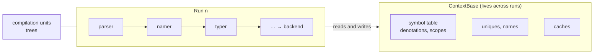
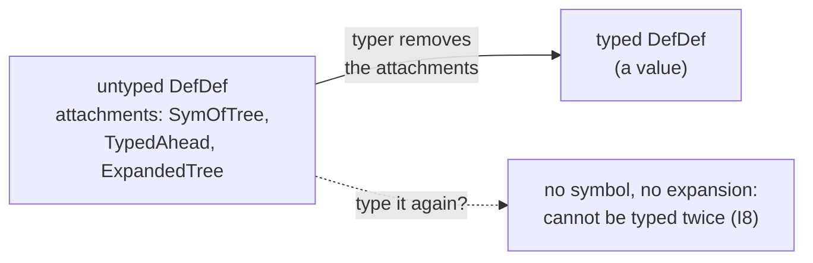
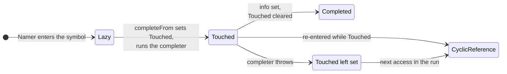
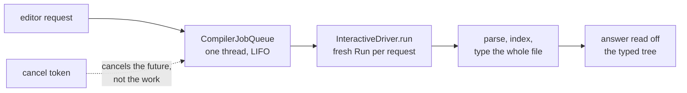
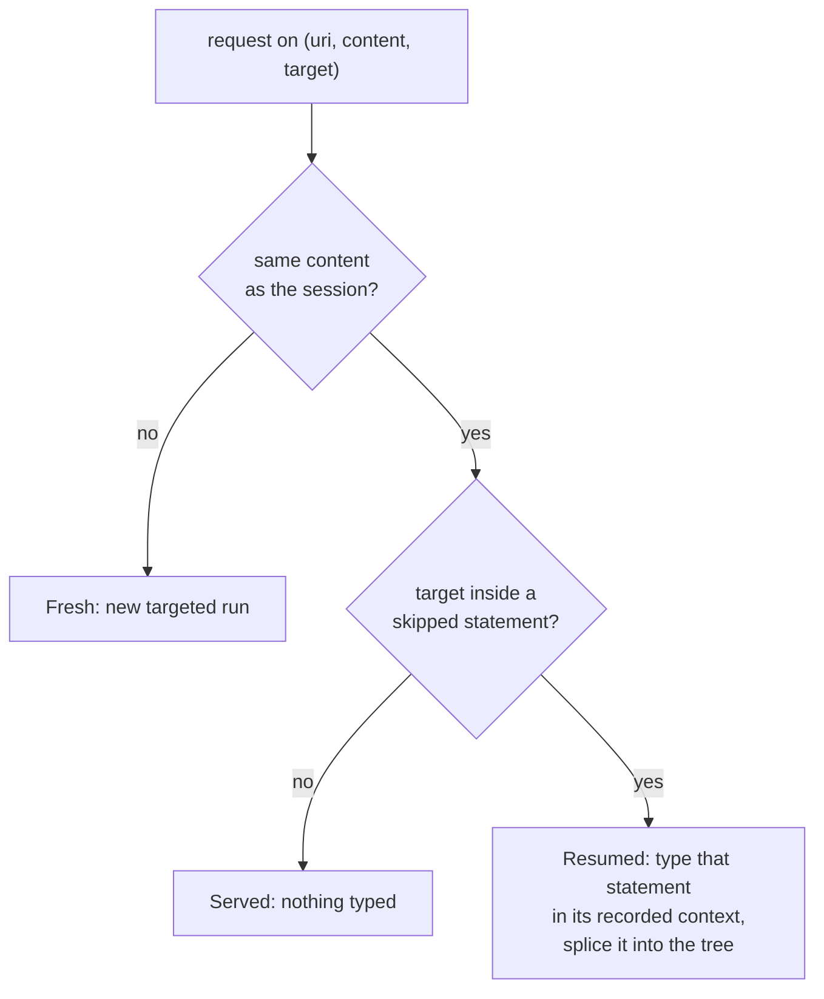
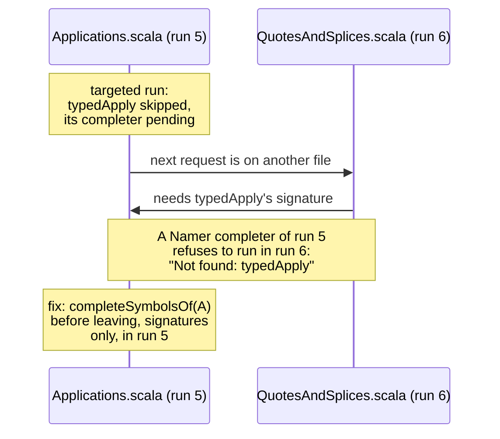
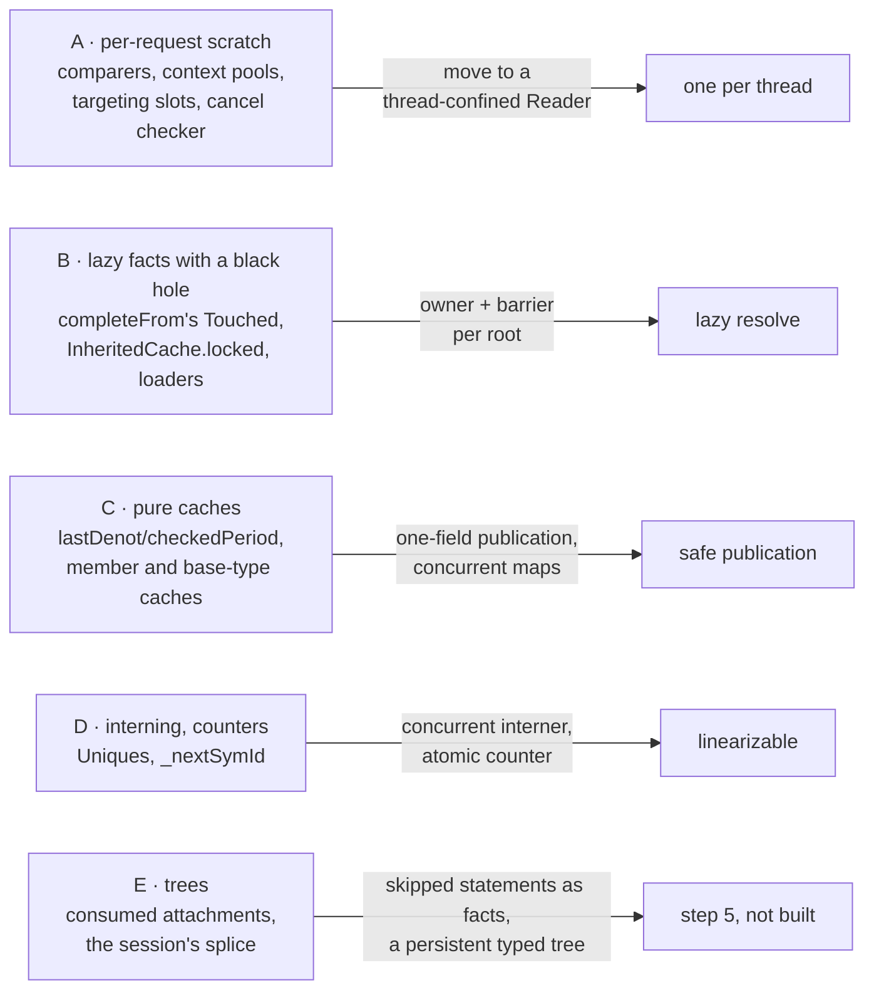
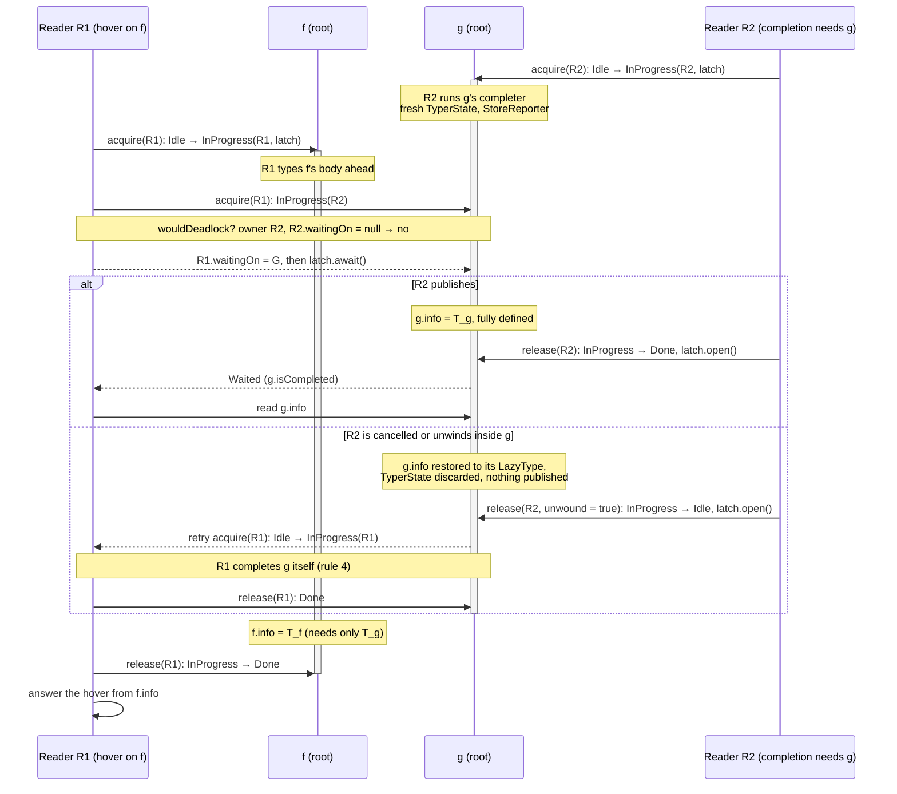

# dotc, from batch to interactive: targeting, a session, cancellation that unwinds, and several readers over one symbol table

**Audience:** people who work on scalac, dotc, Metals, the IntelliJ Scala plugin or another compiler that also has to serve an editor.

**What this is:** a visual guide to a stream of work on Scala 3's presentation compiler (23–24 October 2026, the draft [retronym/scala3#84][PR] on top of [retronym/scala3#68][PR68]). It takes the driver from one whole-file run per request to a targeted, resumable, cancellable session, and then to several concurrent readers over one symbol table, following Kotlin K2's lazy resolve and IntelliJ's read and write actions.

<!-- break -->

**Arc:**

1. The batch compiler as it was, and why scalac's presentation compiler was hard to get right.
2. Targeting: type only the path to the request.
3. The session: one run serves many requests.
4. Cancellation that unwinds.
5. Several readers: K2's rules, and completion as lazy resolve.
6. The races the suites found, each as a before and after.
7. Readers side by side, as lanes over one symbol table.
8. Edits that keep the run, range requests, diagnostics by provenance.
9. The measurements.
10. Prior art.

Every number is from the design notes, cited by section: [session §n][S] is `interactive-session.md`, [readers §n][M] is `interactive-multi-reader.md`, [Track I §n][TI] is the model. `§n` alone is a card of this talk.

---

## Part I — The batch compiler as it was

### 1. One thread, one run

- A `Run` takes a set of units through the phases, on one thread. The symbol table, uniques and caches live on the `ContextBase` and outlive the run.
- `ContextBase.checkSingleThreaded`, asserted at the start of a run, records the assumption. Parallel pickling and `-Ybackend-parallelism` keep every symbol-table access on the main thread and hand workers only context-free work ([readers §3][M]).
- Nothing in the typer polled for cancellation. The check was at unit and subphase boundaries, and the presentation compiler's callback consumed the interrupt bit ([Track I §2][TI]).

### 2. Trees: typed values, untyped trees consumed

- A typed tree is a value: once built, nothing else in the run changes it (with a few exceptions: `withTypeUnchecked` assigns in place, `span_=`).
- The untyped tree is consumed. `retrieveSym` takes `SymOfTree`, `typedUnadapted` takes `TypedAhead`, `traverse` takes `ExpandedTree`, the Namer's `setMods` rewrites modifiers ([readers §3][M], kind E).
- In batch that is free: each tree is typed once. For an editor it is finding I8, and it comes back in §11.

### 3. Completers: lazy facts with a one-bit black hole

- The Namer enters one symbol per definition, its info a `LazyType`. `SymDenotation.completeFrom` sets `Touched`, runs the completer, and stores the info.
- `Touched` is the only recursion guard. Meeting it set is a `CyclicReference`. In batch that is right: a true cycle is an error, and `Namer` and `Typer` catch it where an alternative exists.
- It was not reset if the completer threw. In batch the run ends anyway; in a long-lived session every later request sees a spurious cycle ([session §6][S], [Track I §2][TI]).

### 4. Periods and denotations

<figure class="fig anim">
<svg viewBox="0 0 720 210" role="img" aria-label="A symbol's denotations as a ring, each valid for a period of one run">
  <text x="0" y="16" class="h">phases of run 3</text>
  <g class="a-in" style="--d:.1s">
    <rect x="120" y="28" width="60" height="22" rx="4" class="box"/><text x="150" y="43" text-anchor="middle">parser</text>
    <rect x="184" y="28" width="60" height="22" rx="4" class="box"/><text x="214" y="43" text-anchor="middle">typer</text>
    <rect x="248" y="28" width="70" height="22" rx="4" class="box"/><text x="283" y="43" text-anchor="middle">pickler</text>
    <rect x="322" y="28" width="56" height="22" rx="4" class="box"/><text x="350" y="43" text-anchor="middle">…</text>
    <rect x="382" y="28" width="70" height="22" rx="4" class="box"/><text x="417" y="43" text-anchor="middle">erasure</text>
    <rect x="456" y="28" width="56" height="22" rx="4" class="box"/><text x="484" y="43" text-anchor="middle">…</text>
    <rect x="516" y="28" width="70" height="22" rx="4" class="box"/><text x="551" y="43" text-anchor="middle">backend</text>
  </g>
  <text x="0" y="88" class="b">symbol f</text>
  <text x="0" y="104" class="m">lastDenot</text>
  <rect x="184" y="68" width="194" height="42" rx="6" class="typed a-grow-x" style="--d:.5s"/>
  <text x="194" y="85" class="mono a-in" style="--d:.9s">d1: (x: Int): List[T]</text>
  <text x="194" y="101" class="mono a-in" style="--d:.9s">Period(3, typer..pickler)</text>
  <rect x="382" y="68" width="204" height="42" rx="6" class="pub a-grow-x" style="--d:1.1s"/>
  <text x="392" y="85" class="mono a-in" style="--d:1.5s">d2: (x: Int): List</text>
  <text x="392" y="101" class="mono a-in" style="--d:1.5s">Period(3, erasure..backend)</text>
  <path d="M 586 96 C 650 100, 640 140, 380 140 C 130 140, 120 110, 180 100" class="mut dash a-in" style="--d:1.7s" marker-end="url(#arr4)"/>
  <text x="400" y="158" class="m a-in" style="--d:1.8s">nextInRun: the ring of one symbol's denotations</text>
  <text x="0" y="186" class="b a-in" style="--d:2.2s">run 4:</text>
  <text x="50" y="186" class="mono a-in" style="--d:2.2s">d1.current</text>
  <text x="140" y="186" class="a-in" style="--d:2.4s">brings d1 forward to run 4 (a write on the first read in the run), or finds it stale</text>
  <defs><marker id="arr4" viewBox="0 0 10 10" refX="9" refY="5" markerWidth="7" markerHeight="7" orient="auto-start-reverse"><path d="M0,0 L10,5 L0,10 z" class="f-mut"/></marker></defs>
</svg>
<figcaption>Martin Odersky's design for dotc: a fact is valid for a period, a run id and a range of phases ([periods.md][periods]).</figcaption>
</figure>

- A `Period` is a run id and a phase interval; a `SymDenotation` is a symbol's meaning over one period, and the denotations of one symbol form a ring.
- Reading a denotation in a later run is a write: `Denotation.current` validates it, or brings it forward and links it into the ring ([readers §3][M], kind B).
- The run id is 16 bits, and nothing guarded it: a long-lived driver overflows it into the phase bits (I10, [session §9][S]). A livelock later ran it past 65,535 to 0 (I43).

### 5. scalac's presentation compiler: requests nested inside the type check

<figure class="fig anim">
<svg viewBox="0 0 720 200" role="img" aria-label="scalac services a request at a safepoint inside the background type check">
  <text x="0" y="16" class="h">compiler thread</text>
  <rect x="0" y="34" width="700" height="34" rx="6" class="box a-grow-x" style="--d:.1s"/>
  <text x="10" y="56" class="a-in" style="--d:.3s">backgroundCompile: typing unit A</text>
  <g class="a-in" style="--d:.6s">
    <line x1="240" y1="30" x2="240" y2="72" class="mut"/><line x1="290" y1="30" x2="290" y2="72" class="mut"/>
    <line x1="340" y1="30" x2="340" y2="72" class="mut"/><line x1="390" y1="30" x2="390" y2="72" class="mut"/>
    <line x1="440" y1="30" x2="440" y2="72" class="mut"/><line x1="490" y1="30" x2="490" y2="72" class="mut"/>
    <line x1="540" y1="30" x2="540" y2="72" class="mut"/><line x1="590" y1="30" x2="590" y2="72" class="mut"/>
    <text x="415" y="24" class="m" text-anchor="middle">signalDone after every tree: a safepoint</text>
  </g>
  <g class="a-drop" style="--d:1.1s">
    <rect x="300" y="96" width="180" height="40" rx="6" class="own"/>
    <text x="390" y="114" text-anchor="middle" class="b">askTypeAt(pos)</text>
    <text x="390" y="129" text-anchor="middle" class="m">same trees, same symbols</text>
  </g>
  <path d="M 390 96 L 390 72" class="s-own a-in" style="--d:1.5s" marker-end="url(#arr5)"/>
  <text x="0" y="168" class="a-in" style="--d:1.9s">the background resumes from whatever the request left: synthetics, scopes, caches, the half-typed unit</text>
  <text x="0" y="188" class="b c-bad a-in" style="--d:2.4s">so every invariant over mutable state must hold at every safepoint</text>
  <defs><marker id="arr5" viewBox="0 0 10 10" refX="9" refY="5" markerWidth="7" markerHeight="7" orient="auto-start-reverse"><path d="M0,0 L10,5 L0,10 z" class="f-own"/></marker></defs>
</svg>
<figcaption>Nested servicing ([Track I §1–2][TI]). Requests run only when no completer is in progress (<code>lockedCount == 0</code>) and no speculative typing is buffered.</figcaption>
</figure>

- The typer calls `signalDone` after each tree; there `pollForWork` runs the requests that arrived, inside the type check, on the same thread.
- The property needed is not thread safety (nothing runs at the same time, and a lock is either reentrant and lets the request in, or deadlocks). It is the discipline of async-signal safety ([Track I][TI] summary).

### 6. The bugs that discipline produces: scala/scala#11328

| commit in [scala/scala#11328][11328] | state that is not a fact | broken at a safepoint |
|---|---|---|
| `uninterruptible(addSyntheticMethods)` | a member set grown in a burst | a nested retype saw part of the burst, skipped the rest |
| `consumeSynthetic` | `unit.synthetics`, consumed | a targeted check took the trees and was abandoned |
| keep the implicit factory | a symbol's identity | the implicit cache held the replaced symbol |
| suspend a targeted check's warnings | `suppressionsKnown`, a completeness claim | made by a check that stopped early |

- Track I's toy injects one request at every safepoint of a scalac-shaped kernel. Before the PR the four scenarios modelled on its tests diverge at 8–13 of 14–18 safepoints; after it, at none ([Track I §4][TI]).
- Each fix is local to one shape, and the harness is the only way to know there is no fifth. One remains: a nested `askType(source)` still diverges at 16 of 16 (findings I1 and I2, confirmed against the PR's branch).
- dotc under Metals diverges nowhere, because it never interrupts: a request waits, then pays a fresh whole-file run.

### 7. dotc under Metals, before this work

- Every request made a new `Run` and typed every statement of the file. `CachingDriver` skipped the run when the file and its text were the last ones ([session §1][S]).
- After an edit, the first request is a whole-file run: 0.4 to 1.6 s on `Types.scala`, 7,000 lines ([session §1][S]).
- A run could not be stopped: the cancellation hook consumed the interrupt bit and the typer never polled. A completion made obsolete by the next keystroke ran to the end, and the next one queued behind it ([session §4][S]).
- Failure was all or nothing: a `CyclicReference` anywhere, or a stack overflow, emptied the answer, and a leaked `Touched` poisoned later requests.

---

## Part II — Targeting

### 8. Type only the path

<figure class="fig anim">
<svg viewBox="0 0 720 300" role="img" aria-label="A targeted run types the statements on the path to the request and records the others with their contexts">
  <text x="0" y="14" class="h">A.scala, 60 objects</text>
  <rect x="0" y="24" width="300" height="20" rx="4" class="typed a-in" style="--d:.3s"/><text x="8" y="38" class="mono">import scala.collection.mutable</text>
  <rect x="0" y="48" width="300" height="20" rx="4" class="skip a-in" style="--d:1.8s"/><text x="8" y="62" class="mono">object O1 { … }</text>
  <rect x="0" y="72" width="300" height="20" rx="4" class="skip a-in" style="--d:1.85s"/><text x="8" y="86" class="mono">object O2 { … }</text>
  <rect x="0" y="96" width="300" height="20" rx="4" class="skip a-in" style="--d:1.9s"/><text x="8" y="110" class="mono">…  object O9 { … }</text>
  <rect x="0" y="120" width="300" height="88" rx="4" class="typed a-in" style="--d:.7s"/><text x="8" y="134" class="mono">object O10 {</text>
  <rect x="16" y="142" width="276" height="20" rx="4" class="skip a-in" style="--d:1.95s"/><text x="24" y="156" class="mono">def method10(x: Int): Int = …</text>
  <rect x="16" y="166" width="276" height="20" rx="4" class="typed a-in" style="--d:1.1s"/><text x="24" y="180" class="mono">val r = method10(1).@@</text>
  <text x="8" y="202" class="mono">}</text>
  <rect x="0" y="212" width="300" height="20" rx="4" class="skip a-in" style="--d:2.0s"/><text x="8" y="226" class="mono">object O11 { … }</text>
  <rect x="0" y="236" width="300" height="20" rx="4" class="skip a-in" style="--d:2.05s"/><text x="8" y="250" class="mono">…  object O60 { … }</text>
  <circle cx="232" cy="176" r="5" class="f-own a-pop" style="--d:.1s"/>
  <path d="M 320 176 L 300 176" class="s-own a-in" style="--d:.2s"/>
  <text x="326" y="180" class="c-own b a-in" style="--d:.2s">target</text>
  <g class="a-in" style="--d:2.3s">
    <text x="390" y="62" class="b">skipped: recorded, not typed</text>
    <text x="390" y="80" class="mono">SkippedStat(stat, ctx, owner)</text>
    <text x="390" y="98" class="m">the untyped tree, the context it would</text>
    <text x="390" y="114" class="m">have been typed in, and its owner</text>
  </g>
  <g class="a-in" style="--d:2.7s">
    <text x="390" y="160" class="b">completion in object 10</text>
    <text x="390" y="180">before: 11 statements, 791 trees</text>
    <text x="390" y="198" class="c-typed b">after: 1 statement, 43 trees</text>
    <text x="390" y="222" class="m">400-object file: 2 top-level trees, not 22</text>
  </g>
</svg>

<i class="typed"></i>typed<i class="skip"></i>skipped, context recorded

<figcaption>The x-ray's 60-object file ([session][S] summary, §2, §3).</figcaption>
</figure>

- `Typer.typedStats` types a package's or a template's statements in order, so the decision is made there. Of each list on the way down, only the statement containing the target is typed.
- A skipped statement's symbols are as usable as a typed one's: the Namer entered them before any statement was typed, with completers that compute signatures on demand. What it lacks is its typed tree.
- The first version typed a *prefix*, everything up to the target. The x-ray showed `method1`…`method6` typed for a completion in object 7. The prefix was never the point; the typed *set* is ([session §2][S]).

### 9. Where the rule bends

- **Never skipped:** imports and exports (they shape the context of what follows), nested package clauses, synthetic trees with no span of their own.
- **A point between statements** types only the next one. scalac's rule types the whole list there; on `class JavaParser`'s header that was 10,000 trees for one hover.
- **Blocks** are targeted too, but statements the target's statement names, transitively, are typed in order (200 dependent vals overflowed the stack through their completers), and a skipped local leaves a typed stub so the block's scope still has `x` in `locally { val x = 1; x@@ }`.
- **Typed whole:** a tree that outlives the request as a value. A body typed ahead by an overload resolution (I21), a refinement's synthetic class (I25), an inline method's body (I28), and blocks under speculative typer states such as `tryEither` (I24) ([session §2][S]).

---

## Part III — The session

### 10. One run, many requests

| request ([session §3][S], x-ray, warm JVM) | typed | trees | ms |
|---|---|---|---|
| fresh completion in object 10 | 1 statement | 43 | 12–60 |
| resume into object 40 | +1 statement | 41 | 7 |
| served from what is typed | 0 | 8 | 1–3 |
| whole file, for comparison | 60 statements | 12,097 | 357 |

The run's denotations, completers and caches stay valid throughout: it is the same `Run`. An edit starts a fresh run, which is now cheap.

### 11. Resume and splice

<figure class="fig anim">
<svg viewBox="0 0 720 230" role="img" aria-label="A skipped statement is typed in its recorded context and spliced into the typed tree">
  <text x="0" y="14" class="h">typed tree (tpdTree)</text>
  <rect x="0" y="24" width="250" height="24" rx="5" class="typed"/><text x="10" y="40" class="mono">PackageDef p</text>
  <rect x="20" y="54" width="230" height="22" rx="5" class="typed"/><text x="30" y="69" class="mono">Import …</text>
  <rect x="20" y="80" width="230" height="22" rx="5" class="typed"/><text x="30" y="95" class="mono">ModuleDef O10 (r typed)</text>
  <rect x="20" y="106" width="230" height="22" rx="5" class="typed a-pop" style="--d:2.2s"/><text x="30" y="121" class="mono a-in" style="--d:2.3s">ModuleDef O40</text>
  <text x="440" y="14" class="h">skipped statements</text>
  <rect x="440" y="24" width="200" height="22" rx="5" class="skip"/><text x="450" y="39" class="mono">O1 … O9, O11 … O39</text>
  <rect x="440" y="50" width="200" height="22" rx="5" class="skip a-out" style="--d:1.0s;--o:.15"/><text x="450" y="65" class="mono a-out" style="--d:1.0s;--o:.15">O40  (ctx, owner)</text>
  <rect x="440" y="76" width="200" height="22" rx="5" class="skip"/><text x="450" y="91" class="mono">O41 … O60</text>
  <circle cx="610" cy="61" r="5" class="f-own a-pop" style="--d:.2s"/>
  <text x="560" y="128" class="c-own a-in" style="--d:.3s">hover lands in O40</text>
  <g class="a-in" style="--d:.8s">
    <rect x="300" y="150" width="200" height="40" rx="6" class="own"/>
    <text x="400" y="166" text-anchor="middle" class="mono">typedStats(O40 :: Nil, owner)</text>
    <text x="400" y="182" text-anchor="middle" class="m">in its recorded context</text>
  </g>
  <path d="M 520 72 C 520 120, 470 140, 440 150" class="s-own a-draw" pathLength="1" style="--d:.6s"/>
  <path d="M 300 170 C 270 170, 270 117, 252 117" class="s-typed a-draw" pathLength="1" style="--d:1.7s"/>
  <text x="0" y="215" class="m a-in" style="--d:2.6s">the splice is a TreeMap that copies only the path to the owner; SetRootTree re-run; new skipped members join the list</text>
</svg>
<figcaption>Statements can be typed in any order: object 200 after object 10, then object 5 ([session §3][S]).</figcaption>
</figure>

- Why the recorded context is enough: a statement's context in `typedStats` is the template's plus the imports before it, and nothing typing an earlier sibling adds.
- A whole-file request on the same content completes the session instead of replacing it: every still-skipped statement typed and spliced in one pass. Document highlight asks for one on every cursor move; in one VS Code session 136 of 142 whole-file runs came from it ([session §7][S]).

### 12. Poisoned statements (I8)

<figure class="fig pair">
<svg viewBox="0 0 340 150" role="img" aria-label="Before: a statement whose typing was cancelled cannot be typed again">
  <text x="0" y="14" class="h">before</text>
  <rect x="0" y="26" width="320" height="26" rx="5" class="bad"/><text x="10" y="43" class="mono">object O59 { def giant = … }</text>
  <text x="0" y="74">typing unwound by a cancellation:</text>
  <text x="0" y="92" class="mono">SymOfTree, TypedAhead, ExpandedTree</text>
  <text x="0" y="110">already taken off the untyped tree</text>
  <text x="0" y="134" class="c-bad b">resume: no symbols, nothing to type</text>
</svg>
<svg viewBox="0 0 340 150" role="img" aria-label="After: the statement is re-parsed, re-indexed in its recorded context and skipped again">
  <text x="0" y="14" class="h">after</text>
  <rect x="0" y="26" width="320" height="26" rx="5" class="skip"/><text x="10" y="43" class="mono">object O59 { def giant = … }</text>
  <text x="0" y="74">re-parse the file, find the statement</text>
  <text x="0" y="92">with the same span and class, unlink its</text>
  <text x="0" y="110">symbols, index the fresh tree, skip it</text>
  <text x="0" y="134" class="c-typed b">a later resume types it as new</text>
</svg>
<figcaption>Only definitions are replaceable. An aborted expression statement or a companion pair (I22: a case class's synthetics live in its object's tree) poisons the session, and every later request starts fresh (I23) ([session §3][S]).</figcaption>
</figure>

### 13. Leaving a file (I17)

- A whole-file run never exposed this: it completed every member while typing the bodies ([session §3][S]).
- The rule, honestly stated: a run's lazy facts must be forced or discarded before the run is left, until completers become functions of node and owner (stage 3 of the cancellation design).

---

## Part IV — Cancellation that unwinds

### 14. Cancelling the future, not the work

<figure class="fig pair">
<svg viewBox="0 0 340 170" role="img" aria-label="Before: the cancel token cancels the future; the typer runs on">
  <text x="0" y="14" class="h">before</text>
  <text x="0" y="40">lsp4j cancels the request's future</text>
  <text x="0" y="60">callback: <tspan class="mono">isCancelled = Thread.interrupted()</tspan></text>
  <text x="0" y="80">the bit is consumed by the first check</text>
  <rect x="0" y="96" width="320" height="22" rx="5" class="own"/><text x="10" y="111">typer runs to the end of the file</text>
  <rect x="0" y="124" width="200" height="22" rx="5" class="wait"/><text x="10" y="139">next request queued behind</text>
</svg>
<svg viewBox="0 0 340 170" role="img" aria-label="After: a sticky flag polled every 1,024 typed trees; the typer unwinds">
  <text x="0" y="14" class="h">after</text>
  <text x="0" y="40">token.onCancel() is the driver's checker</text>
  <text x="0" y="60">a sticky flag, polled every 1,024 typed trees</text>
  <text x="0" y="80"><tspan class="mono">CancelledCompilation</tspan> (a ControlThrowable)</text>
  <rect x="0" y="96" width="90" height="22" rx="5" class="own"/><text x="8" y="111">typer</text>
  <path d="M 92 107 L 112 107" class="s-bad"/><text x="116" y="111" class="c-bad">unwinds</text>
  <rect x="0" y="124" width="200" height="22" rx="5" class="typed"/><text x="10" y="139">next request runs at once</text>
</svg>
<figcaption>[session §4][S]. The exception's cause is a <code>CancellationException</code>, so mtags classifies it as a cancellation and keeps the driver.</figcaption>
</figure>

### 15. The token path

<figure class="fig anim">
<svg viewBox="0 0 720 150" role="img" aria-label="The cancellation token's path from the editor to the typer's checkpoint">
  <defs><marker id="m15" viewBox="0 0 10 10" refX="9" refY="5" markerWidth="7" markerHeight="7" orient="auto-start-reverse"><path d="M0,0 L10,5 L0,10 z" class="f-mut"/></marker></defs>
  <g class="a-in" style="--d:.1s"><rect x="0" y="10" width="200" height="44" rx="6" class="box"/><text x="100" y="29" text-anchor="middle" class="b">VS Code</text><text x="100" y="45" text-anchor="middle" class="mono">&#36;/cancelRequest</text></g>
  <path d="M 202 32 L 254 32" class="mut a-draw" pathLength="1" style="--d:.4s" marker-end="url(#m15)"/>
  <g class="a-in" style="--d:.5s"><rect x="260" y="10" width="200" height="44" rx="6" class="box"/><text x="360" y="29" text-anchor="middle" class="b">lsp4j</text><text x="360" y="45" text-anchor="middle">the future is cancelled</text></g>
  <path d="M 462 32 L 514 32" class="mut a-draw" pathLength="1" style="--d:.8s" marker-end="url(#m15)"/>
  <g class="a-in" style="--d:.9s"><rect x="520" y="10" width="200" height="44" rx="6" class="box"/><text x="620" y="29" text-anchor="middle" class="b">Metals CancelTokens</text><text x="620" y="45" text-anchor="middle" class="mono">CancelToken</text></g>
  <path d="M 620 56 C 620 80, 100 70, 100 92" class="mut a-draw" pathLength="1" style="--d:1.2s" marker-end="url(#m15)"/>
  <g class="a-in" style="--d:1.4s"><rect x="0" y="96" width="200" height="44" rx="6" class="box"/><text x="100" y="115" text-anchor="middle" class="b">mtags CompilerAccess</text><text x="100" y="131" text-anchor="middle" class="mono">withInterruptableCompiler</text></g>
  <path d="M 202 118 L 254 118" class="mut a-draw" pathLength="1" style="--d:1.7s" marker-end="url(#m15)"/>
  <g class="a-in" style="--d:1.8s"><rect x="260" y="96" width="200" height="44" rx="6" class="own"/><text x="360" y="115" text-anchor="middle" class="b">Scala3CompilerAccess</text><text x="360" y="131" text-anchor="middle">token.onCancel() as checker</text></g>
  <path d="M 462 118 L 514 118" class="s-own a-draw" pathLength="1" style="--d:2.1s" marker-end="url(#m15)"/>
  <g class="a-pop" style="--d:2.2s"><rect x="520" y="96" width="200" height="44" rx="6" class="bad"/><text x="620" y="115" text-anchor="middle" class="b">Typer.typed</text><text x="620" y="131" text-anchor="middle">checkpoint every 1,024 trees</text></g>
</svg>
</figure>

- `CompletionAbortSuite.abort-via-token` is this path without the editor: a token cancelled 20 ms after submission, the request answers its default, the driver is kept (the next run id is exactly one more) ([session §4][S]).
- Not built on thread interrupts: the bit is unsticky and consumed, `ClosedByInterruptException` in a loader becomes a symbol marked absent, and catch-alls swallowed it.

### 16. The unwind, frame by frame

<figure class="fig anim">
<svg viewBox="0 0 720 360" role="img" aria-label="A cancellation unwinds the stack; each completeFrom frame clears Touched on its way out">
  <text x="0" y="14" class="h">the request's thread, innermost frame on top</text>
  <g class="a-pop" style="--d:.2s"><rect x="490" y="30" width="150" height="24" rx="12" class="bad"/><text x="565" y="46" text-anchor="middle" class="c-bad b">cancel(): flag set</text></g>
  <rect x="0" y="28" width="460" height="28" rx="5" class="bad a-out" style="--d:1.1s"/><text x="10" y="46" class="mono a-out" style="--d:1.1s">checkCancelledTyping  →  throw CancelledCompilation</text>
  <rect x="0" y="60" width="460" height="28" rx="5" class="box a-out" style="--d:1.4s"/><text x="10" y="78" class="mono a-out" style="--d:1.4s">Typer.typed(…)  inside B's body</text>
  <rect x="0" y="92" width="460" height="28" rx="5" class="own a-out" style="--d:1.7s"/><text x="10" y="110" class="mono a-out" style="--d:1.7s">completeFrom(B)</text>
  <g class="a-out" style="--d:1.7s;--o:0"><rect x="490" y="96" width="74" height="20" rx="10" class="own"/><text x="527" y="110" text-anchor="middle" class="c-own">Touched</text></g>
  <g class="a-pop" style="--d:1.9s"><rect x="490" y="96" width="128" height="20" rx="10" class="skip"/><text x="554" y="110" text-anchor="middle">B: LazyType again</text></g>
  <rect x="0" y="124" width="460" height="28" rx="5" class="box a-out" style="--d:2.0s"/><text x="10" y="142" class="mono a-out" style="--d:2.0s">Namer completer of A: types A's body ahead</text>
  <rect x="0" y="156" width="460" height="28" rx="5" class="own a-out" style="--d:2.3s"/><text x="10" y="174" class="mono a-out" style="--d:2.3s">completeFrom(A)</text>
  <g class="a-out" style="--d:2.3s;--o:0"><rect x="490" y="160" width="74" height="20" rx="10" class="own"/><text x="527" y="174" text-anchor="middle" class="c-own">Touched</text></g>
  <g class="a-pop" style="--d:2.5s"><rect x="490" y="160" width="128" height="20" rx="10" class="skip"/><text x="554" y="174" text-anchor="middle">A: LazyType again</text></g>
  <rect x="0" y="188" width="460" height="28" rx="5" class="box a-out" style="--d:2.6s"/><text x="10" y="206" class="mono a-out" style="--d:2.6s">typedStats(O59 :: Nil)  a resume</text>
  <g class="a-pop" style="--d:2.8s"><rect x="490" y="192" width="200" height="20" rx="10" class="skip"/><text x="590" y="206" text-anchor="middle">O59 re-parsed, skipped again</text></g>
  <rect x="0" y="220" width="460" height="28" rx="5" class="box a-out" style="--d:2.9s"/><text x="10" y="238" class="mono a-out" style="--d:2.9s">Run.compileSources</text>
  <rect x="0" y="252" width="460" height="28" rx="5" class="box a-out" style="--d:3.1s"/><text x="10" y="270" class="mono a-out" style="--d:3.1s">InteractiveDriver.runUpTo, CachingDriver.run</text>
  <rect x="0" y="284" width="460" height="28" rx="5" class="typed"/><text x="10" y="302" class="mono">CompilerAccess.withSharedCompiler</text>
  <g class="a-pop" style="--d:3.4s"><rect x="490" y="288" width="232" height="20" rx="10" class="typed"/><text x="606" y="302" text-anchor="middle" class="c-typed">answers the default, keeps the driver</text></g>
  <path d="M 462 42 C 482 42, 482 298, 462 298" class="s-bad a-draw" pathLength="1" style="--d:1.1s"/>
  <text x="0" y="340" class="m a-in" style="--d:3.6s">kept: every statement typed before the abort, the run's facts that completed, the aborted run's context (I14)</text>
</svg>
<figcaption>Each frame restores what it set on the way out: <code>completeFrom</code> clears <code>Touched</code>, a <code>LazyAnnotation</code> keeps its thunk, a <code>SymbolLoader</code> leaves its root loadable ([session §4][S]). The Lean model's <code>forceA_unlock_touched</code> against <code>touched_stays_cyclic</code> is this difference ([Track I §5][TI]).</figcaption>
</figure>

### 17. What survives an abort

| kind of state | after a cancellation ([session §4][S]) |
|---|---|
| facts (denotations) | written only on completion; an unwound completion leaves the lazy type |
| trees and units | the aborted run's partial tree is garbage; the previous run's stay current |
| the run's context | the *aborted* run's: it brought classpath denotations forward to its run id, and the clock does not roll back (I14) |
| unit-scope state, diagnostics | per run, dropped with it |
| the session | statements typed before the abort kept; the one being typed re-parsed (§12) |

The soak suite (`CompletionSoakSuite`) is a seeded random walk of 300 requests, cancellations at random checkpoints and edits on one driver: every completion must equal a fresh whole-file run's, and no symbol of the file may be left `Touched`. It found I14 on its first run.

### 18. Degrade instead of failing

- `Touched` is cleared on every unwinding exception in interactive mode, not only cancellation; a flag found set on a symbol not in this reader's `completing` set is healed, not reported as a cycle.
- A cycle costs one symbol for one request. Only an exception of unknown effect taints the run (the next request starts fresh). That is IntelliJ's `RecursionManager` discipline mapped onto `completeFrom` ([session §6][S]).
- Sized by measurement: one cycle in 1,074 targeted completions over `Typer.scala` and `Namer.scala`; 223 preventions over the whole suite, nearly all in the provider's own type-ahead of implicit conversions ([session §6][S]).
- `a-true-cycle-costs-the-cyclic-members-only`: `def pBeta = pGamma; def pGamma = pBeta` lists as `pBeta: Any, pGamma: Any` beside the whole `pAlpha` and `pDelta`.

---

## Part V — Several readers: K2's rules

### 19. What a second reader is for

- With targeting, a hover queued behind a hover waits milliseconds. Step 0 replayed a recorded VS Code session (814 presentation-compiler events) with Metals' job queue instrumented: 89 to 93 percent of all queueing was behind whole-file work, the first `run` after an edit and the providers that walk the whole typed tree ([readers §0][M], §42).
- So what a second reader buys is a *background pass* (diagnostics, semantic tokens, the session completed) beside foreground hovers that stay fast, and later several open files over one classpath symbol table ([readers §1][M]).
- The measurement also warned: a targeted reader spends 65 to 79 percent of its CPU inside completers, 5 to 20 percent typing bodies (§43). A lock around completions would serialise most of it.

### 20. Read actions and write actions

<figure class="fig anim">
<svg viewBox="0 0 720 190" role="img" aria-label="Readers run together; a writer raises the sticky flag, waits for readers to unwind, and runs alone">
  <text x="0" y="40" class="b">reader 1</text>
  <text x="0" y="80" class="b">reader 2</text>
  <text x="0" y="120" class="b">writer</text>
  <rect x="80" y="26" width="300" height="22" rx="5" class="typed a-grow-x" style="--d:.1s"/><text x="90" y="41" class="a-in" style="--d:.4s">hover: readUpTo</text>
  <rect x="140" y="66" width="250" height="22" rx="5" class="typed a-grow-x" style="--d:.3s"/><text x="150" y="81" class="a-in" style="--d:.6s">background pass: readAll</text>
  <line x1="330" y1="10" x2="330" y2="160" class="s-bad dash a-in" style="--d:1.0s"/>
  <text x="336" y="160" class="c-bad a-in" style="--d:1.0s">new content: writerPending</text>
  <rect x="380" y="26" width="6" height="22" class="f-bad a-pop" style="--d:1.3s"/>
  <rect x="390" y="66" width="6" height="22" class="f-bad a-pop" style="--d:1.4s"/>
  <text x="400" y="41" class="m a-in" style="--d:1.4s">next checkpoint: unwind</text>
  <rect x="400" y="106" width="150" height="22" rx="5" class="own a-grow-x" style="--d:1.7s"/><text x="410" y="121" class="a-in" style="--d:2.0s">fresh run, alone</text>
  <rect x="556" y="26" width="120" height="22" rx="5" class="typed a-grow-x" style="--d:2.4s"/><text x="566" y="41" class="a-in" style="--d:2.6s">retried</text>
  <rect x="556" y="66" width="120" height="22" rx="5" class="typed a-grow-x" style="--d:2.5s"/><text x="566" y="81" class="a-in" style="--d:2.7s">retried</text>
</svg>
<figcaption>IntelliJ's pending write action cancelling read actions at <code>checkCanceled</code>, with the typer's checkpoint as <code>checkCanceled</code> ([readers §2][M], §8 step 3).</figcaption>
</figure>

- Not snapshots. Roslyn's compilations are immutable, so an old reader finishes against the old world. dotc cannot do that while a run brings shared classpath denotations forward to its own run id: two runs cannot be read at once (I14). Snapshot readers need facts that outlive a run (stage 3) ([readers §2][M]).

### 21. What a reader may write: K2's four rules

| rule | stated for dotc ([readers §3][M]) |
|---|---|
| 1. disposable | everything a reader writes is thrown away or re-validated by the next writer; a run already is |
| 2. published once, consistent | another reader sees "not computed" or the finished value, never a partial one |
| 3. idempotent | any reader computing it would write the same value, so a race to publish needs only safe publication |
| 4. cancellation leaves it unpublished | a reader unwound midway leaves the fact as it found it; the next reader recomputes |

Kotlin's low-level FIR resolves declarations in place under these rules (§48). dotc's typer broke all four: trees mutated in place, nothing published a completion, nothing recorded what content a type was computed against, and a cancelled typer left half-typed trees ([PR][PR]).

### 22. Five kinds of state

- dotc had no precedent for concurrent readers of symbols or types ([readers §3][M]).
- The `Reader` (kind A) found its own bug: it cannot be a field of the context, because contexts are captured (completer creation contexts, import contexts, skipped statements' contexts) and run later under another request. It is bound to the thread ([readers §8][M] step 2).

### 23. Step 3: one coarse lock, and why it was not enough

- Every completion, bring-forward, inherited-cache computation and lazy TASTy read under one reentrant lock; concurrency in body typing only, as K2 started.
- The two-reader suites found fourteen races (I34 to I47), each fixed. Then I48: a completer publishes intermediate infos (a `TempClassInfo`, `TypeBounds.empty` while a TASTy type is read) that a reader outside the lock takes as complete.

| hover beside a background pass, `Types.scala` ([readers §8][M]) | median | p90 | right? |
|---|---|---|---|
| reads outside the lock | 1.0 ms | 7.9 ms | no (I48) |
| reads under the lock (serialised) | 141 ms | 457 ms | yes |

The premise did not hold: body typing reads what completions are in the middle of writing. A serialised hover waits for whatever statement the pass is typing, and the statement's size does not predict it: a 95-character statement held the lock for 368 ms through the completions it forced.

### 24. Completion as lazy resolve

```mermaid
stateDiagram-v2
  direction LR
  [*] --> Idle
  Idle: Idle (info is a LazyType)
  Idle --> InProgress: acquire(R)
  InProgress: InProgress(owner R, latch)
  InProgress --> Done: release(R), latch opens
  InProgress --> Idle: R unwinds; LazyType restored, latch opens
  Done: Done (info published)
  Done --> [*]
```

- One claim per *root*: a loader's class and module together, a TASTy file (its address maps are shared), a Namer symbol, an inherited cache, a `LazyRef` ([readers §8][M] step 4).
- While it runs, the symbol's info is an `InProgress`, a lazy type only the owner sees through. Every other reader meets a lazy type and takes the existing slow path of `Denotation.info`, which waits on the root. The hot test, `myInfo.isInstanceOf[LazyType]`, is unchanged.
- A Namer completion runs in a committable typer state of its own and reports to the namer's reporter, so a hover that forces a signature does not swallow its diagnostics.
- Behind `-Yinteractive-readers`; batch never allocates an `InProgress`.

### 25. Two readers, one inferred signature

`def f = g + 1` and `def g = …`, both with inferred result types ([readers §3.1][M]). Part VII draws both branches as lanes.

### 26. What the model says

Before the compiler work, two forcers over one lazy store in Lean (`Query/Concurrent.lean`) and a two-reader kernel in the Java toy ([Track I, two readers][TC], [readers §7][M]):

| statement | theorem | consequence |
|---|---|---|
| with holes owned and a barrier, every value either forcer stores or answers is the fixed point's, under every schedule | `run_agree` | the barrier is the whole correctness argument; no ranking, no fairness needed |
| under a ranked fixed point no schedule reports a cycle | `run_ranked_no_cyc` | a wait that closes a wait-for cycle reports a real cycle; which reader names it varies (15 of 81 interleavings in the toy) |
| a peek at the other forcer's hole races; at one's own, it does not | `peek_any_races`, `peek_own_agrees` | `isCompleting` must mean "on this reader" (toy: 24 of 63 interleavings race) |
| an aborted owner's waiter takes over if the hole is released; stuck if `Touched` stays | `abort_waiter_takes_over`, `abort_keep_hole_waiter_stuck` | the reset belongs in the owner's unwind path |

Left to `decide` rather than proved: progress.

---

## Part VI — The races, before and after

### 27. A peek at another reader's completion (I41)

<figure class="fig pair">
<svg viewBox="0 0 340 190" role="img" aria-label="Before: a peek sees another reader's completion and skips the import">
  <text x="0" y="14" class="h">before</text>
  <text x="40" y="36" class="b" text-anchor="middle">R1</text><text x="290" y="36" class="b" text-anchor="middle">R2</text>
  <line x1="40" y1="44" x2="40" y2="180" class="ln"/><line x1="290" y1="44" x2="290" y2="180" class="ln"/>
  <rect x="115" y="60" width="110" height="34" rx="6" class="own"/><text x="170" y="75" text-anchor="middle" class="mono">import Ops._</text><text x="170" y="89" text-anchor="middle" class="m">Touched by R1</text>
  <path d="M 40 77 L 113 77" class="s-own"/>
  <path d="M 290 120 C 250 120, 240 100, 226 90" class="s-bad dash"/>
  <text x="290" y="138" text-anchor="end" class="mono">isCompleting?</text>
  <text x="290" y="154" text-anchor="end">yes: skip the import</text>
  <text x="290" y="172" text-anchor="end" class="c-bad">"foo is not a member of T"</text>
</svg>
<svg viewBox="0 0 340 190" role="img" aria-label="After: isCompleting means on this reader; another reader's completion is waited for">
  <text x="0" y="14" class="h">after</text>
  <text x="40" y="36" class="b" text-anchor="middle">R1</text><text x="290" y="36" class="b" text-anchor="middle">R2</text>
  <line x1="40" y1="44" x2="40" y2="180" class="ln"/><line x1="290" y1="44" x2="290" y2="180" class="ln"/>
  <rect x="115" y="60" width="110" height="34" rx="6" class="typed"/><text x="170" y="75" text-anchor="middle" class="mono">import Ops._</text><text x="170" y="89" text-anchor="middle" class="m">published by R1</text>
  <path d="M 40 77 L 113 77" class="s-typed"/>
  <path d="M 290 120 C 250 120, 240 100, 226 90" class="s-wait"/>
  <text x="290" y="138" text-anchor="end" class="mono">isCompleting on R2?</text>
  <text x="290" y="154" text-anchor="end">no: wait, look again</text>
  <text x="290" y="172" text-anchor="end" class="c-typed">foo found through Ops</text>
</svg>
<figcaption>Thirteen sites peek at <code>isCompleting</code> and take another path rather than force ([readers §4.1][M]). The model predicted it (<code>peek_any_races</code>); the two-reader suites found it ([readers §8][M], I41).</figcaption>
</figure>

### 28. A wait-for cycle, or a lock order (I54)

<figure class="fig pair">
<svg viewBox="0 0 340 190" role="img" aria-label="Before: two roots taken in different orders raise a false CyclicReference">
  <text x="0" y="14" class="h">before: raise CyclicReference</text>
  <rect x="20" y="40" width="110" height="30" rx="6" class="own"/><text x="75" y="60" text-anchor="middle">R1 holds X.tasty</text>
  <rect x="210" y="40" width="110" height="30" rx="6" class="own"/><text x="265" y="60" text-anchor="middle">R2 holds Y.tasty</text>
  <path d="M 130 50 C 170 40, 180 40, 208 50" class="s-wait"/><text x="170" y="34" text-anchor="middle" class="c-wait">waits</text>
  <path d="M 210 64 C 170 76, 170 76, 132 64" class="s-wait"/><text x="170" y="92" text-anchor="middle" class="c-wait">waits</text>
  <text x="0" y="124">roots are coarser than facts:</text>
  <text x="0" y="142">two files taken in two orders,</text>
  <text x="0" y="160">not a dependency cycle</text>
  <text x="0" y="180" class="c-bad">a false "Cyclic reference"</text>
</svg>
<svg viewBox="0 0 340 190" role="img" aria-label="After: the reader that would close the cycle backs off and is retried">
  <text x="0" y="14" class="h">after: back off and retry</text>
  <rect x="20" y="40" width="110" height="30" rx="6" class="own"/><text x="75" y="60" text-anchor="middle">R1 holds X.tasty</text>
  <rect x="210" y="40" width="110" height="30" rx="6" class="skip"/><text x="265" y="60" text-anchor="middle">R2 released Y</text>
  <path d="M 130 50 C 170 40, 180 40, 208 50" class="s-typed"/><text x="170" y="34" text-anchor="middle" class="c-typed">takes Y, proceeds</text>
  <text x="0" y="124">R2 is pre-empted, as by a writer:</text>
  <text x="0" y="142">unwinds, releases its roots; the</text>
  <text x="0" y="160">driver retries its request</text>
  <text x="0" y="180" class="c-typed">counted; more than 20 fails a test</text>
</svg>
<figcaption>A true dependency cycle then shows in the other reader alone, where a single reader would report it. The cross-thread cycle test gives the single-reader answer in all 30 rounds, backing off 19–25 times ([readers §8][M] step 4).</figcaption>
</figure>

### 29. The base-type cache's sentinel (I34)

<figure class="fig pair">
<svg viewBox="0 0 340 170" role="img" aria-label="Before: the in-progress mark in the shared cache looks like a cycle to the other reader">
  <text x="0" y="14" class="h">before</text>
  <text x="0" y="38" class="mono">baseTypeOf(C, Any)</text>
  <rect x="0" y="50" width="320" height="30" rx="6" class="own"/><text x="10" y="70" class="mono">myBaseTypeCache(Any) = NoPrefix</text>
  <text x="0" y="100">R1's in-progress mark, in the shared cache</text>
  <text x="0" y="120">R2 reads it as "already in progress here"</text>
  <text x="0" y="146" class="c-bad">"Cyclic reference involving class Any"</text>
</svg>
<svg viewBox="0 0 340 170" role="img" aria-label="After: the in-progress mark lives on the reader">
  <text x="0" y="14" class="h">after</text>
  <text x="0" y="38" class="mono">baseTypeOf(C, Any)</text>
  <rect x="0" y="50" width="320" height="30" rx="6" class="typed"/><text x="10" y="70" class="mono">Reader.pendingBaseTypes  (identity set)</text>
  <text x="0" y="100">the mark is R1's own; R2 computes the</text>
  <text x="0" y="120">same value (rule 3); cleared on every unwind</text>
  <text x="0" y="146" class="m">identity: a structural set made equal types cyclic</text>
</svg>
<figcaption>A second black hole hiding in a cache ([readers §8][M] step 3). The cache version also leaked the mark on cancellation.</figcaption>
</figure>

### 30. The period published before the denotation (I36)

<figure class="fig pair">
<svg viewBox="0 0 340 180" role="img" aria-label="Before: the period is stored first; a reader sees a current period and a null symbol">
  <text x="0" y="14" class="h">before</text>
  <text x="0" y="40" class="mono">writer:  checkedPeriod = now</text>
  <text x="59" y="58" class="mono">lastSymbol = sym</text>
  <text x="0" y="90" class="mono">reader:  if checkedPeriod == now</text>
  <text x="73" y="108" class="mono">use lastSymbol</text>
  <rect x="0" y="124" width="320" height="26" rx="6" class="bad"/><text x="10" y="141">current period, null lastSymbol</text>
  <text x="0" y="170" class="m">NamedType.stableInRunSymbol</text>
</svg>
<svg viewBox="0 0 340 180" role="img" aria-label="After: fields first, then the period with a release store, read with an acquire load">
  <text x="0" y="14" class="h">after</text>
  <text x="0" y="40" class="mono">writer:  lastSymbol = sym</text>
  <text x="59" y="58" class="mono">setRelease(checkedPeriod, now)</text>
  <text x="0" y="90" class="mono">reader:  if getAcquire(checkedPeriod)</text>
  <text x="86" y="108" class="mono">== now: use lastSymbol</text>
  <rect x="0" y="124" width="320" height="26" rx="6" class="typed"/><text x="10" y="141">the period publishes the fields</text>
  <text x="0" y="170" class="m">util.Publish: static final VarHandles</text>
</svg>
<figcaption>The one cost that cannot be chosen per mode: a field is a field in batch too. Plain moves on x86, <code>stlr</code>/<code>ldar</code> on Apple silicon; measured with perflab in §47 ([readers §8][M], [PR][PR]).</figcaption>
</figure>

### 31. The typer state dropped with its variable (I62)

<figure class="fig pair">
<svg viewBox="0 0 340 180" role="img" aria-label="Before: a completion's own typer state is dropped with an uninstantiated type variable">
  <text x="0" y="14" class="h">before</text>
  <text x="0" y="38" class="mono">val retractedVars = Set.empty[A] …</text>
  <rect x="0" y="50" width="200" height="40" rx="6" class="own"/><text x="10" y="67">completion's TyperState</text><text x="10" y="83" class="mono">A: uninstantiated</text>
  <path d="M 200 70 L 240 70" class="s-bad"/><text x="246" y="74" class="c-bad">dropped</text>
  <text x="0" y="116" class="mono">retractedVars: Set[A | TermRef]</text>
  <text x="0" y="134">A belongs to no live state</text>
  <text x="0" y="160" class="c-bad mono">Found: Set[A | TermRef]</text>
  <text x="0" y="176" class="c-bad mono">Required: Set[TermRef]</text>
</svg>
<svg viewBox="0 0 340 180" role="img" aria-label="After: variables are instantiated when the completion ends, then made permanent">
  <text x="0" y="14" class="h">after</text>
  <text x="0" y="38" class="mono">val retractedVars = Set.empty[A] …</text>
  <rect x="0" y="50" width="200" height="40" rx="6" class="typed"/><text x="10" y="67">completion ends:</text><text x="10" y="83">instantiate, then gc</text>
  <text x="0" y="116" class="mono">retractedVars: Set[TermRef]</text>
  <text x="0" y="134">as fullyDefinedType would</text>
  <text x="0" y="160" class="c-typed">1,441 identifiers of Nullables.scala</text>
  <text x="0" y="176" class="c-typed">match a whole-file run</text>
</svg>
<figcaption>In the serialised mode the variable stayed in the namer's state and the enclosing statement instantiated it. In a state of its own it was dropped ([readers §8][M] step 4).</figcaption>
</figure>

### 32. The leaked claim that wedged the x-ray (I61)

<figure class="fig pair">
<svg viewBox="0 0 340 180" role="img" aria-label="Before: a claim is released only on cancellation; another exception leaks it">
  <text x="0" y="14" class="h">before</text>
  <rect x="0" y="30" width="190" height="28" rx="6" class="own"/><text x="10" y="48">claim: statement s, R1</text>
  <text x="200" y="48" class="c-bad">assertion escapes</text>
  <text x="0" y="82">released only on cancellation</text>
  <rect x="0" y="96" width="320" height="28" rx="6" class="wait"/><text x="10" y="114">R2 waits for s, holding the session monitor</text>
  <text x="0" y="146">forever: the x-ray's handlers ran on</text>
  <text x="0" y="164" class="c-bad">the HTTP dispatcher, and the page froze</text>
</svg>
<svg viewBox="0 0 340 180" role="img" aria-label="After: released on any exception, the session poisoned, waits bounded">
  <text x="0" y="14" class="h">after</text>
  <rect x="0" y="30" width="190" height="28" rx="6" class="skip"/><text x="10" y="48">claim released</text>
  <text x="200" y="48" class="c-typed">session poisoned</text>
  <text x="0" y="82">on any exception; the next request is fresh</text>
  <rect x="0" y="96" width="320" height="28" rx="6" class="typed"/><text x="10" y="114">a claim records its owner thread</text>
  <text x="0" y="146">a wait gives up if the owner is gone,</text>
  <text x="0" y="164">or after 60 s, and retries</text>
</svg>
<figcaption>Any mode, not only with several readers ([readers §8][M] step 4). The x-ray now handles each request on a thread of its own and reports one that takes more than 30 s.</figcaption>
</figure>

### 33. The rest of the register

| | finding ([readers §8][M]) |
|---|---|
| I35 | the unpickler's address maps filled under the lock and read outside it: `key not found: Addr(417)` |
| I42 | a completer's constraints and a resume's commit in one typer state: a looping `OrderingConstraint` until the heap ran out |
| I43 | two fresh runs replacing each other for ever, run ids past 65,535 to 0: a fresh run and the read of its result are one write action |
| I44 | a completer captured before the wait, stale after it: `UnsupportedOperationException: complete` |
| I45 | `cleanup` erroring out a classpath symbol another reader was loading |
| I52, I55, I57 | a read action in the run's root typer state; a shared implicit `SearchRoot`; a `LazyRef` in progress taken for a cycle |
| I63–I67 | found by the throughput runs: a false self-type cycle, explicit nulls' flow facts, committed creation states, a class's caches read twice |
| I60 | two-reader soak failures under heavy load, a different symptom each time: an import's selector facts, now published as one value |
| I68 | open: with four or eight readers over the whole source set, now and then one file's errors differ from the whole-set run |

---

## Part VII — Readers side by side

Each panel is lanes over time, running down: readers at the edges, the roots they claim in the middle. A root's lane shows its state: idle, in progress with an owner, done.

<i class="own"></i>in progress, owned (and the owner's work)<i class="wait"></i>waiting on a barrier<i class="typed"></i>published, done<i class="skip"></i>idle: a lazy type<i class="bad"></i>cancelled

### 34. A claim, a wait, a publication

<figure class="fig anim">
<svg viewBox="0 0 720 360" role="img" aria-label="R2 owns g; R1 owns f and waits on g's barrier; R2 publishes g; R1 completes f and answers">
  <defs><marker id="m34" viewBox="0 0 10 10" refX="9" refY="5" markerWidth="7" markerHeight="7" orient="auto-start-reverse"><path d="M0,0 L10,5 L0,10 z" class="f-mut"/></marker></defs>
  <text x="90" y="20" class="b" text-anchor="middle">R1 · hover on f</text><text x="290" y="20" class="b" text-anchor="middle">root f</text><text x="430" y="20" class="b" text-anchor="middle">root g</text><text x="630" y="20" class="b" text-anchor="middle">R2 · completion</text>
  <line x1="90" y1="30" x2="90" y2="340" class="ln"/><line x1="290" y1="30" x2="290" y2="340" class="ln"/><line x1="430" y1="30" x2="430" y2="340" class="ln"/><line x1="630" y1="30" x2="630" y2="340" class="ln"/>
  <rect x="250" y="34" width="80" height="56" rx="4" class="skip"/><text x="290" y="66" text-anchor="middle" class="m">idle</text>
  <rect x="390" y="34" width="80" height="26" rx="4" class="skip"/><text x="430" y="51" text-anchor="middle" class="m">idle</text>
  <rect x="390" y="60" width="80" height="110" rx="4" class="own a-grow-d" style="--d:.31s"/><text x="430" y="104" text-anchor="middle" class="b a-in" style="--d:.5s">InProgress</text><text x="430" y="120" text-anchor="middle" class="a-in" style="--d:.5s">owner R2</text>
  <rect x="570" y="60" width="120" height="110" rx="4" class="own a-grow-d" style="--d:.31s"/><text x="580" y="80" class="a-in" style="--d:.5s">runs g's completer</text><text x="580" y="96" class="m a-in" style="--d:.5s">own TyperState</text>
  <path d="M 568 64 L 474 64" class="mut a-in" style="--d:.31s" marker-end="url(#m34)"/><text x="520" y="58" text-anchor="middle" class="m a-in" style="--d:.31s">acquire</text>
  <rect x="250" y="90" width="80" height="160" rx="4" class="own a-grow-d" style="--d:.78s"/><text x="290" y="160" text-anchor="middle" class="b a-in" style="--d:1s">InProgress</text><text x="290" y="176" text-anchor="middle" class="a-in" style="--d:1s">owner R1</text>
  <rect x="30" y="90" width="120" height="40" rx="4" class="own a-grow-d" style="--d:.78s"/><text x="40" y="108" class="a-in" style="--d:.9s">types f's body</text><text x="40" y="122" class="m a-in" style="--d:.9s">ahead</text>
  <path d="M 152 94 L 246 94" class="mut a-in" style="--d:.78s" marker-end="url(#m34)"/><text x="200" y="88" text-anchor="middle" class="m a-in" style="--d:.78s">acquire</text>
  <path d="M 152 134 L 386 134" class="s-wait a-draw" pathLength="1" style="--d:1.4s"/><text x="200" y="128" text-anchor="middle" class="c-wait a-in" style="--d:1.4s">needs g</text>
  <g class="a-in" style="--d:1.5s"><rect x="30" y="130" width="120" height="40" rx="4" class="wait a-blink" style="--d:1.7s"/></g><text x="40" y="148" class="a-in" style="--d:1.5s">waits on g's</text><text x="40" y="162" class="a-in" style="--d:1.5s">barrier</text>
  <text x="200" y="152" text-anchor="middle" class="m a-in" style="--d:1.5s">no cycle</text>
  <rect x="390" y="170" width="80" height="160" rx="4" class="typed a-grow-d" style="--d:2s"/><text x="430" y="200" text-anchor="middle" class="b a-in" style="--d:2.1s">Done</text><text x="430" y="216" text-anchor="middle" class="mono a-in" style="--d:2.1s">T_g</text>
  <path d="M 388 178 L 154 178" class="s-pub a-draw" pathLength="1" style="--d:2s"/><text x="200" y="192" text-anchor="middle" class="c-pub a-in" style="--d:2.1s">latch opens</text>
  <rect x="570" y="170" width="120" height="30" rx="4" class="typed a-grow-d" style="--d:2s"/><text x="580" y="190" class="a-in" style="--d:2.1s">publishes, goes on</text>
  <rect x="30" y="182" width="120" height="66" rx="4" class="own a-grow-d" style="--d:2.2s"/><text x="40" y="200" class="a-in" style="--d:2.3s">reads g.info,</text><text x="40" y="216" class="a-in" style="--d:2.3s">finishes f</text>
  <rect x="250" y="250" width="80" height="80" rx="4" class="typed a-grow-d" style="--d:3.26s"/><text x="290" y="280" text-anchor="middle" class="b a-in" style="--d:3.35s">Done</text><text x="290" y="296" text-anchor="middle" class="mono a-in" style="--d:3.35s">T_f</text>
  <rect x="30" y="256" width="120" height="30" rx="4" class="typed a-grow-d" style="--d:3.41s"/><text x="40" y="276" class="a-in" style="--d:3.5s">answers the hover</text>
  <line x1="20" y1="40" x2="700" y2="40" class="mut dash a-sweep" style="--ty:296px;--t:4.6s"/>
</svg>
<figcaption>Rule 2 is the barrier: nobody but the owner sees <code>f</code> or <code>g</code> half-completed. Rule 3: whoever completes <code>g</code> writes the same <code>T_g</code> ([readers §3.1][M]).</figcaption>
</figure>

### 35. A cancelled owner hands over

<figure class="fig anim">
<svg viewBox="0 0 720 360" role="img" aria-label="R2 owns g and is cancelled; it unwinds, restores the lazy type and opens the latch; R1 takes over and completes g">
  <defs><marker id="m35" viewBox="0 0 10 10" refX="9" refY="5" markerWidth="7" markerHeight="7" orient="auto-start-reverse"><path d="M0,0 L10,5 L0,10 z" class="f-mut"/></marker></defs>
  <text x="100" y="20" class="b" text-anchor="middle">R1 · needs g</text><text x="360" y="20" class="b" text-anchor="middle">root g</text><text x="620" y="20" class="b" text-anchor="middle">R2 · owner</text>
  <line x1="100" y1="30" x2="100" y2="340" class="ln"/><line x1="360" y1="30" x2="360" y2="340" class="ln"/><line x1="620" y1="30" x2="620" y2="340" class="ln"/>
  <rect x="310" y="34" width="100" height="26" rx="4" class="skip"/><text x="360" y="51" text-anchor="middle" class="m">idle</text>
  <rect x="310" y="60" width="100" height="110" rx="4" class="own a-grow-d" style="--d:.31s"/><text x="360" y="100" text-anchor="middle" class="b a-in" style="--d:.5s">InProgress</text><text x="360" y="116" text-anchor="middle" class="a-in" style="--d:.5s">owner R2</text>
  <rect x="550" y="60" width="140" height="110" rx="4" class="own a-grow-d" style="--d:.31s"/><text x="560" y="80" class="a-in" style="--d:.5s">runs g's completer</text>
  <path d="M 548 64 L 414 64" class="mut a-in" style="--d:.31s" marker-end="url(#m35)"/><text x="480" y="58" text-anchor="middle" class="m a-in" style="--d:.31s">acquire</text>
  <path d="M 172 104 L 306 104" class="s-wait a-draw" pathLength="1" style="--d:.95s"/><text x="240" y="98" text-anchor="middle" class="c-wait a-in" style="--d:.95s">acquire: owner R2</text>
  <g class="a-in" style="--d:1s"><rect x="30" y="100" width="140" height="90" rx="4" class="wait a-blink" style="--d:1.2s;--n:4"/></g><text x="40" y="120" class="a-in" style="--d:1s">waits on g's barrier</text>
  <g class="a-pop" style="--d:1.7s"><rect x="560" y="130" width="120" height="24" rx="12" class="bad"/><text x="620" y="146" text-anchor="middle" class="c-bad b">cancelled</text></g>
  <rect x="550" y="170" width="140" height="8" class="f-bad a-pop" style="--d:2s"/><text x="560" y="196" class="c-bad a-in" style="--d:2s">unwinds: TyperState</text><text x="560" y="212" class="c-bad a-in" style="--d:2s">discarded, nothing</text><text x="560" y="228" class="c-bad a-in" style="--d:2s">published</text>
  <rect x="310" y="170" width="100" height="24" rx="4" class="skip a-grow-d" style="--d:2s"/><text x="360" y="186" text-anchor="middle" class="a-in" style="--d:2.1s">idle again</text>
  <path d="M 306 182 L 174 182" class="s-pub a-draw" pathLength="1" style="--d:2.1s"/><text x="240" y="176" text-anchor="middle" class="c-pub a-in" style="--d:2.1s">latch opens</text>
  <rect x="310" y="194" width="100" height="86" rx="4" class="own a-grow-d" style="--d:2.4s"/><text x="360" y="230" text-anchor="middle" class="b a-in" style="--d:2.5s">InProgress</text><text x="360" y="246" text-anchor="middle" class="a-in" style="--d:2.5s">owner R1</text>
  <rect x="30" y="194" width="140" height="86" rx="4" class="own a-grow-d" style="--d:2.4s"/><text x="40" y="214" class="a-in" style="--d:2.5s">retries acquire,</text><text x="40" y="230" class="a-in" style="--d:2.5s">completes g itself</text>
  <path d="M 172 198 L 306 198" class="mut a-in" style="--d:2.4s" marker-end="url(#m35)"/>
  <rect x="310" y="280" width="100" height="50" rx="4" class="typed a-grow-d" style="--d:3.6s"/><text x="360" y="304" text-anchor="middle" class="b a-in" style="--d:3.7s">Done</text><text x="360" y="320" text-anchor="middle" class="mono a-in" style="--d:3.7s">T_g</text>
  <rect x="30" y="284" width="140" height="30" rx="4" class="typed a-grow-d" style="--d:3.7s"/><text x="40" y="304" class="a-in" style="--d:3.8s">goes on with T_g</text>
  <line x1="20" y1="40" x2="700" y2="40" class="mut dash a-sweep" style="--ty:296px;--t:4.6s"/>
</svg>
<figcaption>Rule 4, and the model's <code>abort_waiter_takes_over</code>. With dotc's old discipline (<code>Touched</code> left set) the barrier is owned by a reader that no longer exists and R1 waits for the rest of the run (<code>abort_keep_hole_waiter_stuck</code>). So the owner resets the root in its own unwind path, before releasing it ([Track I, two readers][TC]). A waiter cancelled by a writer is cancelled too; hand-over is for an owner's own failure ([readers §9][M]).</figcaption>
</figure>

### 36. A background pass beside hovers

<figure class="fig anim">
<svg viewBox="0 0 720 380" role="img" aria-label="A background pass claims and types one skipped statement at a time; hovers on another reader are served, wait for the claimed statement, or claim one the pass has not reached">
  <defs><marker id="m36" viewBox="0 0 10 10" refX="9" refY="5" markerWidth="7" markerHeight="7" orient="auto-start-reverse"><path d="M0,0 L10,5 L0,10 z" class="f-mut"/></marker></defs>
  <text x="100" y="20" class="b" text-anchor="middle">R1 · background pass</text><text x="360" y="20" class="b" text-anchor="middle">skipped statements</text><text x="620" y="20" class="b" text-anchor="middle">R2 · hovers</text>
  <line x1="100" y1="30" x2="100" y2="360" class="ln"/><line x1="620" y1="30" x2="620" y2="360" class="ln"/>
  <rect x="300" y="36" width="120" height="22" rx="4" class="skip"/><text x="360" y="51" text-anchor="middle" class="mono">s1 … s4</text>
  <rect x="30" y="60" width="140" height="60" rx="4" class="own a-grow-d" style="--d:.3s"/><text x="40" y="80" class="a-in" style="--d:.4s">visible lines first</text><text x="40" y="96" class="m a-in" style="--d:.4s">a range target</text>
  <rect x="300" y="122" width="120" height="22" rx="4" class="own a-pop" style="--d:1.1s"/><text x="360" y="137" text-anchor="middle" class="mono a-in" style="--d:1.1s">s1 claimed by R1</text>
  <rect x="30" y="122" width="140" height="56" rx="4" class="own a-grow-d" style="--d:1.1s"/><text x="40" y="142" class="a-in" style="--d:1.2s">types s1</text>
  <circle cx="620" cy="80" r="6" class="f-typed a-pop" style="--d:.5s"/><text x="608" y="84" text-anchor="end" class="a-in" style="--d:.5s">served, 1 ms</text>
  <circle cx="620" cy="104" r="6" class="f-typed a-pop" style="--d:.8s"/><text x="608" y="108" text-anchor="end" class="a-in" style="--d:.8s">served</text>
  <circle cx="620" cy="128" r="6" class="f-typed a-pop" style="--d:1.1s"/><text x="608" y="132" text-anchor="end" class="a-in" style="--d:1.1s">served</text>
  <path d="M 548 156 L 424 140" class="s-wait a-draw" pathLength="1" style="--d:1.45s"/><text x="490" y="166" text-anchor="middle" class="c-wait a-in" style="--d:1.45s">lands in s1</text>
  <g class="a-in" style="--d:1.5s"><rect x="560" y="152" width="120" height="26" rx="4" class="wait a-blink" style="--d:1.6s;--n:2"/></g><text x="570" y="169" class="a-in" style="--d:1.5s">waits for s1</text>
  <rect x="300" y="180" width="120" height="22" rx="4" class="typed a-pop" style="--d:2s"/><text x="360" y="195" text-anchor="middle" class="mono a-in" style="--d:2s">s1 spliced</text>
  <path d="M 424 191 L 556 186" class="s-pub a-draw" pathLength="1" style="--d:2s"/>
  <circle cx="620" cy="196" r="6" class="f-typed a-pop" style="--d:2.1s"/><text x="608" y="200" text-anchor="end" class="a-in" style="--d:2.1s">answered</text>
  <rect x="300" y="210" width="120" height="22" rx="4" class="own a-pop" style="--d:2.3s"/><text x="360" y="225" text-anchor="middle" class="mono a-in" style="--d:2.3s">s2 claimed by R1</text>
  <rect x="30" y="210" width="140" height="56" rx="4" class="own a-grow-d" style="--d:2.3s"/><text x="40" y="230" class="a-in" style="--d:2.4s">types s2</text>
  <rect x="300" y="240" width="120" height="22" rx="4" class="own a-pop" style="--d:2.7s"/><text x="360" y="255" text-anchor="middle" class="mono a-in" style="--d:2.7s">s4 claimed by R2</text>
  <rect x="560" y="240" width="120" height="40" rx="4" class="own a-grow-d" style="--d:2.7s"/><text x="570" y="258" class="a-in" style="--d:2.8s">types s4 itself</text><text x="570" y="272" class="m a-in" style="--d:2.8s">a resume</text>
  <rect x="300" y="270" width="120" height="22" rx="4" class="typed a-pop" style="--d:3.1s"/><text x="360" y="285" text-anchor="middle" class="mono a-in" style="--d:3.1s">s2, s4 spliced</text>
  <rect x="30" y="296" width="140" height="40" rx="4" class="own a-grow-d" style="--d:3.4s"/><text x="40" y="314" class="a-in" style="--d:3.5s">types s3; s4 is</text><text x="40" y="328" class="m a-in" style="--d:3.5s">already typed</text>
  <circle cx="620" cy="300" r="6" class="f-typed a-pop" style="--d:3.4s"/><text x="608" y="304" text-anchor="end" class="a-in" style="--d:3.4s">served</text>
  <circle cx="620" cy="324" r="6" class="f-typed a-pop" style="--d:3.7s"/><text x="608" y="328" text-anchor="end" class="a-in" style="--d:3.7s">served</text>
  <line x1="20" y1="40" x2="700" y2="40" class="mut dash a-sweep" style="--ty:310px;--t:4.4s"/>
</svg>
<figcaption>The x-ray's background pass. On a quiet machine with <code>-Yinteractive-readers</code>, the pass types <code>Types.scala</code> in 560–850 ms with 27–53 hovers served beside it at about 1 ms median; serialised, 3–6 hovers at 17–490 ms median. Its diagnostics equal a whole-file run's ([readers §8][M] step 4).</figcaption>
</figure>

[PR]: https://github.com/retronym/scala3/pull/84
[PR68]: https://github.com/retronym/scala3/pull/68
[S]: https://github.com/retronym/scala3/blob/claude/mr-code-813f14/docs/_docs/internals/interactive-session.md
[M]: https://github.com/retronym/scala3/blob/claude/mr-code-813f14/docs/_docs/internals/interactive-multi-reader.md
[TI]: https://github.com/retronym/jvm-lang-models/blob/main/packages/scala/docs/track-i.md
[TC]: https://github.com/retronym/jvm-lang-models/blob/main/packages/scala/docs/track-i-concurrent.md
[11328]: https://github.com/scala/scala/pull/11328
[periods]: https://github.com/scala/scala3/blob/main/docs/_docs/internals/periods.md
