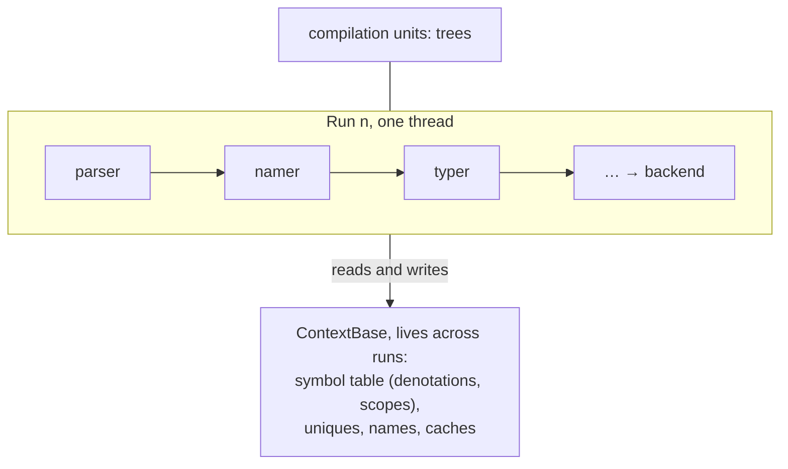
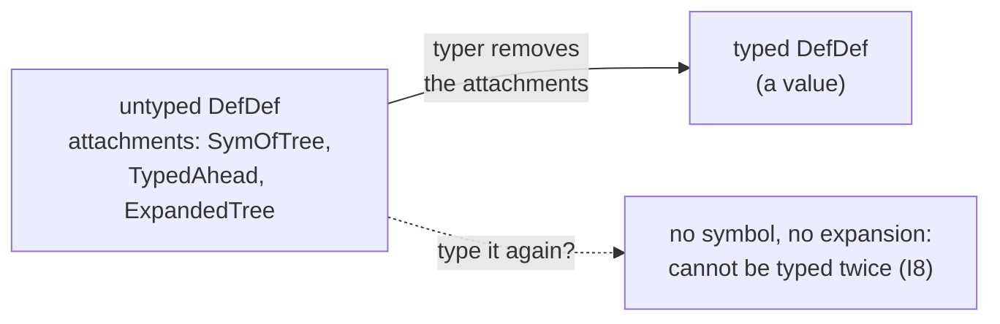
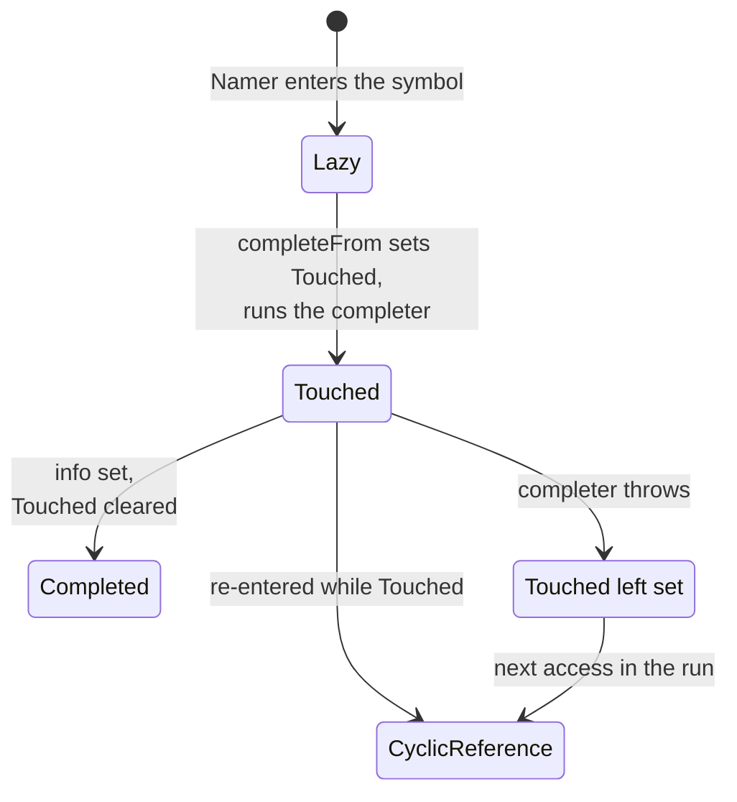
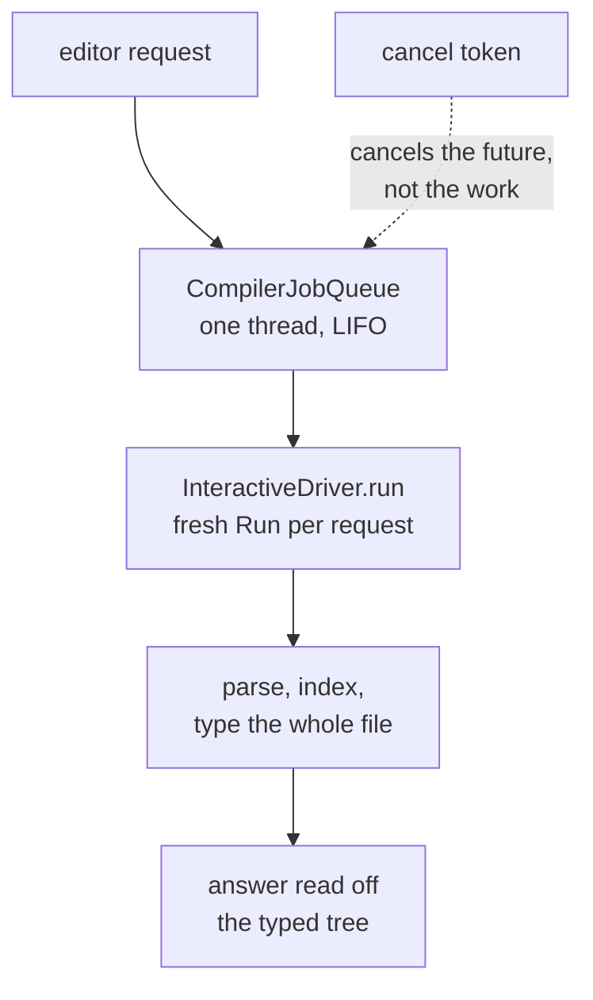
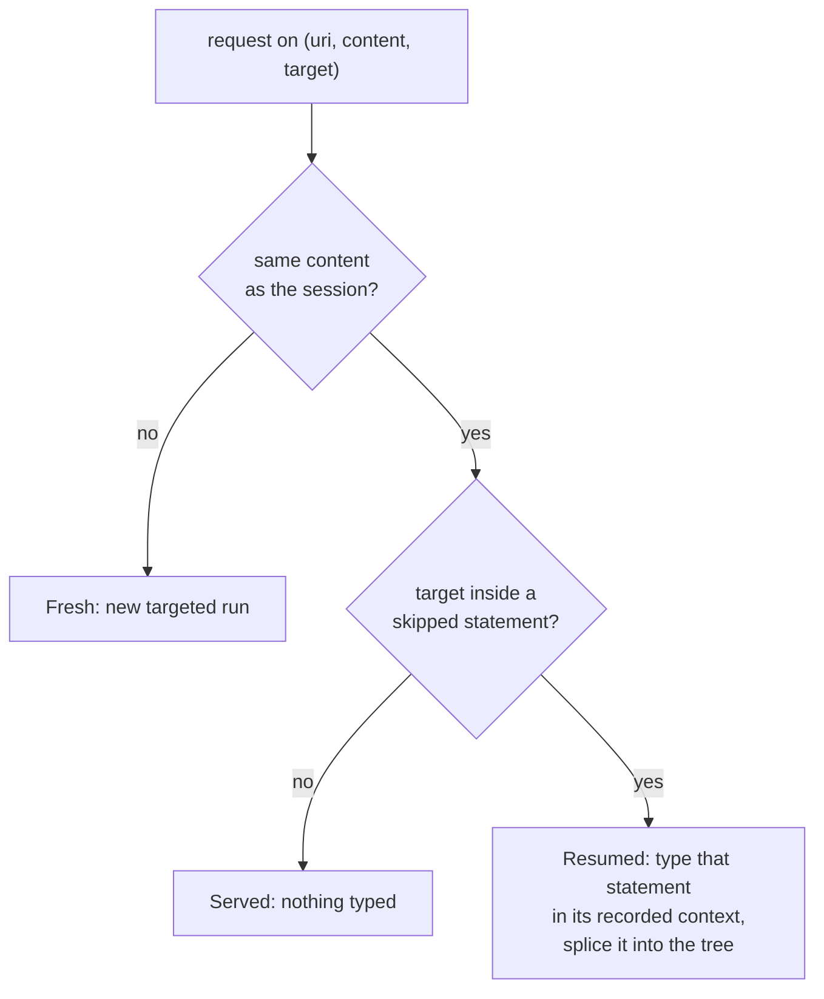
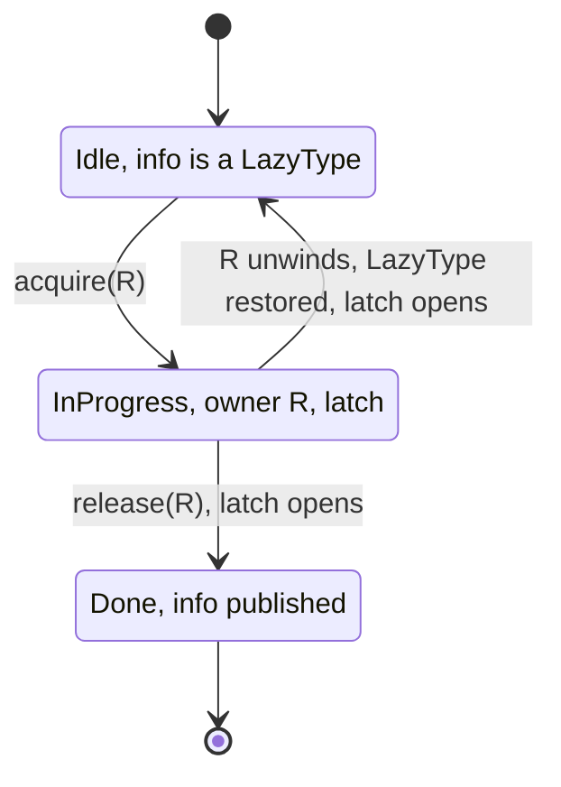
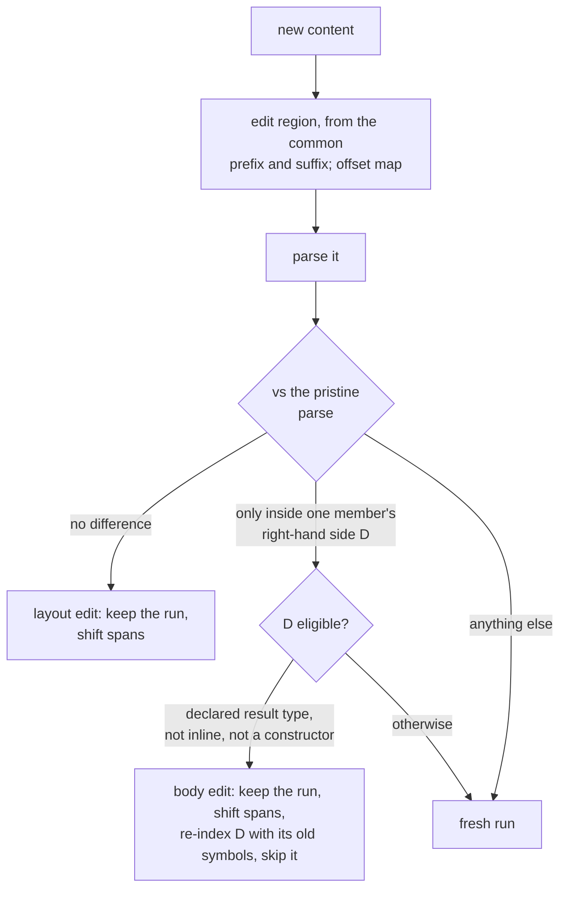
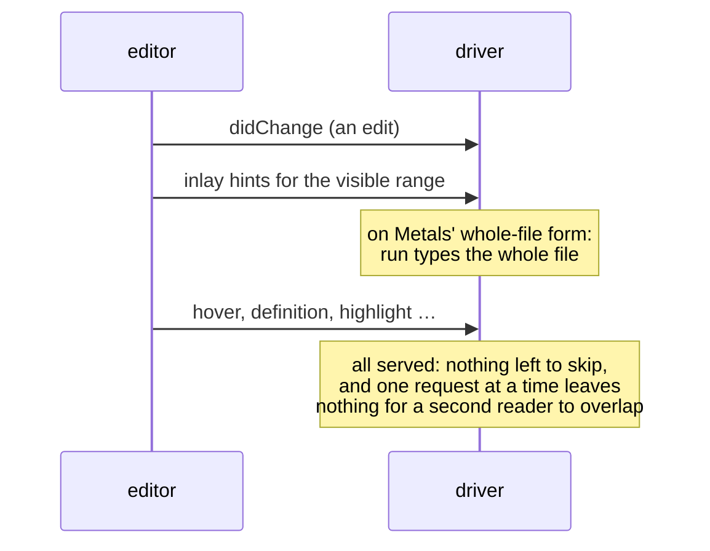
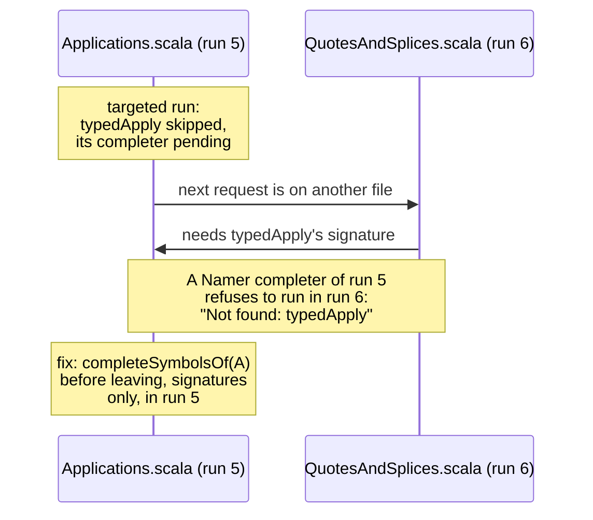
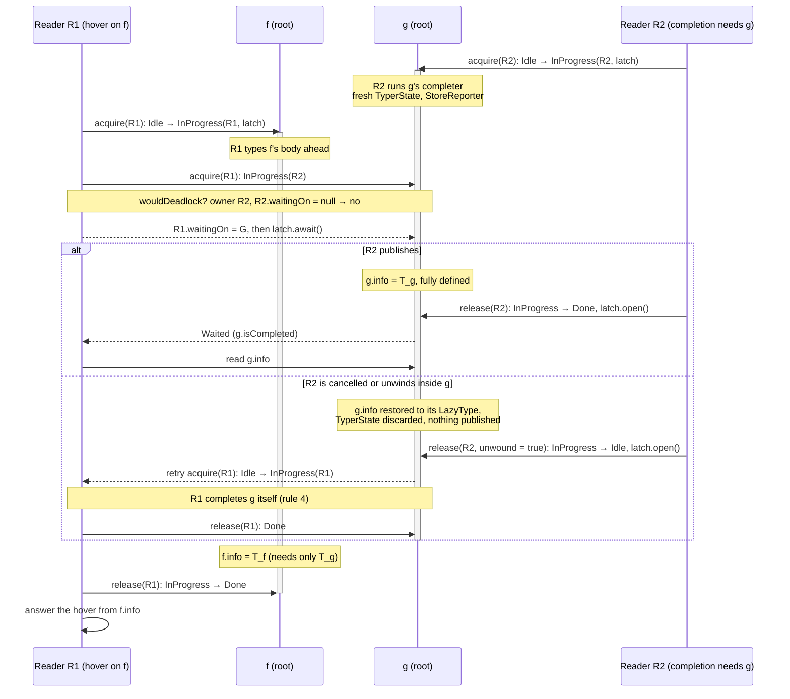

# A more interactive Scala 3

<p class="sub">Targeted, cancellable, incremental and parallel typechecking for Scala 3's presentation compiler</p>

**Audience:** people who work on Scala 2, Scala 3, Metals, the IntelliJ Scala plugin or another compiler that also has to serve an editor.

**What this is:** a visual guide to how Scala 3's presentation compiler goes from one whole-file typecheck per request to a targeted, resumable, cancellable session, and then to several concurrent readers over one symbol table, after Kotlin K2's lazy resolve and IntelliJ's read and write actions. The code is [retronym/scala3#84][PR].

<!-- break -->

**Arc:**

1. Batch typechecking, and why Scala 2's presentation compiler was hard to get right.
2. Targeting: type only the path to the request.
3. The session: one run serves many requests.
4. Cancellable typechecking.
5. Several readers: K2's rules, and completion as lazy resolve.
6. The races the suites found, each as a before and after.
7. Readers side by side, as lanes over one symbol table.
8. Incremental typechecking: an edit inside a body keeps the run, ranges type only the visible lines, diagnostics are invalidated by provenance.
9. The measurements.
10. Prior art.
11. Checkpoint: where it stands, what is open, the lessons, what can go upstream now.

Every number is from the design notes, cited by section: [session §n][S] is `interactive-session.md`, [readers §n][M] is `interactive-multi-reader.md`, [Track I §n][TI] is the earlier comparison of the Scala 2, Scala 3 and IntelliJ presentation compilers. `§n` alone is a card of this talk.

### Labels on the cards

Small labels mark the cards whose subject is a kind of mutable state (teal) or a concurrency pattern (amber), and appear only there. The five kinds are introduced together in §22; each has a card that explains it.

| kind of state | explained | pattern | explained |
|---|---|---|---|
| {chip:A scratch} | §22b | {chip:coarse lock} | §23 |
| {chip:B lazy fact} | §3, §24 | {chip:claim} | §24 |
| {chip:C cache} | §29 | {chip:wait, don't peek} | §27 |
| {chip:D interning} | §22c | {chip:ordered stamp} | §30 |
| {chip:E trees} | §2 | {chip:publish once} {chip:packed value} | §29 |
| | | {chip:private state} | §31 |

The patterns are summarised in §32.

---

## Part I — Batch typechecking

### 1. The batch compiler runs on one thread



- A `Run` takes a set of units through the phases, on one thread. The symbol table, uniques and caches live on the `ContextBase` and outlive the run.
- `ContextBase.checkSingleThreaded`, asserted at the start of a run, records the assumption. Parallel pickling and `-Ybackend-parallelism` keep every symbol-table access on the main thread and hand workers only context-free work ([readers §3][M]).
- Nothing in the typer polled for cancellation. The check was at unit and subphase boundaries, and the presentation compiler's callback consumed the interrupt bit ([Track I §2][TI]).

### 2. Typing consumes the untyped tree

<div class="chips">{chip:E trees}</div>



- A typed tree is a value: once built, nothing else in the run changes it (with a few exceptions: `withTypeUnchecked` assigns in place, `span_=`).
- The untyped tree is consumed. `retrieveSym` takes `SymOfTree`, `typedUnadapted` takes `TypedAhead`, `traverse` takes `ExpandedTree`, the Namer's `setMods` rewrites modifiers ([readers §3][M], kind E).
- In batch that is free: each tree is typed once. For an editor it is finding I8, and it comes back in §11.

### 3. Completers and the `Touched` flag

<div class="chips">{chip:B lazy fact}</div>



- The Namer enters one symbol per definition, its info a `LazyType`. `SymDenotation.completeFrom` sets `Touched`, runs the completer, and stores the info.
- `Touched` is the only recursion guard. Meeting it set is a `CyclicReference`. In batch that is right: a true cycle is an error, and `Namer` and `Typer` catch it where an alternative exists.
- It was not reset if the completer threw. In batch the run ends anyway; in a long-lived session every later request sees a spurious cycle ([session §6][S], [Track I §2][TI]).

### 4. Periods and denotations

<figure class="fig anim">
<svg viewBox="0 0 720 210" role="img" aria-label="A symbol's denotations as a ring, each valid for a period of one run">
  <text x="0" y="16" class="h">phases of run 3</text>
  <g class="a-in" style="--d:.1s">
    <rect x="120" y="28" width="60" height="22" rx="4" class="box"/><text x="150" y="43" text-anchor="middle">parser</text>
    <rect x="184" y="28" width="60" height="22" rx="4" class="box"/><text x="214" y="43" text-anchor="middle">typer</text>
    <rect x="248" y="28" width="70" height="22" rx="4" class="box"/><text x="283" y="43" text-anchor="middle">pickler</text>
    <rect x="322" y="28" width="56" height="22" rx="4" class="box"/><text x="350" y="43" text-anchor="middle">…</text>
    <rect x="382" y="28" width="70" height="22" rx="4" class="box"/><text x="417" y="43" text-anchor="middle">erasure</text>
    <rect x="456" y="28" width="56" height="22" rx="4" class="box"/><text x="484" y="43" text-anchor="middle">…</text>
    <rect x="516" y="28" width="70" height="22" rx="4" class="box"/><text x="551" y="43" text-anchor="middle">backend</text>
  </g>
  <text x="0" y="88" class="b">symbol f</text>
  <text x="0" y="104" class="m">lastDenot</text>
  <rect x="184" y="68" width="194" height="42" rx="6" class="typed a-grow-x" style="--d:.5s"/>
  <text x="194" y="85" class="mono a-in" style="--d:.9s">d1: (x: Int): List[T]</text>
  <text x="194" y="101" class="mono a-in" style="--d:.9s">Period(3, typer..pickler)</text>
  <rect x="382" y="68" width="204" height="42" rx="6" class="pub a-grow-x" style="--d:1.1s"/>
  <text x="392" y="85" class="mono a-in" style="--d:1.5s">d2: (x: Int): List</text>
  <text x="392" y="101" class="mono a-in" style="--d:1.5s">Period(3, erasure..backend)</text>
  <path d="M 586 96 C 650 100, 640 140, 380 140 C 130 140, 120 110, 180 100" class="mut dash a-in" style="--d:1.7s" marker-end="url(#arr4)"/>
  <text x="400" y="158" class="m a-in" style="--d:1.8s">nextInRun: the ring of one symbol's denotations</text>
  <text x="0" y="186" class="b a-in" style="--d:2.2s">run 4:</text>
  <text x="50" y="186" class="mono a-in" style="--d:2.2s">d1.current</text>
  <text x="140" y="186" class="a-in" style="--d:2.4s">brings d1 forward to run 4 (a write on the first read in the run), or finds it stale</text>
  <defs><marker id="arr4" viewBox="0 0 10 10" refX="9" refY="5" markerWidth="7" markerHeight="7" orient="auto-start-reverse"><path d="M0,0 L10,5 L0,10 z" class="f-mut"/></marker></defs>
</svg>
<figcaption>Martin Odersky's design for Scala 3: a fact is valid for a period, a run id and a range of phases ([periods.md][periods]).</figcaption>
</figure>

- A `Period` is a run id and a phase interval; a `SymDenotation` is a symbol's meaning over one period, and the denotations of one symbol form a ring.
- Reading a denotation in a later run is a write: `Denotation.current` validates it, or brings it forward and links it into the ring ([readers §3][M], kind B).
- The run id is 16 bits, and nothing guarded it: a long-lived driver overflows it into the phase bits (I10, [session §9][S]).

### 5. Scala 2's presentation compiler runs requests inside the background type check

<figure class="fig anim">
<svg viewBox="0 0 720 200" role="img" aria-label="Scala 2 services a request at a safepoint inside the background type check">
  <text x="0" y="16" class="h">compiler thread</text>
  <rect x="0" y="34" width="700" height="34" rx="6" class="box a-grow-x" style="--d:.1s"/>
  <text x="10" y="56" class="a-in" style="--d:.3s">backgroundCompile: typing unit A</text>
  <g class="a-in" style="--d:.6s">
    <line x1="240" y1="30" x2="240" y2="72" class="mut"/><line x1="290" y1="30" x2="290" y2="72" class="mut"/>
    <line x1="340" y1="30" x2="340" y2="72" class="mut"/><line x1="390" y1="30" x2="390" y2="72" class="mut"/>
    <line x1="440" y1="30" x2="440" y2="72" class="mut"/><line x1="490" y1="30" x2="490" y2="72" class="mut"/>
    <line x1="540" y1="30" x2="540" y2="72" class="mut"/><line x1="590" y1="30" x2="590" y2="72" class="mut"/>
    <text x="415" y="24" class="m" text-anchor="middle">signalDone after every tree: a safepoint</text>
  </g>
  <g class="a-drop" style="--d:1.1s">
    <rect x="300" y="96" width="180" height="40" rx="6" class="own"/>
    <text x="390" y="114" text-anchor="middle" class="b">askTypeAt(pos)</text>
    <text x="390" y="129" text-anchor="middle" class="m">same trees, same symbols</text>
  </g>
  <path d="M 390 96 L 390 72" class="s-own a-in" style="--d:1.5s" marker-end="url(#arr5)"/>
  <text x="0" y="168" class="a-in" style="--d:1.9s">the background resumes from whatever the request left: synthetics, scopes, caches, the half-typed unit</text>
  <text x="0" y="188" class="b c-bad a-in" style="--d:2.4s">so every invariant over mutable state must hold at every safepoint</text>
  <defs><marker id="arr5" viewBox="0 0 10 10" refX="9" refY="5" markerWidth="7" markerHeight="7" orient="auto-start-reverse"><path d="M0,0 L10,5 L0,10 z" class="f-own"/></marker></defs>
</svg>
<figcaption>Nested servicing ([Track I §1–2][TI]). Requests run only when no completer is in progress (<code>lockedCount == 0</code>) and no speculative typing is buffered.</figcaption>
</figure>

- The typer calls `signalDone` after each tree; there `pollForWork` runs the requests that arrived, inside the type check, on the same thread.
- The property needed is not thread safety (nothing runs at the same time, and a lock is either reentrant and lets the request in, or deadlocks). It is the discipline of async-signal safety ([Track I][TI] summary).

### 7. Scala 3 under Metals: a whole-file run per request



- Every request made a new `Run` and typed every statement of the file. `CachingDriver` skipped the run when the file and its text were the last ones ([session §1][S]).
- After an edit, the first request is a whole-file run: 0.4 to 1.6 s on `Types.scala`, 7,000 lines ([session §1][S]).
- A run could not be stopped: the cancellation hook consumed the interrupt bit and the typer never polled. A completion made obsolete by the next keystroke ran to the end, and the next one queued behind it ([session §4][S]).
- Failure was all or nothing: a `CyclicReference` anywhere, or a stack overflow, emptied the answer, and a leaked `Touched` poisoned later requests.

---

## Part II — Targeting

### 8. A request types only the statements on the path to it

<figure class="fig anim">
<svg viewBox="0 0 720 300" role="img" aria-label="A targeted run types the statements on the path to the request and records the others with their contexts">
  <text x="0" y="14" class="h">A.scala, 60 objects</text>
  <rect x="0" y="24" width="300" height="20" rx="4" class="typed a-in" style="--d:.3s"/><text x="8" y="38" class="mono">import scala.collection.mutable</text>
  <rect x="0" y="48" width="300" height="20" rx="4" class="skip a-in" style="--d:1.8s"/><text x="8" y="62" class="mono">object O1 { … }</text>
  <rect x="0" y="72" width="300" height="20" rx="4" class="skip a-in" style="--d:1.85s"/><text x="8" y="86" class="mono">object O2 { … }</text>
  <rect x="0" y="96" width="300" height="20" rx="4" class="skip a-in" style="--d:1.9s"/><text x="8" y="110" class="mono">…  object O9 { … }</text>
  <rect x="0" y="120" width="300" height="88" rx="4" class="typed a-in" style="--d:.7s"/><text x="8" y="134" class="mono">object O10 {</text>
  <rect x="16" y="142" width="276" height="20" rx="4" class="skip a-in" style="--d:1.95s"/><text x="24" y="156" class="mono">def method10(x: Int): Int = …</text>
  <rect x="16" y="166" width="276" height="20" rx="4" class="typed a-in" style="--d:1.1s"/><text x="24" y="180" class="mono">val r = method10(1).@@</text>
  <text x="8" y="202" class="mono">}</text>
  <rect x="0" y="212" width="300" height="20" rx="4" class="skip a-in" style="--d:2.0s"/><text x="8" y="226" class="mono">object O11 { … }</text>
  <rect x="0" y="236" width="300" height="20" rx="4" class="skip a-in" style="--d:2.05s"/><text x="8" y="250" class="mono">…  object O60 { … }</text>
  <circle cx="232" cy="176" r="5" class="f-own a-pop" style="--d:.1s"/>
  <path d="M 320 176 L 300 176" class="s-own a-in" style="--d:.2s"/>
  <text x="326" y="180" class="c-own b a-in" style="--d:.2s">target</text>
  <g class="a-in" style="--d:2.3s">
    <text x="390" y="62" class="b">skipped: recorded, not typed</text>
    <text x="390" y="80" class="mono">SkippedStat(stat, ctx, owner)</text>
    <text x="390" y="98" class="m">the untyped tree, the context it would</text>
    <text x="390" y="114" class="m">have been typed in, and its owner</text>
  </g>
  <g class="a-in" style="--d:2.7s">
    <text x="390" y="160" class="b">completion in object 10</text>
    <text x="390" y="180">before: 11 statements, 791 trees</text>
    <text x="390" y="198" class="c-typed b">after: 1 statement, 43 trees</text>
    <text x="390" y="222" class="m">400-object file: 2 top-level trees, not 22</text>
  </g>
</svg>
<div class="legend"><span><i class="typed"></i>typed</span><span><i class="skip"></i>skipped, context recorded</span></div>
<figcaption>The x-ray's 60-object file ([session][S] summary, §2, §3).</figcaption>
</figure>

- `Typer.typedStats` types a package's or a template's statements in order, so the decision is made there. Of each list on the way down, only the statement containing the target is typed.
- A skipped statement's symbols are as usable as a typed one's: the Namer entered them before any statement was typed, with completers that compute signatures on demand. What it lacks is its typed tree.
- The first version typed a *prefix*, everything up to the target. The x-ray showed `method1`…`method6` typed for a completion in object 7. The prefix was never the point; the typed *set* is ([session §2][S]).

---

## Part III — The session

### 10. One run serves many requests on the same text



| request ([session §3][S], x-ray, warm JVM) | typed | trees | ms |
|---|---|---|---|
| fresh completion in object 10 | 1 statement | 43 | 12–60 |
| resume into object 40 | +1 statement | 41 | 7 |
| served from what is typed | 0 | 8 | 1–3 |
| whole file, for comparison | 60 statements | 12,097 | 357 |

The run's denotations, completers and caches stay valid throughout: it is the same `Run`. An edit starts a fresh run, which is now cheap.

### 11. Typing a skipped statement later, and splicing it in

<figure class="fig anim">
<svg viewBox="0 0 720 230" role="img" aria-label="A skipped statement is typed in its recorded context and spliced into the typed tree">
  <text x="0" y="14" class="h">typed tree (tpdTree)</text>
  <rect x="0" y="24" width="250" height="24" rx="5" class="typed"/><text x="10" y="40" class="mono">PackageDef p</text>
  <rect x="20" y="54" width="230" height="22" rx="5" class="typed"/><text x="30" y="69" class="mono">Import …</text>
  <rect x="20" y="80" width="230" height="22" rx="5" class="typed"/><text x="30" y="95" class="mono">ModuleDef O10 (r typed)</text>
  <rect x="20" y="106" width="230" height="22" rx="5" class="typed a-pop" style="--d:2.2s"/><text x="30" y="121" class="mono a-in" style="--d:2.3s">ModuleDef O40</text>
  <text x="440" y="14" class="h">skipped statements</text>
  <rect x="440" y="24" width="200" height="22" rx="5" class="skip"/><text x="450" y="39" class="mono">O1 … O9, O11 … O39</text>
  <rect x="440" y="50" width="200" height="22" rx="5" class="skip a-out" style="--d:1.0s;--o:.15"/><text x="450" y="65" class="mono a-out" style="--d:1.0s;--o:.15">O40  (ctx, owner)</text>
  <rect x="440" y="76" width="200" height="22" rx="5" class="skip"/><text x="450" y="91" class="mono">O41 … O60</text>
  <circle cx="610" cy="61" r="5" class="f-own a-pop" style="--d:.2s"/>
  <text x="560" y="128" class="c-own a-in" style="--d:.3s">hover lands in O40</text>
  <g class="a-in" style="--d:.8s">
    <rect x="300" y="150" width="200" height="40" rx="6" class="own"/>
    <text x="400" y="166" text-anchor="middle" class="mono">typedStats(O40 :: Nil, owner)</text>
    <text x="400" y="182" text-anchor="middle" class="m">in its recorded context</text>
  </g>
  <path d="M 520 72 C 520 120, 470 140, 440 150" class="s-own a-draw" pathLength="1" style="--d:.6s"/>
  <path d="M 300 170 C 270 170, 270 117, 252 117" class="s-typed a-draw" pathLength="1" style="--d:1.7s"/>
  <text x="0" y="215" class="m a-in" style="--d:2.6s">the splice is a TreeMap that copies only the path to the owner; SetRootTree re-run; new skipped members join the list</text>
</svg>
<figcaption>Statements can be typed in any order: object 200 after object 10, then object 5 ([session §3][S]).</figcaption>
</figure>

- Why the recorded context is enough: a statement's context in `typedStats` is the template's plus the imports before it, and nothing typing an earlier sibling adds.
- A whole-file request on the same content completes the session instead of replacing it: every still-skipped statement typed and spliced in one pass. Document highlight asks for one on every cursor move; in one VS Code session 136 of 142 whole-file runs came from it ([session §7][S]).

### 12. A statement whose typing was cancelled cannot be typed again (I8)

<figure class="fig pair">
<svg viewBox="0 0 340 150" role="img" aria-label="Before: a statement whose typing was cancelled cannot be typed again">
  <text x="0" y="14" class="h">before</text>
  <rect x="0" y="26" width="320" height="26" rx="5" class="bad"/><text x="10" y="43" class="mono">object O59 { def giant = … }</text>
  <text x="0" y="74">typing unwound by a cancellation:</text>
  <text x="0" y="92" class="mono">SymOfTree, TypedAhead, ExpandedTree</text>
  <text x="0" y="110">already taken off the untyped tree</text>
  <text x="0" y="134" class="c-bad b">resume: no symbols, nothing to type</text>
</svg>
<svg viewBox="0 0 340 150" role="img" aria-label="After: the statement is re-parsed, re-indexed in its recorded context and skipped again">
  <text x="0" y="14" class="h">after</text>
  <rect x="0" y="26" width="320" height="26" rx="5" class="skip"/><text x="10" y="43" class="mono">object O59 { def giant = … }</text>
  <text x="0" y="74">re-parse the file, find the statement</text>
  <text x="0" y="92">with the same span and class, unlink its</text>
  <text x="0" y="110">symbols, index the fresh tree, skip it</text>
  <text x="0" y="134" class="c-typed b">a later resume types it as new</text>
</svg>
<figcaption>Only definitions are replaceable. An aborted expression statement or a companion pair (I22: a case class's synthetics live in its object's tree) poisons the session, and every later request starts fresh (I23) ([session §3][S]).</figcaption>
</figure>

---

## Part IV — Cancellable typechecking

### 14. Stock cancellation never stops the typer

<figure class="fig pair">
<svg viewBox="0 0 340 170" role="img" aria-label="Before: the cancel token cancels the future; the typer runs on">
  <text x="0" y="14" class="h">before</text>
  <text x="0" y="40">lsp4j cancels the request's future</text>
  <text x="0" y="60">callback: <tspan class="mono">isCancelled = Thread.interrupted()</tspan></text>
  <text x="0" y="80">the bit is consumed by the first check</text>
  <rect x="0" y="96" width="320" height="22" rx="5" class="own"/><text x="10" y="111">typer runs to the end of the file</text>
  <rect x="0" y="124" width="200" height="22" rx="5" class="wait"/><text x="10" y="139">next request queued behind</text>
</svg>
<svg viewBox="0 0 340 170" role="img" aria-label="After: a sticky flag polled every 1,024 typed trees; the typer unwinds">
  <text x="0" y="14" class="h">after</text>
  <text x="0" y="40">token.onCancel() is the driver's checker</text>
  <text x="0" y="60">a sticky flag, polled every 1,024 typed trees</text>
  <text x="0" y="80"><tspan class="mono">CancelledCompilation</tspan> (a ControlThrowable)</text>
  <rect x="0" y="96" width="90" height="22" rx="5" class="own"/><text x="8" y="111">typer</text>
  <path d="M 92 107 L 112 107" class="s-bad"/><text x="116" y="111" class="c-bad">unwinds</text>
  <rect x="0" y="124" width="200" height="22" rx="5" class="typed"/><text x="10" y="139">next request runs at once</text>
</svg>
<figcaption>[session §4][S]. The exception's cause is a <code>CancellationException</code>, so mtags classifies it as a cancellation and keeps the driver.</figcaption>
</figure>

### 16. A cancellation unwinding the stack

<figure class="fig anim">
<svg viewBox="0 0 720 360" role="img" aria-label="A cancellation unwinds the stack; each completeFrom frame clears Touched on its way out">
  <text x="0" y="14" class="h">the request's thread, innermost frame on top</text>
  <g class="a-pop" style="--d:.2s"><rect x="490" y="30" width="150" height="24" rx="12" class="bad"/><text x="565" y="46" text-anchor="middle" class="c-bad b">cancel(): flag set</text></g>
  <rect x="0" y="28" width="460" height="28" rx="5" class="bad a-out" style="--d:1.1s"/><text x="10" y="46" class="mono a-out" style="--d:1.1s">checkCancelledTyping  →  throw CancelledCompilation</text>
  <rect x="0" y="60" width="460" height="28" rx="5" class="box a-out" style="--d:1.4s"/><text x="10" y="78" class="mono a-out" style="--d:1.4s">Typer.typed(…)  inside B's body</text>
  <rect x="0" y="92" width="460" height="28" rx="5" class="own a-out" style="--d:1.7s"/><text x="10" y="110" class="mono a-out" style="--d:1.7s">completeFrom(B)</text>
  <g class="a-out" style="--d:1.7s;--o:0"><rect x="490" y="96" width="74" height="20" rx="10" class="own"/><text x="527" y="110" text-anchor="middle" class="c-own">Touched</text></g>
  <g class="a-pop" style="--d:1.9s"><rect x="490" y="96" width="128" height="20" rx="10" class="skip"/><text x="554" y="110" text-anchor="middle">B: LazyType again</text></g>
  <rect x="0" y="124" width="460" height="28" rx="5" class="box a-out" style="--d:2.0s"/><text x="10" y="142" class="mono a-out" style="--d:2.0s">Namer completer of A: types A's body ahead</text>
  <rect x="0" y="156" width="460" height="28" rx="5" class="own a-out" style="--d:2.3s"/><text x="10" y="174" class="mono a-out" style="--d:2.3s">completeFrom(A)</text>
  <g class="a-out" style="--d:2.3s;--o:0"><rect x="490" y="160" width="74" height="20" rx="10" class="own"/><text x="527" y="174" text-anchor="middle" class="c-own">Touched</text></g>
  <g class="a-pop" style="--d:2.5s"><rect x="490" y="160" width="128" height="20" rx="10" class="skip"/><text x="554" y="174" text-anchor="middle">A: LazyType again</text></g>
  <rect x="0" y="188" width="460" height="28" rx="5" class="box a-out" style="--d:2.6s"/><text x="10" y="206" class="mono a-out" style="--d:2.6s">typedStats(O59 :: Nil)  a resume</text>
  <g class="a-pop" style="--d:2.8s"><rect x="490" y="192" width="200" height="20" rx="10" class="skip"/><text x="590" y="206" text-anchor="middle">O59 re-parsed, skipped again</text></g>
  <rect x="0" y="220" width="460" height="28" rx="5" class="box a-out" style="--d:2.9s"/><text x="10" y="238" class="mono a-out" style="--d:2.9s">Run.compileSources</text>
  <rect x="0" y="252" width="460" height="28" rx="5" class="box a-out" style="--d:3.1s"/><text x="10" y="270" class="mono a-out" style="--d:3.1s">InteractiveDriver.runUpTo, CachingDriver.run</text>
  <rect x="0" y="284" width="460" height="28" rx="5" class="typed"/><text x="10" y="302" class="mono">CompilerAccess.withSharedCompiler</text>
  <g class="a-pop" style="--d:3.4s"><rect x="490" y="288" width="232" height="20" rx="10" class="typed"/><text x="606" y="302" text-anchor="middle" class="c-typed">answers the default, keeps the driver</text></g>
  <path d="M 462 42 C 482 42, 482 298, 462 298" class="s-bad a-draw" pathLength="1" style="--d:1.1s"/>
  <text x="0" y="340" class="m a-in" style="--d:3.6s">kept: every statement typed before the abort, the run's facts that completed, the aborted run's context (I14)</text>
</svg>
<figcaption>Each frame restores what it set on the way out: <code>completeFrom</code> clears <code>Touched</code>, a <code>LazyAnnotation</code> keeps its thunk, a <code>SymbolLoader</code> leaves its root loadable ([session §4][S]).</figcaption>
</figure>

### 18. A cycle or a crash costs one symbol, not the request

- `Touched` is cleared on every unwinding exception in interactive mode, not only cancellation; a flag found set on a symbol not in this reader's `completing` set is healed, not reported as a cycle.
- A cycle costs one symbol for one request. Only an exception of unknown effect taints the run (the next request starts fresh). That is IntelliJ's `RecursionManager` discipline mapped onto `completeFrom` ([session §6][S]).
- Sized by measurement: one cycle in 1,074 targeted completions over `Typer.scala` and `Namer.scala`; 223 preventions over the whole suite, nearly all in the provider's own type-ahead of implicit conversions ([session §6][S]).
- `a-true-cycle-costs-the-cyclic-members-only`: `def pBeta = pGamma; def pGamma = pBeta` lists as `pBeta: Any, pGamma: Any` beside the whole `pAlpha` and `pDelta`.

---

## Part V — Several readers: K2's rules

### 19. A second concurrent request is for background work

- With targeting, a hover queued behind a hover waits milliseconds. Step 0 replayed a recorded VS Code session (814 presentation-compiler events) with Metals' job queue instrumented: 89 to 93 percent of all queueing was behind whole-file work, the first `run` after an edit and the providers that walk the whole typed tree ([readers §0][M], §42).
- So what a second reader buys is a *background pass* (diagnostics, semantic tokens, the session completed) beside foreground hovers that stay fast, and later several open files over one classpath symbol table ([readers §1][M]).
- The measurement also warned: a targeted reader spends 65 to 79 percent of its CPU inside completers, 5 to 20 percent typing bodies (§43). A lock around completions would serialise most of it.

### 20. Requests read concurrently; new text is written alone

<figure class="fig anim">
<svg viewBox="0 0 720 190" role="img" aria-label="Readers run together; a writer raises the sticky flag, waits for readers to unwind, and runs alone">
  <text x="0" y="40" class="b">reader 1</text>
  <text x="0" y="80" class="b">reader 2</text>
  <text x="0" y="120" class="b">writer</text>
  <rect x="80" y="26" width="300" height="22" rx="5" class="typed a-grow-x" style="--d:.1s"/><text x="90" y="41" class="a-in" style="--d:.4s">hover: readUpTo</text>
  <rect x="140" y="66" width="250" height="22" rx="5" class="typed a-grow-x" style="--d:.3s"/><text x="150" y="81" class="a-in" style="--d:.6s">background pass: readAll</text>
  <line x1="330" y1="10" x2="330" y2="160" class="s-bad dash a-in" style="--d:1.0s"/>
  <text x="336" y="160" class="c-bad a-in" style="--d:1.0s">new content: writerPending</text>
  <rect x="380" y="26" width="6" height="22" class="f-bad a-pop" style="--d:1.3s"/>
  <rect x="390" y="66" width="6" height="22" class="f-bad a-pop" style="--d:1.4s"/>
  <text x="400" y="41" class="m a-in" style="--d:1.4s">next checkpoint: unwind</text>
  <rect x="400" y="106" width="150" height="22" rx="5" class="own a-grow-x" style="--d:1.7s"/><text x="410" y="121" class="a-in" style="--d:2.0s">fresh run, alone</text>
  <rect x="556" y="26" width="120" height="22" rx="5" class="typed a-grow-x" style="--d:2.4s"/><text x="566" y="41" class="a-in" style="--d:2.6s">retried</text>
  <rect x="556" y="66" width="120" height="22" rx="5" class="typed a-grow-x" style="--d:2.5s"/><text x="566" y="81" class="a-in" style="--d:2.7s">retried</text>
</svg>
<figcaption>IntelliJ's pending write action cancelling read actions at <code>checkCanceled</code>, with the typer's checkpoint as <code>checkCanceled</code> ([readers §2][M], §8 step 3).</figcaption>
</figure>

- Not snapshots. Roslyn's compilations are immutable, so an old reader finishes against the old world. Scala 3 cannot do that while a run brings shared classpath denotations forward to its own run id: two runs cannot be read at once (I14). Snapshot readers need facts that outlive a run (stage 3) ([readers §2][M]).

### 21. K2's rules for writes by a concurrent request

| rule | stated for Scala 3 ([readers §3][M]) |
|---|---|
| 1. disposable | everything a reader writes is thrown away or re-validated by the next writer; a run already is |
| 2. published once, consistent | another reader sees "not computed" or the finished value, never a partial one |
| 3. idempotent | any reader computing it would write the same value, so a race to publish needs only safe publication |
| 4. cancellation leaves it unpublished | a reader unwound midway leaves the fact as it found it; the next reader recomputes |

Kotlin's low-level FIR resolves declarations in place under these rules (§48). Scala 3's typer broke all four: trees mutated in place, nothing published a completion, nothing recorded what content a type was computed against, and a cancelled typer left half-typed trees ([PR][PR]).

### 22. Kinds of mutable state a request writes

<figure class="fig anim kinds">
<div class="krow khead"><span></span><span>kind</span><span></span><span>treatment</span></div>
<div class="krow a-in" style="--d:0.15s"><span>{chip:A scratch}</span><div class="kbox"><div class="kt">Per-request scratch</div><div class="kd">State one request uses while it runs and then throws away.</div><div class="kx">comparers, context pools, targeting slots, the cancel checker</div></div><div class="karrow">→</div><div class="kbox ktreat"><div class="kd">Move to a per-thread <code>Reader</code>.</div><div class="kx">§22b</div></div></div>
<div class="krow a-in" style="--d:0.50s"><span>{chip:B lazy fact}</span><div class="kbox"><div class="kt">Lazy facts</div><div class="kd">Computed once, on first use, and marked in progress while that runs (a black hole).</div><div class="kx">completeFrom's Touched, InheritedCache.locked, symbol loaders</div></div><div class="karrow">→</div><div class="kbox ktreat"><div class="kd">An owner and a barrier per root.</div><div class="kx">§24</div></div></div>
<div class="krow a-in" style="--d:0.85s"><span>{chip:C cache}</span><div class="kbox"><div class="kt">Caches</div><div class="kd">Derived values kept to avoid recomputing them; any reader would compute the same value.</div><div class="kx">lastDenot and checkedPeriod, member and base-type caches</div></div><div class="karrow">→</div><div class="kbox ktreat"><div class="kd">One published value, or an ordered stamp; concurrent maps.</div><div class="kx">§30, §29, §30</div></div></div>
<div class="krow a-in" style="--d:1.20s"><span>{chip:D interning}</span><div class="kbox"><div class="kt">Interning and counters</div><div class="kd">One shared table so that equal types are one object; ids handed out in order.</div><div class="kx">Uniques, NamedTypeUniques, _nextSymId</div></div><div class="karrow">→</div><div class="kbox ktreat"><div class="kd">A concurrent interner, an atomic counter.</div><div class="kx">§22c</div></div></div>
<div class="krow a-in" style="--d:1.55s"><span>{chip:E trees}</span><div class="kbox"><div class="kt">Trees</div><div class="kd">The file's syntax trees: typed into new trees, their attachments consumed on the way.</div><div class="kx">SymOfTree, TypedAhead, ExpandedTree, the session's splice</div></div><div class="karrow">→</div><div class="kbox ktreat"><div class="kd">Skipped statements as facts, a persistent typed tree.</div><div class="kx">not built (step 5)</div></div></div>
</figure>

- Scala 3 had no precedent for concurrent readers of symbols or types ([readers §3][M]).
- Before a reader runs a completion it takes exclusive ownership of the completion's *root*; that is a *claim*, and the reader is the root's *owner*. While it holds the claim, any other reader that needs one of the root's symbols waits at the root's *barrier*, a latch the owner opens when it finishes or unwinds. The root is the group of symbols the completion fills in together: a symbol loader completes a class and its module at once, so the pair is one root; the TASTy completers of one file share the unpickler's address maps, so the file is one root ([readers §3.1][M]). §24 lists the roots.

### 22a. `Sharing`: batch, serialised or parallel, chosen per symbol table

<figure class="fig anim">
<svg viewBox="0 0 720 200" role="img" aria-label="Three instances of Sharing, chosen per ContextBase: Batch, Serialised, Parallel">
  <text x="0" y="14" class="h">final class Sharing(concurrent, parallel), one per ContextBase, never changed</text>
  <g class="a-in" style="--d:.1s"><rect x="0" y="30" width="226" height="150" rx="8" class="box"/>
    <text x="14" y="54" class="b">Sharing.Batch</text><text x="14" y="72" class="mono m">concurrent = false</text>
    <text x="14" y="98">one thread, no locking</text><text x="14" y="116">the batch compiler, the default</text>
    <text x="14" y="150" class="mono">lockAndComplete0</text></g>
  <g class="a-in" style="--d:.5s"><rect x="246" y="30" width="226" height="150" rx="8" class="own"/>
    <text x="260" y="54" class="b">Sharing.Serialised</text><text x="260" y="72" class="mono m">concurrent, not parallel</text>
    <text x="260" y="98">coarse-grained: one completion</text><text x="260" y="116">lock that read actions take too</text>
    <text x="260" y="150" class="mono">completeUnderGlobalLock</text><text x="260" y="168" class="m">step 3; interactive default</text></g>
  <g class="a-in" style="--d:.9s"><rect x="492" y="30" width="228" height="150" rx="8" class="typed"/>
    <text x="506" y="54" class="b">Sharing.Parallel</text><text x="506" y="72" class="mono m">concurrent and parallel</text>
    <text x="506" y="98">fine-grained: a claim per root,</text><text x="506" y="116">read actions in parallel</text>
    <text x="506" y="150" class="mono">completeUnderRootClaim</text><text x="506" y="168" class="m">step 4; -Yinteractive-parallel</text></g>
</svg>
</figure>

```scala
private def lockAndComplete(completer: LazyType)(using Context): Unit =
  val base = ctx.base
  if base.parallel then completeUnderRootClaim(completer)
  else if base.concurrent then completeUnderGlobalLock(completer)
  else lockAndComplete0(completer, ctx.mode.is(Mode.Interactive))
```

- *Concurrent* means several readers share the base; *parallel* means they run at once: the distinction of Marlow ([*Parallel and Concurrent Programming in Haskell*][marlowbook], chapter 1) and Pike ("Concurrency is not parallelism", Waza 2012, [go.dev blog][pike]). Serialised is coarse-grained, as K2's global phase resolve lock was before Kotlin 2.0 dropped the option to enable it (KT-66306) beside "LL FIR: Implement multi-threaded resolve" (KT-55750; both in the [2.0.0 ChangeLog][kt200]). Parallel is fine-grained: a claim per root, as K2's per-declaration locks and IntelliJ's read actions, where "multiple threads can read data at the same time" ([threading model][ijthread]).
- Construction-time choices are plain methods called once per base or cache: `newEqHashMap`, `newMap`, `newUniques`. Operations that take code (`exclusive`, `claimed`, `privately`, `serialised`) are inline methods whose batch branch is the code as it was before concurrency: a batch call site compiles to a test of a final field and the original expression, and allocates nothing. The concurrent branches live in `interactive.SharingImpl` ([`Sharing.scala`][sharing]).

### 22b. Per-request state moves to a per-thread `Reader`

<div class="chips">{chip:A scratch}</div>

<figure class="fig pair">
<svg viewBox="0 0 340 190" role="img" aria-label="Before: the reader is a field of the context; a captured context runs request 2's typing on request 1's dead reader">
  <text x="0" y="14" class="h">first version: a field of the context</text>
  <rect x="0" y="28" width="150" height="40" rx="6" class="box"/><text x="10" y="45">request 1</text><text x="10" y="60" class="mono">import Givens.given</text>
  <rect x="0" y="80" width="150" height="26" rx="6" class="skip"/><text x="10" y="97">its reader, done</text>
  <path d="M 75 68 L 75 80" class="mut"/>
  <rect x="180" y="28" width="150" height="40" rx="6" class="own"/><text x="190" y="45">request 2 forces</text><text x="190" y="60">the given's completion</text>
  <path d="M 180 60 C 160 80, 160 90, 152 93" class="s-bad"/>
  <text x="0" y="132">through request 1's captured import context:</text>
  <text x="0" y="150">checkpoints counted on a dead reader,</text>
  <text x="0" y="168" class="c-bad">request 2's cancel checker never polled</text>
</svg>
<svg viewBox="0 0 340 190" role="img" aria-label="After: the reader is bound to the thread in interactive mode, a plain field in batch">
  <text x="0" y="14" class="h">built: bound to the thread</text>
  <rect x="0" y="28" width="320" height="40" rx="6" class="typed"/><text x="10" y="45" class="mono">ContextBase.reader</text><text x="10" y="60">one virtual call, whatever context is used</text>
  <text x="0" y="92">batch: a field read; interactive: a</text>
  <text x="0" y="110"><tspan class="mono">ThreadLocal</tspan> on <tspan class="mono">InteractiveContextBase</tspan></text>
  <text x="0" y="136">comparers, context pools, recursion guards,</text>
  <text x="0" y="154">the target and skipped statements, the</text>
  <text x="0" y="172">completions in progress, the cancel checker</text>
</svg>
<figcaption>[readers §8][M] step 2. Contexts are captured and outlive the request that made them (completer creation contexts, import contexts, skipped statements' contexts), so per-request state cannot ride on them.</figcaption>
</figure>

- Kind A was per-request scratch kept on `ContextBase` and `Run`, correct with one caller and shared by accident with two. The `Reader` names every piece of it in one place; `errorsToBeReported` turned out to be a fact of the run and moved to `Run` instead.
- Batch pays one more dependent load on `comparer` and `handleRecursive` (§47).
- A thread-local reaches the base that owns it, so a pool thread kept a replaced driver's whole symbol table alive (I83). The outermost cancel-checker scope now unbinds the thread when it ends; `DriverThreadLocalLeakSuite` checks through a `WeakReference` that the base is collected.

### 22c. Interning types from several threads

<div class="chips">{chip:D interning}</div>

- Types are hash-consed: `Uniques`, `NamedTypeUniques` and `AppliedUniques` are unsynchronised weak hash sets on the hottest path of type creation, and `_nextSymId += 1` allocates symbol ids. Names were already safe ([readers §3][M], kind D).
- On a concurrent base `Sharing` chooses concurrent interners and an atomic counter at construction (§22a); batch keeps its own.
- The first concurrent interners took one monitor each, hits included. With four readers they were contended: `ObjectMonitor::TrySpin` under `unique`; with the interners' own work and `SyncEqHashMap`'s lookups, about a quarter of what sharing cost per file. Spinning won before a reader parked, so none of it showed as a wait ([readers §8][M], shared against independent).
- Now a hit takes no lock: a bucket's head is loaded with acquire, a new entry stored with release, a resize publishes the new table only once it is complete; a miss is looked up again under the monitor before it inserts, so equal types still intern to one object. With the same change to `SyncEqHashMap` and a fast path in `isCurrent`, this took shared k=4 from 12.7 to 11.1 ms per file (§46b).
- Interning order, and so symbol ids and fresh names, now depends on the schedule. Nothing may depend on it; the oracles compare up to fresh-name numbers ([readers §4.3][M]).

### 22d. The primitives as a library

The claims, evidence, black holes, guarded fields, `once` and the stamped cache never needed the compiler. What tied them to it was where they found their inputs. They now live in `dotty.tools.sharing`, a package that names nothing in the compiler, and the compiler supplies the inputs ([readers §8][M], the primitives as a library):

| input | what it is | the compiler's |
|---|---|---|
| `Mode` | whether threads are concurrent, an inline given | a value class over the base's flag, so a batch call site is still one load and a branch |
| `ClaimRegistry` | what a claim, `claimAt` and `once` call when concurrent | `CompletionRoots` with parallel readers, the completion lock with serialised ones |
| `CycleHandler` | what a registry does when a wait would close a wait-for cycle | back off the reader (§28) |

- `SharingBoundaryTest` compiles the package on its own against the Scala library and fails if it names the compiler.
- `Stamped`, added since, is a stamped cache that needs no mode at all (§30b).
- An opaque `Int` for the mode was tried first: the inliner left a load of the package object at every site, about 12 bytes more each.
- Next: a separate module built before the compiler, with the Lincheck suites moving with it; then capture checking, so that evidence such as a `Holds` cannot escape the operation that made it.

### 23. Step 3: one lock around all completions is correct but too slow

<div class="chips">{chip:coarse lock}</div>

- Every completion, bring-forward, inherited-cache computation and lazy TASTy read under one reentrant lock; concurrency in body typing only, as K2 started.
- Then I48: a completer publishes intermediate infos (a `TempClassInfo`, `TypeBounds.empty` while a TASTy type is read) that a reader outside the lock takes as complete.

| hover beside a background pass, `Types.scala` ([readers §8][M]) | median | p90 | right? |
|---|---|---|---|
| reads outside the lock | 1.0 ms | 7.9 ms | no (I48) |
| reads under the lock (serialised) | 141 ms | 457 ms | yes |

The premise did not hold: body typing reads what completions are in the middle of writing. A serialised hover waits for whatever statement the pass is typing, and the statement's size does not predict it: a 95-character statement held the lock for 368 ms through the completions it forced.

### 24. One reader claims a completion's root; the others wait for it

<div class="chips">{chip:B lazy fact} {chip:claim}</div>



- What a reader claims before a completion (§22 defines claim and root; [readers §3.1, §8][M] step 4):

| root | what one completion fills in | why it is claimed as one |
|---|---|---|
| a classpath class and its companion | the class and its module, read from one class or TASTy file | one loader enters both at once |
| a TASTy file | every symbol whose definition the file holds | its completers share the unpickler's tables from file offsets to symbols and trees |
| a symbol of the file being edited | that symbol's signature, typed by the Namer | nothing else is written with it |
| a class's inherited data | its base classes and the names of its members, computed once per class | it had an in-progress mark of its own, a second black hole |
| a tree read from TASTy on demand | that tree | it reads the same shared tables as the file's completers (I35) |
| a `LazyRef`, a type computed on first use | that type | another reader took one in progress for a cycle (I57) |
| bringing a denotation forward to a new run (§4) | the denotation's validity and its place in the ring | one key covers every bring-forward |

- While it runs, the symbol's info is an `InProgress`, a lazy type only the owner sees through. Every other reader meets a lazy type and takes the existing slow path of `Denotation.info`, which waits on the root. The hot test, `myInfo.isInstanceOf[LazyType]`, is unchanged.
- A Namer completion runs in a committable typer state of its own and reports to the namer's reporter, so a hover that forces a signature does not swallow its diagnostics.
- Behind `-Yinteractive-parallel`; batch never allocates an `InProgress`.

---

## Part VI — Sharing one symbol table: hazards and patterns

Each card names a hazard that appears once several readers share one symbol table, the pattern that handles it, and the `Sharing` operation (§22a) the pattern lives behind. The bugs are cited as examples.

### 27. Looking at another reader's work in progress

<div class="chips">{chip:wait, don't peek}</div>

**Hazard.** Some code asks whether a symbol is being completed and, if so, takes another path: an import being completed is not used to resolve a name, a parent being completed is skipped. With one reader "in progress" means "further up my own stack", so the answer is deterministic. With several it can mean another thread, and the answer depends on timing.

<figure class="fig pair">
<svg viewBox="0 0 340 190" role="img" aria-label="Before: a peek sees another reader's completion and skips the import">
  <text x="0" y="14" class="h">before</text>
  <text x="40" y="36" class="b" text-anchor="middle">R1</text><text x="290" y="36" class="b" text-anchor="middle">R2</text>
  <line x1="40" y1="44" x2="40" y2="180" class="ln"/><line x1="290" y1="44" x2="290" y2="180" class="ln"/>
  <rect x="115" y="60" width="110" height="34" rx="6" class="own"/><text x="170" y="75" text-anchor="middle" class="mono">import Ops._</text><text x="170" y="89" text-anchor="middle" class="m">Touched by R1</text>
  <path d="M 40 77 L 113 77" class="s-own"/>
  <path d="M 290 120 C 250 120, 240 100, 226 90" class="s-bad dash"/>
  <text x="290" y="138" text-anchor="end" class="mono">isCompleting?</text>
  <text x="290" y="154" text-anchor="end">yes: skip the import</text>
  <text x="290" y="172" text-anchor="end" class="c-bad">"foo is not a member of T"</text>
</svg>
<svg viewBox="0 0 340 190" role="img" aria-label="After: isCompleting means on this reader; another reader's completion is waited for">
  <text x="0" y="14" class="h">after</text>
  <text x="40" y="36" class="b" text-anchor="middle">R1</text><text x="290" y="36" class="b" text-anchor="middle">R2</text>
  <line x1="40" y1="44" x2="40" y2="180" class="ln"/><line x1="290" y1="44" x2="290" y2="180" class="ln"/>
  <rect x="115" y="60" width="110" height="34" rx="6" class="typed"/><text x="170" y="75" text-anchor="middle" class="mono">import Ops._</text><text x="170" y="89" text-anchor="middle" class="m">published by R1</text>
  <path d="M 40 77 L 113 77" class="s-typed"/>
  <path d="M 290 120 C 250 120, 240 100, 226 90" class="s-wait"/>
  <text x="290" y="138" text-anchor="end" class="mono">isCompleting on R2?</text>
  <text x="290" y="154" text-anchor="end">no: wait, look again</text>
  <text x="290" y="172" text-anchor="end" class="c-typed">foo found through Ops</text>
</svg>
<figcaption>Thirteen sites peek at <code>isCompleting</code> and take another path rather than force ([readers §4.1][M]). The two-reader suites found it ([readers §8][M], I41).</figcaption>
</figure>

**Pattern: wait, don't peek.** "In progress on another reader" is a state to wait for, never one to act on. `isCompleting` means "on this reader"; on a concurrent base, another reader's completion is waited for and the symbol looked at again (`awaitOtherReader`).

- The design counted thirteen such sites ([readers §4.1][M]). More sites had the same shape: a constructor completion skipped (I72), an empty type-parameter list cached (I73, I75), a `LazyRef` being computed taken for a cycle (I57).

### 28. Two readers waiting on each other

<div class="chips">{chip:claim}</div>

**Hazard.** Each reader holds a claim and waits for the other's. Roots are coarser than facts (a whole TASTy file; one key for every bring-forward), so most such cycles are two roots taken in different orders, not a dependency cycle. Raising `CyclicReference` there made a false error (I54); backing off a reader inside a Namer completion left that symbol unwound for the rest of the run, since a Namer completion cannot run twice (I74).

<figure class="fig pair">
<svg viewBox="0 0 340 200" role="img" aria-label="Before: a reader inside a Namer completion backs off and leaves it unwound for the rest of the run">
  <text x="0" y="14" class="h">before: whoever closes the cycle</text>
  <rect x="0" y="30" width="150" height="40" rx="6" class="own"/><text x="10" y="47">R1 inside a Namer</text><text x="10" y="62">completion of s</text>
  <rect x="190" y="30" width="150" height="40" rx="6" class="own"/><text x="200" y="47">R2 typing</text><text x="200" y="62">a body</text>
  <text x="0" y="96">R1 closes a wait-for cycle and backs off</text>
  <rect x="0" y="108" width="320" height="26" rx="6" class="bad"/><text x="10" y="125">s: UnwoundCompletion (cannot run twice, I53)</text>
  <text x="0" y="156">pre-empts every reader that reaches it</text>
  <text x="0" y="172">until a fresh run: with every file in one</text>
  <text x="0" y="188" class="c-bad">run, 4 of 20 cells at k=8 never recovered</text>
</svg>
<svg viewBox="0 0 340 200" role="img" aria-label="After: the body-typing reader backs off; a reader inside a Namer completion never does">
  <text x="0" y="14" class="h">after: a victim with no Namer completion</text>
  <rect x="0" y="30" width="150" height="40" rx="6" class="typed"/><text x="10" y="47">R1 finishes s</text><text x="10" y="62">and publishes</text>
  <rect x="190" y="30" width="150" height="40" rx="6" class="skip"/><text x="200" y="47">R2 backs off,</text><text x="200" y="62">its request restarts</text>
  <text x="0" y="96">all parties inside Namer completions,</text>
  <text x="0" y="112">every root a symbol: one raises</text>
  <text x="0" y="128">CyclicReference, the single-reader answer;</text>
  <text x="0" y="144">through a coarse root it waits, bounded</text>
  <text x="0" y="172" class="m">a raised cycle no sequential order has:</text>
  <text x="0" y="188" class="m">7 divergent files in 20 rounds (Setting)</text>
</svg>
<figcaption>[readers §8][M] step 4.</figcaption>
</figure>

**Pattern: detect before waiting, then choose a victim.** Before it waits, a reader follows owners from the root back to itself. On a cycle, a reader typing a body backs off and its request restarts; a reader inside a Namer completion never does; if every party is inside a Namer completion and every root is a symbol, one raises `CyclicReference`, the single-reader answer.

- **Where it lives:** `Sharing.exclusive` and `Sharing.claimed` take the claim on a parallel base and pass `CompletionRoots.backOff` as what to do on a cycle; on a serialised base `exclusive` takes the one completion lock, and batch runs the code as it was.
- The residue: two readers completing `Settings.Setting`'s members in opposite orders still raise a cycle no sequential order has (7 divergent files in 20 rounds of 484). Namer completions that can run again are the fix ([readers §8][M] step 4).

### 29. A cache published one field at a time

<div class="chips">{chip:C cache} {chip:publish once} {chip:packed value}</div>

**Hazard.** Types are hash-consed, and symbols, scopes, annotations and import infos are reached by every reader, so every lazily filled field on them is shared. The batch compiler fills them with idioms that are correct on one thread and race on two ([readers §4.4][M]):

| idiom | what another reader sees | example |
|---|---|---|
| a cache in several fields, written one after another | one reader's key with another's value | `PreDenotation.asSeenFrom` (I78) |
| a sentinel while the value is computed | the sentinel, as the answer or as a cycle | `packageObjsCache = Nil` (I79) |
| a field read twice | a value another reader replaced in between | `ImportInfo.featureImported` (I80) |
| a structure filled after it is published | the structure half filled | `MutableScope.toList` (I77) |

<figure class="fig pair">
<svg viewBox="0 0 340 200" role="img" aria-label="Before: a cache in three fields, written one after the other; another reader pairs one reader's key with the other's result">
  <text x="0" y="14" class="h">before: three fields</text>
  <rect x="0" y="28" width="100" height="26" rx="5" class="own"/><text x="50" y="45" text-anchor="middle" class="mono">prefix</text>
  <rect x="110" y="28" width="100" height="26" rx="5" class="own"/><text x="160" y="45" text-anchor="middle" class="mono">result</text>
  <rect x="220" y="28" width="100" height="26" rx="5" class="own"/><text x="270" y="45" text-anchor="middle" class="mono">period</text>
  <text x="0" y="80">R1 stores its prefix, R2 its result:</text>
  <text x="0" y="98">a reader pairs one with the other</text>
  <rect x="0" y="112" width="320" height="26" rx="6" class="bad"/><text x="10" y="129" class="mono">Conversion#apply as from a Showable</text>
  <text x="0" y="160" class="m">PreDenotation.asSeenFrom: the Formatting.Shown</text>
  <text x="0" y="176" class="m">divergences of the race hunt (I78)</text>
</svg>
<svg viewBox="0 0 340 200" role="img" aria-label="After: the key and the value in one immutable object, stored once in a volatile field, read once into a local">
  <text x="0" y="14" class="h">after: one value, one store</text>
  <rect x="0" y="28" width="320" height="26" rx="5" class="typed"/><text x="160" y="45" text-anchor="middle" class="mono">@volatile cached = (prefix, result, period)</text>
  <text x="0" y="80">built in a local, published by one store,</text>
  <text x="0" y="98">read once: a reader sees none or all of it</text>
  <rect x="0" y="112" width="320" height="26" rx="6" class="typed"/><text x="10" y="129">the result for this reader's prefix</text>
  <text x="0" y="160" class="m">on a concurrent base; batch keeps</text>
  <text x="0" y="176" class="m">its plain fields</text>
</svg>
<figcaption>[readers §4.4][M], shapes 1 and 4.</figcaption>
</figure>

**Pattern: build in a local, publish one value, read it once.** Several fields become one immutable value in one `@volatile` field (packed); a structure is built in a local and stored once; a field is read once into a local and the local returned; a sentinel becomes a claim, as in §28.

- **Where it lives:** each fix is taken under `ctx.base.concurrent` where it costs anything; most cost nothing on the batch path (a local instead of a field, the order of two stores). Maps and interners that readers share are chosen when the base is made (`Sharing.newEqHashMap`, `newMap`, `newUniques`; §22c).

### 29a. Alternatives to a packed value

<div class="chips">{chip:packed value} {chip:ordered stamp}</div>

Three ways to publish a group of fields that several readers fill lazily:

| | how | correct when | cost |
|---|---|---|---|
| packed value | one immutable object in one `@volatile` field, built in a local, stored once | always | an allocation per store |
| seqlock (`StampedLock`'s optimistic read) | the writer makes a version odd, writes the fields, makes it even with release; a reader rereads the version after its reads and retries if it changed | always | writers exclude each other; every read rereads and may retry |
| release and acquire on a last field | the fields stored plainly, one designated field last with release; readers load it first with acquire | every writer in a period stores the same values | a fence per read on ARM, no allocation |
| immutable cell | one object with final fields in one plain field; a store replaces the cell | always | an allocation per store, a dependent load per read, no fence (§30b) |

- It is not enough for `asSeenFrom` (a prefix and a result) or `MatchType.reduced` (one reduction per reader's constraint), whose writers in one period store different values. Release and acquire order one writer's stores but do not make the group atomic across two writers, so a reader can pair one writer's key with another's value: I78.
- For caches written this rarely a packed value is the simpler of the two that are always correct. They were not measured against each other.
- The last row is cheaper than both and is correct whenever the writers agree. They do agree for the commonest cache of all, a value and the period it was computed in: within one run every writer computes the same value. That is the next card.

### 30. A value and its stamp in two fields

<div class="chips">{chip:C cache} {chip:ordered stamp}</div>

**Hazard.** The commonest cache is a value and the period or run id it was computed in, in two plain fields: the case where the last row of §29a is enough, if the stores are ordered. Plain stores are seen reordered on Apple silicon: a reader finds the new stamp and the old value, a null (I36's `lastSymbol`, I60's `underlyingNormalizable`), a `false`, or the previous run's value.

<figure class="fig pair">
<svg viewBox="0 0 340 190" role="img" aria-label="Before: a value and its stamp in two plain fields; a reader can see the new stamp and the old value">
  <text x="0" y="14" class="h">before: two plain fields</text>
  <text x="0" y="40" class="mono">if stamp != now then</text>
  <text x="20" y="58" class="mono">value = compute</text>
  <text x="20" y="76" class="mono">stamp = now</text>
  <text x="0" y="94" class="mono">value</text>
  <rect x="0" y="110" width="320" height="26" rx="6" class="bad"/><text x="10" y="127">new stamp, old value: null, false, last run's</text>
  <text x="0" y="158">types alone had thirteen such pairs;</text>
  <text x="0" y="176">plain stores are reordered on Apple silicon</text>
</svg>
<svg viewBox="0 0 340 190" role="img" aria-label="After: Caching.stamped reads the stamp then the value with acquire, stores the value then the stamp with release">
  <text x="0" y="14" class="h">after: Caching.stamped</text>
  <text x="0" y="40" class="mono">s = stamp; acquireFence</text>
  <text x="0" y="58" class="mono">v = value; if s == now then v</text>
  <text x="0" y="76" class="mono">else releaseFence; value = v1</text>
  <text x="34" y="94" class="mono">releaseFence; stamp = now; v1</text>
  <rect x="0" y="110" width="320" height="26" rx="6" class="typed"/><text x="10" y="127">a current stamp means a value for this period</text>
  <text x="0" y="158">fences only on a concurrent base;</text>
  <text x="0" y="176">the local returned, never the field again</text>
</svg>
<figcaption>[readers §4.4.1][M], [`Caching.scala`][caching]. The two nulls found earlier were this shape: I36's <code>lastSymbol</code> and I60's <code>underlyingNormalizable</code>.</figcaption>
</figure>

**Pattern: an ordered stamp.** The stamp is read first, with acquire; a writer stores the value, then the stamp, with release. It is correct because all readers of a run share one period, so two writers in that period store values equally valid for it.

- Before `Caching`, 21 fields paired a value with a period or run-id stamp.¹ Six were protected, in three idioms: `util.Publish` (`Symbol`, `NamedType`), a packed `@volatile` value (`asSeenFrom`, package objects, `MatchType`'s reduction), `synchronized` (`InheritedCache`). Two were partly protected: `ClassDenotation`'s member and base-type caches, concurrent maps whose reference and period were plain. Thirteen were plain pairs, all in `Types.scala`: the signatures, `canDropAlias`, `AndType`'s and `OrType`'s base classes, `OrType`'s join, union, atoms and widening, `AppliedType`'s super type, stability, constant folding and normalizable underlying type.
- One helper, `core.Caching`, now holds the thirteen and the two. Variants: `stampedIf` keeps only a value that is not provisional, `stampedWhen` takes its own hit test, `peek` reads without computing.
- Each is an inline method: one copy of the code with the fences under a test of the base's final `concurrent` field, since two copies would double every site's bytecode, which the JIT's inlining budget counts. Fences rather than a `VarHandle` per field, so one helper serves any pair: free on x86, `dmb ishld` and `dmb ish` on AArch64, and only on a concurrent base.
- The invariant it relies on: all readers of a run are in one period, and a writer in another run is cancelled before the run changes. Two writers in one period compute values equally valid for it, so pairing one's stamp with the other's value is still right.
- Where the key is more than the stamp, a packed value instead: `PreDenotation.asSeenFrom` (the prefix too), `MatchType.reduced`, `packageObjs`.
- `StampedCachesTest` is the lint: in `core`, a stamp field appears only in a `Caching` call or a reset, with the exceptions named. `CachingLincheckTest` checks the helper (§30a).

<div class="fn">¹ A survey of #84 at 911b78d4f8, before <code>Caching</code>, over <code>compiler/src</code>; <code>Denotation.myValidFor</code> and <code>Phase.myPeriod</code> are not caches and are not counted.</div>

### 30a. Checking the stamped cache with Lincheck

[Lincheck][lincheck] is JetBrains' framework for testing concurrent JVM code. A test declares operations with `@Operation`; Lincheck generates concurrent scenarios of them and checks that every result is one some sequential order of the same operations could give (linearizability). It runs a scenario two ways: *model checking* explores the interleavings of the threads' reads and writes deterministically, and *stress* runs it on real threads.

```scala
class Cell:                      // starts with a pair from an earlier period
  private var stamp: Int = 1
  private var value: Int = 10

  @Operation def get(): Int =               // every reader is in period 2, whose value is 20
    Caching.cache(true, stamp, value, stamp = _, value = _, (s, _) => s == Now, Now, _ => true, 20)

  @Operation def getProvisional(): Int =    // computes -1, which is not kept
    Caching.cache(true, stamp, value, stamp = _, value = _, (s, _) => s == Now, Now, _ != -1, -1)
```

- In any sequential order `get` returns 20, and `getProvisional` returns -1 until some `get` has stored 20. A concurrent result outside that, such as 10 (the earlier period's value) for a current stamp, fails the test.
- Three threads, three operations each. Model checking assumes sequential consistency, so it checks the order of the reads and stores, not the fences; the stress run, on real threads and on Apple silicon too, is the part that can exercise them.
- `Broken`, the plain idiom `Caching` replaced (the value stored whether kept or not, then the field read again), must fail, so the test is known to catch the bug it is for ([`CachingLincheckTest.scala`][lincheckTest]).

### 30b. One cell instead of two fields

<div class="chips">{chip:C cache} {chip:packed value}</div>

`Caching` keeps two fields and orders them. `Stamped` keeps one: the stamp and the value as one immutable cell with final fields, so whoever loads the cell sees the pair whole, on any base, with no fence and no test of the mode.

<figure class="fig pair">
<svg viewBox="0 0 340 190" role="img" aria-label="Before: Caching keeps the stamp and the value in two fields of the type, ordered by fences on a concurrent base">
  <text x="0" y="14" class="h">Caching: two fields</text>
  <rect x="0" y="28" width="150" height="56" rx="6" class="box"/><text x="10" y="46" class="b">OrType</text>
  <text x="10" y="64" class="mono">myJoinPeriod: Int</text><text x="10" y="78" class="mono">myJoin: Type</text>
  <text x="170" y="50">8 bytes on every</text><text x="170" y="66">instance, filled or not</text>
  <rect x="0" y="110" width="320" height="26" rx="6" class="typed"/><text x="10" y="127">fences under the mode's test</text>
  <text x="0" y="158">correct because every writer in a</text>
  <text x="0" y="176">period computes an equal value</text>
</svg>
<svg viewBox="0 0 340 190" role="img" aria-label="After: Stamped keeps one reference to an immutable cell; an empty cache points at the shared Stamped.Empty">
  <text x="0" y="14" class="h">Stamped: one cell</text>
  <rect x="0" y="28" width="180" height="56" rx="6" class="box"/><text x="10" y="46" class="b">OrType</text>
  <text x="10" y="64" class="mono">myJoin: Stamped[Type]</text>
  <rect x="210" y="28" width="120" height="56" rx="6" class="pub"/><text x="220" y="46" class="b">Stamped</text>
  <text x="220" y="64" class="mono">final stamp</text><text x="220" y="78" class="mono">final value</text>
  <path d="M 180 60 L 210 56" class="s-pub"/>
  <rect x="0" y="110" width="320" height="26" rx="6" class="typed"/><text x="10" y="127">the same code on a batch and a concurrent base</text>
  <text x="0" y="158">empty: 4 bytes, a reference to Stamped.Empty;</text>
  <text x="0" y="176">a miss allocates a 16 or 24 byte cell</text>
</svg>
<figcaption>[readers §4.4.1][M], [`Stamped.scala`][stamped].</figcaption>
</figure>

- All but two of the stamped caches in `Types` are cells now: the signatures, base classes, join, union, atoms, widening, super type, compile-time fold and normalizable underlying type. `canDropAlias` and `isStable`, a `Boolean` each, and `ClassDenotation`'s member and base-type caches stay on `Caching`.
- Most instances never fill most of these caches: a method's Java and Scala 2 signatures, a union's join, a compile-time fold. An empty cache is now one reference to a shared `Stamped.Empty` instead of a stamp and a value, so the types get smaller, and cells are allocated only for the caches that fill.
- On the batch compiler cycles per op did not move beyond noise (dottyUtil −0.1% ± 4.0, re2s −0.9% ± 5.1), and allocation per op went down 0.7–0.8%: the fields the cells replace outweigh the cells ([readers §4.4.1][M]).
- Not for `Symbol.checkedPeriod` and `NamedType.checkedPeriod`: a hit there moves the stamp without recomputing, so a cell would allocate once per symbol or type per period, on the hottest reads in the compiler. They keep `util.Publish`.
- `StampedLincheckTest` checks the cell as §30a checks the fields; a cell updated in place must fail it ([`StampedLincheckTest.scala`][stampedLincheck]).

### 31. One reader's type variables reaching another

<div class="chips">{chip:private state}</div>

**Hazard.** A typer state holds type variables and constraints. Committing a completion's or a statement's state into a state that several readers share (the namer's, the run's) lets one reader's binding reach another's typing, or drops a variable another state still refers to.

<figure class="fig pair">
<svg viewBox="0 0 340 200" role="img" aria-label="Before: readers commit statements into the run's shared typer state and fork from it">
  <text x="0" y="14" class="h">before</text>
  <rect x="80" y="26" width="180" height="40" rx="6" class="bad"/><text x="170" y="43" text-anchor="middle" class="b">the run's TyperState</text><text x="170" y="58" text-anchor="middle" class="m">shared, committed into</text>
  <rect x="0" y="100" width="130" height="30" rx="6" class="own"/><text x="65" y="120" text-anchor="middle">R1's statement</text>
  <rect x="210" y="100" width="130" height="30" rx="6" class="own"/><text x="275" y="120" text-anchor="middle">R2's statement</text>
  <path d="M 65 100 L 120 68" class="s-bad"/><text x="40" y="88" class="c-bad">commit</text>
  <path d="M 220 68 L 275 100" class="s-wait"/><text x="262" y="88" class="c-wait">fork</text>
  <text x="0" y="156">the given's [A], bound by R1's commit,</text>
  <text x="0" y="172">met by R2's typing</text>
  <text x="0" y="192" class="c-bad">conversion to Shown rejected; an NPE</text>
</svg>
<svg viewBox="0 0 340 200" role="img" aria-label="After: a statement's typer state is settled when it ends and dropped; the run's state is read-only">
  <text x="0" y="14" class="h">after</text>
  <rect x="80" y="26" width="180" height="40" rx="6" class="typed"/><text x="170" y="43" text-anchor="middle" class="b">the run's TyperState</text><text x="170" y="58" text-anchor="middle" class="m">read-only once the run opens</text>
  <rect x="0" y="100" width="130" height="30" rx="6" class="own"/><text x="65" y="120" text-anchor="middle">R1's statement</text>
  <rect x="210" y="100" width="130" height="30" rx="6" class="own"/><text x="275" y="120" text-anchor="middle">R2's statement</text>
  <path d="M 120 68 L 65 100" class="s-typed"/><path d="M 220 68 L 275 100" class="s-typed"/>
  <text x="0" y="156">each settled when it ends (variables</text>
  <text x="0" y="172">instantiated), then dropped, never committed</text>
  <text x="0" y="192" class="c-typed">an assertion in commit keeps it so</text>
</svg>
<figcaption>The rule I66 made for locals, applied to statements; lazy annotation arguments and inline bodies, typed by whichever reader forces them, get a private child state too ([readers §8][M] step 4). A change to how a session keeps constraints, not a race fix.</figcaption>
</figure>

**Pattern: a private typer state, settled and dropped.** Each completion and each statement is typed in a state of its own; when it ends its variables are instantiated (as `fullyDefinedType` would) and the state is dropped, never committed. The run's state is read-only once the run opens, which an assertion in `commit` checks.

- **Where it lives:** `Sharing.privately` runs code in a private child state on a parallel base, and as before otherwise; `Sharing.endState` settles and drops on a parallel base and commits under the completion lock on a serialised one.
- Examples: a variable dropped with its state (I62, "Found: Set[A | TermRef], Required: Set[TermRef]"); constraints from one reader's commit met by another's typing, the conversions to `Formatting.Shown` rejected (I70, I76).

### 31a. A reader changing a scope that others read

**Hazard.** Every reader looks names up in scopes: a class's members, a package's. Typing still wrote into scopes other readers were already reading: indexing into a package, deleting from it in a classfile's completion, entering inline accessors, retracting a definition. The presentation-compiler suites made 2,101 such changes outside a write action. A package's flat classes entered in place rehashed its table under readers (12,201 missed lookups of classes it held). And a member made on its first lookup (`Function23`) made answers depend on what earlier code had mentioned: of 200 synthesized names, 101 split into two symbols across readers.

<figure class="fig anim">
<svg viewBox="0 0 720 196" role="img" aria-label="Filled while no reader can see it, frozen once its completion returns; after that only a write action changes it.">
  <defs><marker id="mswf" viewBox="0 0 10 10" refX="9" refY="5" markerWidth="7" markerHeight="7" orient="auto-start-reverse"><path d="M0,0 L10,5 L0,10 z" class="f-mut"/></marker></defs>
  <text x="0" y="31" class="b">completer</text><line x1="112" y1="27" x2="712" y2="27" class="ln"/>
  <text x="0" y="89" class="b">reader</text><line x1="112" y1="85" x2="712" y2="85" class="ln"/>
  <text x="0" y="147" class="b">write action</text><line x1="112" y1="143" x2="712" y2="143" class="ln"/>
  <g class="a-grow-x" style="--d:0.15s"><rect x="112.0" y="16" width="210.0" height="22" rx="4" class="own"/></g>
  <text x="118.0" y="31" class="a-in" style="--d:0.40s;font-size:11px">fills the scope, hidden</text>
  <g class="a-grow-x" style="--d:1.37s"><rect x="340.0" y="74" width="108.0" height="22" rx="4" class="typed"/></g>
  <text x="340.0" y="69" class="m a-in" style="--d:1.62s;font-size:11px">looks up, no lock</text>
  <g class="a-grow-x" style="--d:1.94s"><g class="a-blink" style="--d:2.54s;--n:2"><rect x="448.0" y="74" width="36.0" height="22" rx="4" class="wait"/></g></g>
  <text x="448.0" y="69" class="m a-in" style="--d:2.19s;font-size:11px">unwinds</text>
  <g class="a-grow-x" style="--d:2.13s"><rect x="484.0" y="132" width="132.0" height="22" rx="4" class="pub"/></g>
  <text x="484.0" y="127" class="m a-in" style="--d:2.38s;font-size:11px">builds aside, publishes</text>
  <g class="a-grow-x" style="--d:2.93s"><rect x="634.0" y="74" width="78.0" height="22" rx="4" class="typed"/></g>
  <text x="712.0" y="69" text-anchor="end" class="m a-in" style="--d:3.18s;font-size:11px">sees the new table</text>
  <g class="a-pop" style="--d:1.27s"><line x1="322.0" y1="13" x2="322.0" y2="41" class="s-own" stroke-width="2"/></g>
  <text x="326.0" y="11" class="c-own a-in" style="--d:1.27s;font-size:10.5px">published</text>
  <path d="M 322.0 38 L 340.0 74" class="s-pub a-draw" pathLength="1" style="--d:1.27s" marker-end="url(#mswf)"/>
  <path d="M 616.0 132 L 634.0 96" class="s-pub a-draw" pathLength="1" style="--d:2.84s" marker-end="url(#mswf)"/>
</svg>
<div class="legend"><span><i class="typed"></i>working</span><span><i class="own"></i>holding a claim or lock</span><span><i class="wait"></i>waiting</span><span><i class="pub"></i>write action</span></div>
<figcaption>Fill hidden, then freeze: a scope is filled while its owner's completion hides it, published when the completion returns, and changed after that only by a write action, building new entries aside. From the state map's guide ([`tools/state-map`][statemap]).</figcaption>
</figure>

<figure class="fig anim">
<svg viewBox="0 0 720 138" role="img" aria-label="One symbol per name, and the scope&#x27;s enumeration never changes.">
  <defs><marker id="mswm" viewBox="0 0 10 10" refX="9" refY="5" markerWidth="7" markerHeight="7" orient="auto-start-reverse"><path d="M0,0 L10,5 L0,10 z" class="f-mut"/></marker></defs>
  <text x="0" y="31" class="b">reader 1</text><line x1="112" y1="27" x2="712" y2="27" class="ln"/>
  <text x="0" y="89" class="b">reader 2</text><line x1="112" y1="85" x2="712" y2="85" class="ln"/>
  <g class="a-grow-x" style="--d:0.15s"><rect x="112.0" y="16" width="180.0" height="22" rx="4" class="typed"/></g>
  <text x="118.0" y="31" class="a-in" style="--d:0.40s;font-size:11px">Function23: synthesizes</text>
  <g class="a-grow-x" style="--d:0.28s"><rect x="136.0" y="74" width="180.0" height="22" rx="4" class="typed"/></g>
  <text x="142.0" y="89" class="a-in" style="--d:0.53s;font-size:11px">Function23: synthesizes</text>
  <g class="a-grow-x" style="--d:1.30s"><rect x="328.0" y="16" width="324.0" height="22" rx="4" class="typed"/></g>
  <text x="334.0" y="31" class="a-in" style="--d:1.55s;font-size:11px">the symbol</text>
  <g class="a-grow-x" style="--d:1.30s"><rect x="328.0" y="74" width="324.0" height="22" rx="4" class="typed"/></g>
  <text x="334.0" y="89" class="a-in" style="--d:1.55s;font-size:11px">the same symbol</text>
  <g class="a-pop" style="--d:1.11s"><line x1="292.0" y1="13" x2="292.0" y2="41" class="s-own" stroke-width="2"/></g>
  <text x="296.0" y="11" class="c-own a-in" style="--d:1.11s;font-size:10.5px">putIfAbsent wins</text>
  <g class="a-pop" style="--d:1.24s"><line x1="316.0" y1="71" x2="316.0" y2="99" class="s-own" stroke-width="2"/></g>
  <text x="320.0" y="69" class="c-own a-in" style="--d:1.24s;font-size:10.5px">loses: takes the winner&#x27;s</text>
</svg>
<div class="legend"><span><i class="typed"></i>working</span><span><i class="own"></i>holding a claim or lock</span><span><i class="wait"></i>waiting</span><span><i class="pub"></i>write action</span></div>
<figcaption>Synthesize beside, not into: a member made on a lookup is kept in a memo beside the scope (`putIfAbsent`), never entered, so an enumeration does not depend on history.</figcaption>
</figure>

- **Patterns:** fill hidden, then freeze (`MutableScope.published`; `-Ycheck-frozen-scopes` fails any other change); build a new table aside and publish it with one store after a release fence (`extendAside`); synthesize beside, not into.
- **Result:** 0 changes outside a write action in those suites, 0 missed lookups, 0 split names.

### 31b. Invalidation racing a store

**Hazard.** A change pushes invalidation into other objects' caches. A reader that computed from the old information stores its result after the invalidation went past, and the stale value stays. The inherited caches had a monitor each, a validity check on store and a weak map of dependents to keep this right (I46, I92).

<figure class="fig anim">
<svg viewBox="0 0 720 138" role="img" aria-label="Nobody invalidates the cache; the reader compares stamps when it reads.">
  <defs><marker id="mswp" viewBox="0 0 10 10" refX="9" refY="5" markerWidth="7" markerHeight="7" orient="auto-start-reverse"><path d="M0,0 L10,5 L0,10 z" class="f-mut"/></marker></defs>
  <text x="0" y="31" class="b">reader</text><line x1="112" y1="27" x2="712" y2="27" class="ln"/>
  <text x="0" y="89" class="b">writer</text><line x1="112" y1="85" x2="712" y2="85" class="ln"/>
  <g class="a-grow-x" style="--d:0.15s"><rect x="112.0" y="16" width="150.0" height="22" rx="4" class="typed"/></g>
  <text x="112.0" y="11" class="m a-in" style="--d:0.40s;font-size:11px">member names cached at epoch 5</text>
  <g class="a-grow-x" style="--d:1.27s"><rect x="322.0" y="74" width="120.0" height="22" rx="4" class="pub"/></g>
  <text x="322.0" y="69" class="m a-in" style="--d:1.52s;font-size:11px">changes a published scope: epoch 6</text>
  <g class="a-grow-x" style="--d:2.23s"><rect x="502.0" y="16" width="180.0" height="22" rx="4" class="typed"/></g>
  <text x="508.0" y="31" class="a-in" style="--d:2.48s;font-size:11px">epoch 5 ≠ 6: recomputes</text>
  <path d="M 442.0 74 L 502.0 38" class="s-pub a-draw" pathLength="1" style="--d:1.91s" marker-end="url(#mswp)"/>
  <text x="508.0" y="50.0" class="c-pub a-in" style="--d:1.91s;font-size:10.5px">epoch</text>
</svg>
<div class="legend"><span><i class="typed"></i>working</span><span><i class="own"></i>holding a claim or lock</span><span><i class="wait"></i>waiting</span><span><i class="pub"></i>write action</span></div>
<figcaption>Pull, do not push: nobody invalidates the cache; the reader compares stamps when it reads. From the state map's guide ([`tools/state-map`][statemap]).</figcaption>
</figure>

```scala
// InheritedCacheImpl, on a concurrent base
private val epoch: Int = if concurrent then base.structureEpoch else 0
protected final def epochCurrent: Boolean = !concurrent || epoch == base.structureEpoch
protected def invalidateDependents(): Unit =
  if concurrent then base.bumpStructureEpoch()   // every stamped cache is now stale
  else …                                          // batch: walk the dependents, as before
```

A cache records the base's structure epoch when it is made and is valid while the epoch has not moved; a change to a published scope moves it. A store that races with a change lands in a cache already stale.

### 31c. A result read after the lock is released

**Hazard.** A provider calls `runUpTo`, the read lock is released, and it reads the typed tree afterwards. A write action between the two replaces what it reads. Most providers read the current context and compilation units outside the lock.

<figure class="fig anim">
<svg viewBox="0 0 720 138" role="img" aria-label="A result read after a write is not handed over; the request is served again, at most three times.">
  <defs><marker id="msws" viewBox="0 0 10 10" refX="9" refY="5" markerWidth="7" markerHeight="7" orient="auto-start-reverse"><path d="M0,0 L10,5 L0,10 z" class="f-mut"/></marker></defs>
  <text x="0" y="31" class="b">request</text><line x1="112" y1="27" x2="712" y2="27" class="ln"/>
  <text x="0" y="89" class="b">writer</text><line x1="112" y1="85" x2="712" y2="85" class="ln"/>
  <g class="a-grow-x" style="--d:0.15s"><rect x="112.0" y="16" width="150.0" height="22" rx="4" class="typed"/></g>
  <text x="118.0" y="31" class="a-in" style="--d:0.40s;font-size:11px">runUpTo: stamp 7</text>
  <g class="a-grow-x" style="--d:0.95s"><rect x="262.0" y="16" width="180.0" height="22" rx="4" class="typed"/></g>
  <text x="262.0" y="11" class="m a-in" style="--d:1.20s;font-size:11px">provider reads the tree, no lock</text>
  <g class="a-grow-x" style="--d:1.27s"><rect x="322.0" y="74" width="78.0" height="22" rx="4" class="pub"/></g>
  <text x="322.0" y="69" class="m a-in" style="--d:1.52s;font-size:11px">write: count 8</text>
  <g class="a-grow-x" style="--d:2.13s"><rect x="484.0" y="16" width="198.0" height="22" rx="4" class="typed"/></g>
  <text x="490.0" y="31" class="a-in" style="--d:2.38s;font-size:11px">again, on a fresh reader</text>
  <g class="a-pop" style="--d:2.01s"><line x1="460.0" y1="13" x2="460.0" y2="41" class="s-own" stroke-width="2"/></g>
  <text x="464.0" y="11" class="c-own a-in" style="--d:2.01s;font-size:10.5px">7 ≠ 8</text>
</svg>
<div class="legend"><span><i class="typed"></i>working</span><span><i class="own"></i>holding a claim or lock</span><span><i class="wait"></i>waiting</span><span><i class="pub"></i>write action</span></div>
<figcaption>Stamp the result: a request's result carries the driver's write count when it last left a lock, and the request is served again if a write ran after it, at most three times. From the state map's guide ([`tools/state-map`][statemap]).</figcaption>
</figure>

### 32. The patterns, by mode of `Sharing`

| hazard | pattern | `Batch` | `Serialised` | `Parallel` |
|---|---|---|---|---|
| completions racing each other | coarse lock | the original code | one completion lock (`exclusive`, `serialised`)  | – |
| a completion's intermediate state seen by others (§24) | claim and barrier | the original code  | – | a claim per root (`exclusive`, `claimed`) |
| acting on another reader's work in progress (§27)  | wait, don't peek | – | wait on the lock, look again | `awaitOtherReader` |
| readers waiting on each other (§28)  | a chosen victim | –  | – | `CompletionRoots.backOff` |
| a cache in several fields (§29) | one published value | plain fields | packed value, publish once | packed value, publish once |
| a value and its stamp (§30) | ordered stamp | plain stores | `Caching.stamped` with fences | `Caching.stamped` with fences |
| type variables crossing readers (§31) | private typer state | the original code | commit under the lock (`endState`) | settle and drop (`privately`, `endState`) |
| shared maps and interners | concurrent structures | plain | synchronised, lock-free hits (`newEqHashMap`, `newUniques`) | the same |
| a reader changing a published scope (§31a) | fill hidden, then freeze; build aside; synthesize beside | the original code | changes only in a write action | changes only in a write action |
| invalidation racing a store (§31b) | pull by epoch | push: walk the dependents | structure epoch | structure epoch |
| a result read after the lock (§31c) | stamp the result | – | served again after a write | served again after a write |


### 33. Testing the concurrency

| layer | what it checks |
|---|---|
| Lincheck on `Caching` | the stamped cell from several threads against every sequential order (§30a) |
| two-reader soak and oracle suites | random walks of requests, cancellations and edits on one driver, every answer equal to a whole-file run's |
| the k=8 race-hunt loop | `Throughput -Dtp.loop`: 484 files, per-file diagnostics diffed against a single-reader run, the claim log around each divergence |
| one-pattern soaks | `ShownSoak` (conversions to `Shown`, written out longhand as well), `ExtensionParamsSuite`, `LazyRefRunSpliceSuite`, `DriverThreadLocalLeakSuite` |
| Lincheck on the claims | readers claiming in nested orders, never opposite ones, must never back off |
| lints | `StampedCachesTest`: a stamp in `core` only through `Caching` |

A soak that hammers one pattern, written out longhand as well, separates "the search picked wrong" from "the answer it checked was wrong" ([readers §4.4][M]).


### 33a. A map of the shared state, extracted from TASTy

<div class="chips">{chip:A scratch} {chip:B lazy fact} {chip:C cache} {chip:D interning} {chip:E trees}</div>

A script over the compiler's TASTy collects every `var`, and every `val` holding a mutable collection, of the classes a reader can reach: 1047 fields in 350 classes. For each it records:

- **the kind** of §22, A to E, by rules over owner, base classes, declared type and name;
- **what protects it** from other readers: `Caching`, `util.Publish`, a packed or single volatile, the completion lock, a root's claim, confinement to one thread, a monitor, batch only, post-typer, or none;
- **its feature area** and the classes its type names, which give the diagram its edges.

Protection is read from the trees around every access, not from the declaration, so a field protected at most accesses but not all shows as *partial*, with the unprotected lines listed. Checked against the design notes' tables (the stamped caches of §30, the race register), it reports 12 mismatches, each a real access outside the stated discipline ([PR][PR], [`tools/state-map`][statemap]).

[The diagram][statemapdiagram] draws the main classes as nodes, a row per field: the left bar is its kind, the right column its protection, a red row has none at some access, and an edge is the fields whose types name another class.

### 33b. Declaring what names and types do not show

<figure class="fig anim">
<svg viewBox="0 0 720 230" role="img" aria-label="Annotated exemplar fields with kind, annotations, protection and what the extractor says">
  <text x="0" y="14" class="h">rows of the state map: kind, field, declared, protection</text>
  <g class="a-in" style="--d:0.15s"><rect x="0" y="30" width="720" height="28" rx="4" class="box"/><rect x="0" y="30" width="6" height="28" rx="2" class="f-typed"/><text x="16" y="48" class="b">A</text><text x="34" y="48" class="mono">ContextPool.inUse</text><text x="270" y="48" class="mono m">@scratch @confined</text><text x="520" y="48">confined</text><text x="600" y="48" class="m">agrees</text></g>
  <g class="a-in" style="--d:0.45s"><rect x="0" y="64" width="720" height="28" rx="4" class="box"/><rect x="0" y="64" width="6" height="28" rx="2" class="f-typed"/><text x="16" y="82" class="b">B</text><text x="34" y="82" class="mono">Namer.myNestedTyper</text><text x="270" y="82" class="mono m">@lazyFact @publishedBy(&quot;volatile&quot;)</text><text x="520" y="82">volatile</text><text x="600" y="82" class="m">agrees</text></g>
  <g class="a-in" style="--d:0.75s"><rect x="0" y="98" width="720" height="28" rx="4" class="bad"/><rect x="0" y="98" width="6" height="28" rx="2" class="f-typed"/><text x="16" y="116" class="b">C</text><text x="34" y="116" class="mono">Symbol.lastDenot</text><text x="270" y="116" class="mono m">@cache @publishedBy(&quot;Publish&quot;)</text><text x="520" y="116">Publish</text></g>
  <text x="270" y="142" class="c-bad a-in" style="--d:1.15s">≠ the rules find eleven reads outside the publishing methods</text>
  <g class="a-in" style="--d:1.05s"><rect x="0" y="150" width="720" height="28" rx="4" class="box"/><rect x="0" y="150" width="6" height="28" rx="2" class="f-typed"/><text x="16" y="168" class="b">C</text><text x="34" y="168" class="mono">LambdaParam.myVariance</text><text x="270" y="168" class="mono m">@cache @benignRace</text><text x="520" y="168">benign race</text><text x="600" y="168" class="m">races by design</text></g>
  <g class="a-in" style="--d:1.35s"><rect x="0" y="184" width="720" height="28" rx="4" class="box"/><rect x="0" y="184" width="6" height="28" rx="2" class="f-typed"/><text x="16" y="202" class="b">D</text><text x="34" y="202" class="mono">NameKinds.uniqueNameKinds</text><text x="270" y="202" class="mono m">@interned</text><text x="520" y="202">(and @sharable)</text></g>
  <g class="a-in" style="--d:1.65s"><rect x="0" y="218" width="720" height="28" rx="4" class="box"/><rect x="0" y="218" width="6" height="28" rx="2" class="f-typed"/><text x="16" y="236" class="b">E</text><text x="34" y="236" class="mono">InteractiveDriver.myOpenedTrees</text><text x="270" y="236" class="mono m">@treeState @guardedBy(&quot;myOpenedTrees&quot;)</text><text x="520" y="236">monitor</text></g>
</svg>
<figcaption>The seven fields annotated as exemplars, one per kind and protection the rules cannot place (one, a feature-area marker, not shown). <code>@</code> marks a declared fact; <code>≠</code> a disagreement the extractor reports. From <code>tools/state-map/README.md</code> on #84.</figcaption>
</figure>

- Naming and types carry the rules a long way, not all of it: a pool field is per reader only because the pools moved to the `Reader`; a completer writes `myInfo` under a lock taken further up the stack; `LambdaParam.myVariance` races by design.
- Ten annotations in `scala.annotation.internal` say it on the field: kind (`@scratch`, `@lazyFact`, `@cache`, `@interned`, `@treeState`), protection (`@guardedBy`, `@confined`, `@publishedBy`, `@benignRace`) and `@featureArea`. They win over the rules, which still report whether they *agree*, *disagree* or cannot check (*unverified*).
- `@sharable` and `@unshared` are a different axis: they tell `-Ycheck-reentrant` that state reachable from a static object is safe across compiler instances, which says nothing about readers sharing one symbol table. Nothing runs that check today.
- Prior art: JCIP's `@GuardedBy`, checked by [Error Prone][epguarded]; IntelliJ's `@RequiresReadLock`, checked by instrumentation in tests.

### 33c. A claim held further up the stack, as a capability

<div class="chips">{chip:claim}</div>

A lock taken further up the stack is what neither the rules nor an annotation can check at the access. [Clang's thread-safety analysis][clangtsa] makes it a capability (`REQUIRES(...)` on a function); Scala can do the same with a context parameter.

```scala
sealed abstract class Holds[K]                          // evidence of holding the claim on K
inline def unguarded[K](inline why: String): Holds[K]   // the named escape hatch

// made only by Sharing.exclusive, Sharing.claimed, and a completion (lockAndComplete0); signatures:
def complete(denot: SymDenotation)(using Context, Sharing.Holds[denot.type]): Unit   // LazyType
protected final def isLocked(using Sharing.Holds[this.type]): Boolean               // InheritedCacheImpl
```

- State only the holder may touch is reachable only through methods that take a `Holds`, so a touch outside the claim does not compile.
- `Holds` is invariant in its key, one shared instance serves every key, and nothing is allocated.

### 33d. Compile errors as the list of gaps

Each pilot put one kind of state behind a `Holds` and recompiled. The errors were short lists, and most held a latent bug:

| behind the capability | errors | what they were |
|---|---|---|
| inherited caches (`Sharing.exclusive`) | 3 | both `invalidate`s read another reader's black hole as their own re-entry: fixed. `signalProvisional` holds the claim further up the same stack: `unguarded` |
| `LazyRef` (`Sharing.claimed`) | 2 | both in `update`, which wrote the reference while another reader computed it: it takes the claim now |
| bring-forward (`bringForward`, `updateValidity`) | 0 | the denotation ring, which the map had counted under this claim, is written only by phases after typer (53 sites): the claim is not its guard. The capability shows where the map had the wrong lock |
| completers (`LazyType.complete`) | 2 of 33 callers | `PackageLoader` completing its module val, a root of the same load: `unguarded`. `integrateOpaqueMembers` running an opaque alias's completer directly: fixed, below |

```scala
// before: run directly, outside any completion
case completer: LazyType =>
  completer.complete(sym)   // two readers could run it at once
  null
```

```scala
// after: through the completion's own path
case completer: LazyType =>
  sym.denot.completeFrom(completer)
  null
```

On one thread, a re-entry had also run it a second time, nested in the first. `completeFrom` gives it `Touched`, the root's claim and the hiding from other readers.

None of these races has been reproduced, and the batch-path cost (`Thread.currentThread` around an inherited cache's computation, one more argument per completion) has not been measured ([PR][PR]).

---

## Part VII — Several readers drawn as lanes over time

Each panel is lanes over time, running down: readers at the edges, the roots they claim in the middle. A root's lane shows its state: idle, in progress with an owner, done.

<div class="legend"><span><i class="own"></i>in progress, owned (and the owner's work)</span><span><i class="wait"></i>waiting on a barrier</span><span><i class="typed"></i>published, done</span><span><i class="skip"></i>idle: a lazy type</span><span><i class="bad"></i>cancelled</span></div>

### 34. Lanes: one reader completes g, another waits for it

<figure class="fig anim">
<svg viewBox="0 0 720 360" role="img" aria-label="R2 owns g; R1 owns f and waits on g's barrier; R2 publishes g; R1 completes f and answers">
  <defs><marker id="m34" viewBox="0 0 10 10" refX="9" refY="5" markerWidth="7" markerHeight="7" orient="auto-start-reverse"><path d="M0,0 L10,5 L0,10 z" class="f-mut"/></marker></defs>
  <text x="90" y="20" class="b" text-anchor="middle">R1 · hover on f</text><text x="290" y="20" class="b" text-anchor="middle">root f</text><text x="430" y="20" class="b" text-anchor="middle">root g</text><text x="630" y="20" class="b" text-anchor="middle">R2 · completion</text>
  <line x1="90" y1="30" x2="90" y2="340" class="ln"/><line x1="290" y1="30" x2="290" y2="340" class="ln"/><line x1="430" y1="30" x2="430" y2="340" class="ln"/><line x1="630" y1="30" x2="630" y2="340" class="ln"/>
  <rect x="250" y="34" width="80" height="56" rx="4" class="skip"/><text x="290" y="66" text-anchor="middle" class="m">idle</text>
  <rect x="390" y="34" width="80" height="26" rx="4" class="skip"/><text x="430" y="51" text-anchor="middle" class="m">idle</text>
  <rect x="390" y="60" width="80" height="110" rx="4" class="own a-grow-d" style="--d:.31s"/><text x="430" y="104" text-anchor="middle" class="b a-in" style="--d:.5s">InProgress</text><text x="430" y="120" text-anchor="middle" class="a-in" style="--d:.5s">owner R2</text>
  <rect x="570" y="60" width="120" height="110" rx="4" class="own a-grow-d" style="--d:.31s"/><text x="580" y="80" class="a-in" style="--d:.5s">runs g's completer</text><text x="580" y="96" class="m a-in" style="--d:.5s">own TyperState</text>
  <path d="M 568 64 L 474 64" class="mut a-in" style="--d:.31s" marker-end="url(#m34)"/><text x="520" y="58" text-anchor="middle" class="m a-in" style="--d:.31s">acquire</text>
  <rect x="250" y="90" width="80" height="160" rx="4" class="own a-grow-d" style="--d:.78s"/><text x="290" y="160" text-anchor="middle" class="b a-in" style="--d:1s">InProgress</text><text x="290" y="176" text-anchor="middle" class="a-in" style="--d:1s">owner R1</text>
  <rect x="30" y="90" width="120" height="40" rx="4" class="own a-grow-d" style="--d:.78s"/><text x="40" y="108" class="a-in" style="--d:.9s">types f's body</text><text x="40" y="122" class="m a-in" style="--d:.9s">ahead</text>
  <path d="M 152 94 L 246 94" class="mut a-in" style="--d:.78s" marker-end="url(#m34)"/><text x="200" y="88" text-anchor="middle" class="m a-in" style="--d:.78s">acquire</text>
  <path d="M 152 134 L 386 134" class="s-wait a-draw" pathLength="1" style="--d:1.4s"/><text x="200" y="128" text-anchor="middle" class="c-wait a-in" style="--d:1.4s">needs g</text>
  <g class="a-in" style="--d:1.5s"><rect x="30" y="130" width="120" height="40" rx="4" class="wait a-blink" style="--d:1.7s"/></g><text x="40" y="148" class="a-in" style="--d:1.5s">waits on g's</text><text x="40" y="162" class="a-in" style="--d:1.5s">barrier</text>
  <text x="200" y="152" text-anchor="middle" class="m a-in" style="--d:1.5s">no cycle</text>
  <rect x="390" y="170" width="80" height="160" rx="4" class="typed a-grow-d" style="--d:2s"/><text x="430" y="200" text-anchor="middle" class="b a-in" style="--d:2.1s">Done</text><text x="430" y="216" text-anchor="middle" class="mono a-in" style="--d:2.1s">T_g</text>
  <path d="M 388 178 L 154 178" class="s-pub a-draw" pathLength="1" style="--d:2s"/><text x="200" y="192" text-anchor="middle" class="c-pub a-in" style="--d:2.1s">latch opens</text>
  <rect x="570" y="170" width="120" height="30" rx="4" class="typed a-grow-d" style="--d:2s"/><text x="580" y="190" class="a-in" style="--d:2.1s">publishes, goes on</text>
  <rect x="30" y="182" width="120" height="66" rx="4" class="own a-grow-d" style="--d:2.2s"/><text x="40" y="200" class="a-in" style="--d:2.3s">reads g.info,</text><text x="40" y="216" class="a-in" style="--d:2.3s">finishes f</text>
  <rect x="250" y="250" width="80" height="80" rx="4" class="typed a-grow-d" style="--d:3.26s"/><text x="290" y="280" text-anchor="middle" class="b a-in" style="--d:3.35s">Done</text><text x="290" y="296" text-anchor="middle" class="mono a-in" style="--d:3.35s">T_f</text>
  <rect x="30" y="256" width="120" height="30" rx="4" class="typed a-grow-d" style="--d:3.41s"/><text x="40" y="276" class="a-in" style="--d:3.5s">answers the hover</text>
  <line x1="20" y1="40" x2="700" y2="40" class="mut dash a-sweep" style="--ty:296px;--t:4.6s"/>
</svg>
<figcaption>Rule 2 is the barrier: nobody but the owner sees <code>f</code> or <code>g</code> half-completed. Rule 3: whoever completes <code>g</code> writes the same <code>T_g</code> ([readers §3.1][M]).</figcaption>
</figure>

### 35. Lanes: the owner is cancelled, the waiter takes over

<figure class="fig anim">
<svg viewBox="0 0 720 360" role="img" aria-label="R2 owns g and is cancelled; it unwinds, restores the lazy type and opens the latch; R1 takes over and completes g">
  <defs><marker id="m35" viewBox="0 0 10 10" refX="9" refY="5" markerWidth="7" markerHeight="7" orient="auto-start-reverse"><path d="M0,0 L10,5 L0,10 z" class="f-mut"/></marker></defs>
  <text x="100" y="20" class="b" text-anchor="middle">R1 · needs g</text><text x="360" y="20" class="b" text-anchor="middle">root g</text><text x="620" y="20" class="b" text-anchor="middle">R2 · owner</text>
  <line x1="100" y1="30" x2="100" y2="340" class="ln"/><line x1="360" y1="30" x2="360" y2="340" class="ln"/><line x1="620" y1="30" x2="620" y2="340" class="ln"/>
  <rect x="310" y="34" width="100" height="26" rx="4" class="skip"/><text x="360" y="51" text-anchor="middle" class="m">idle</text>
  <rect x="310" y="60" width="100" height="110" rx="4" class="own a-grow-d" style="--d:.31s"/><text x="360" y="100" text-anchor="middle" class="b a-in" style="--d:.5s">InProgress</text><text x="360" y="116" text-anchor="middle" class="a-in" style="--d:.5s">owner R2</text>
  <rect x="550" y="60" width="140" height="110" rx="4" class="own a-grow-d" style="--d:.31s"/><text x="560" y="80" class="a-in" style="--d:.5s">runs g's completer</text>
  <path d="M 548 64 L 414 64" class="mut a-in" style="--d:.31s" marker-end="url(#m35)"/><text x="480" y="58" text-anchor="middle" class="m a-in" style="--d:.31s">acquire</text>
  <path d="M 172 104 L 306 104" class="s-wait a-draw" pathLength="1" style="--d:.95s"/><text x="240" y="98" text-anchor="middle" class="c-wait a-in" style="--d:.95s">acquire: owner R2</text>
  <g class="a-in" style="--d:1s"><rect x="30" y="100" width="140" height="90" rx="4" class="wait a-blink" style="--d:1.2s;--n:4"/></g><text x="40" y="120" class="a-in" style="--d:1s">waits on g's barrier</text>
  <g class="a-pop" style="--d:1.7s"><rect x="560" y="130" width="120" height="24" rx="12" class="bad"/><text x="620" y="146" text-anchor="middle" class="c-bad b">cancelled</text></g>
  <rect x="550" y="170" width="140" height="8" class="f-bad a-pop" style="--d:2s"/><text x="560" y="196" class="c-bad a-in" style="--d:2s">unwinds: TyperState</text><text x="560" y="212" class="c-bad a-in" style="--d:2s">discarded, nothing</text><text x="560" y="228" class="c-bad a-in" style="--d:2s">published</text>
  <rect x="310" y="170" width="100" height="24" rx="4" class="skip a-grow-d" style="--d:2s"/><text x="360" y="186" text-anchor="middle" class="a-in" style="--d:2.1s">idle again</text>
  <path d="M 306 182 L 174 182" class="s-pub a-draw" pathLength="1" style="--d:2.1s"/><text x="240" y="176" text-anchor="middle" class="c-pub a-in" style="--d:2.1s">latch opens</text>
  <rect x="310" y="194" width="100" height="86" rx="4" class="own a-grow-d" style="--d:2.4s"/><text x="360" y="230" text-anchor="middle" class="b a-in" style="--d:2.5s">InProgress</text><text x="360" y="246" text-anchor="middle" class="a-in" style="--d:2.5s">owner R1</text>
  <rect x="30" y="194" width="140" height="86" rx="4" class="own a-grow-d" style="--d:2.4s"/><text x="40" y="214" class="a-in" style="--d:2.5s">retries acquire,</text><text x="40" y="230" class="a-in" style="--d:2.5s">completes g itself</text>
  <path d="M 172 198 L 306 198" class="mut a-in" style="--d:2.4s" marker-end="url(#m35)"/>
  <rect x="310" y="280" width="100" height="50" rx="4" class="typed a-grow-d" style="--d:3.6s"/><text x="360" y="304" text-anchor="middle" class="b a-in" style="--d:3.7s">Done</text><text x="360" y="320" text-anchor="middle" class="mono a-in" style="--d:3.7s">T_g</text>
  <rect x="30" y="284" width="140" height="30" rx="4" class="typed a-grow-d" style="--d:3.7s"/><text x="40" y="304" class="a-in" style="--d:3.8s">goes on with T_g</text>
  <line x1="20" y1="40" x2="700" y2="40" class="mut dash a-sweep" style="--ty:296px;--t:4.6s"/>
</svg>
<figcaption>Rule 4 of §21. If the owner left <code>Touched</code> set when it unwound, as Scala 3's completers used to (§3), the barrier would belong to a reader that no longer exists and R1 would wait for the rest of the run. So the owner resets the root in its own unwind path, before releasing it ([Track I, two readers][TC]). A waiter cancelled by a writer is cancelled too; hand-over is for an owner's own failure ([readers §9][M]).</figcaption>
</figure>

### 36. Lanes: hovers while another thread types the whole file

<figure class="fig anim">
<svg viewBox="0 0 720 380" role="img" aria-label="A background pass claims and types one skipped statement at a time; hovers on another reader are served, wait for the claimed statement, or claim one the pass has not reached">
  <defs><marker id="m36" viewBox="0 0 10 10" refX="9" refY="5" markerWidth="7" markerHeight="7" orient="auto-start-reverse"><path d="M0,0 L10,5 L0,10 z" class="f-mut"/></marker></defs>
  <text x="100" y="20" class="b" text-anchor="middle">R1 · background pass</text><text x="360" y="20" class="b" text-anchor="middle">skipped statements</text><text x="620" y="20" class="b" text-anchor="middle">R2 · hovers</text>
  <line x1="100" y1="30" x2="100" y2="360" class="ln"/><line x1="620" y1="30" x2="620" y2="360" class="ln"/>
  <rect x="300" y="36" width="120" height="22" rx="4" class="skip"/><text x="360" y="51" text-anchor="middle" class="mono">s1 … s4</text>
  <rect x="30" y="60" width="140" height="60" rx="4" class="own a-grow-d" style="--d:.3s"/><text x="40" y="80" class="a-in" style="--d:.4s">visible lines first</text><text x="40" y="96" class="m a-in" style="--d:.4s">a range target</text>
  <rect x="300" y="122" width="120" height="22" rx="4" class="own a-pop" style="--d:1.1s"/><text x="360" y="137" text-anchor="middle" class="mono a-in" style="--d:1.1s">s1 claimed by R1</text>
  <rect x="30" y="122" width="140" height="56" rx="4" class="own a-grow-d" style="--d:1.1s"/><text x="40" y="142" class="a-in" style="--d:1.2s">types s1</text>
  <circle cx="620" cy="80" r="6" class="f-typed a-pop" style="--d:.5s"/><text x="608" y="84" text-anchor="end" class="a-in" style="--d:.5s">served, 1 ms</text>
  <circle cx="620" cy="104" r="6" class="f-typed a-pop" style="--d:.8s"/><text x="608" y="108" text-anchor="end" class="a-in" style="--d:.8s">served</text>
  <circle cx="620" cy="128" r="6" class="f-typed a-pop" style="--d:1.1s"/><text x="608" y="132" text-anchor="end" class="a-in" style="--d:1.1s">served</text>
  <path d="M 548 156 L 424 140" class="s-wait a-draw" pathLength="1" style="--d:1.45s"/><text x="490" y="166" text-anchor="middle" class="c-wait a-in" style="--d:1.45s">lands in s1</text>
  <g class="a-in" style="--d:1.5s"><rect x="560" y="152" width="120" height="26" rx="4" class="wait a-blink" style="--d:1.6s;--n:2"/></g><text x="570" y="169" class="a-in" style="--d:1.5s">waits for s1</text>
  <rect x="300" y="180" width="120" height="22" rx="4" class="typed a-pop" style="--d:2s"/><text x="360" y="195" text-anchor="middle" class="mono a-in" style="--d:2s">s1 spliced</text>
  <path d="M 424 191 L 556 186" class="s-pub a-draw" pathLength="1" style="--d:2s"/>
  <circle cx="620" cy="196" r="6" class="f-typed a-pop" style="--d:2.1s"/><text x="608" y="200" text-anchor="end" class="a-in" style="--d:2.1s">answered</text>
  <rect x="300" y="210" width="120" height="22" rx="4" class="own a-pop" style="--d:2.3s"/><text x="360" y="225" text-anchor="middle" class="mono a-in" style="--d:2.3s">s2 claimed by R1</text>
  <rect x="30" y="210" width="140" height="56" rx="4" class="own a-grow-d" style="--d:2.3s"/><text x="40" y="230" class="a-in" style="--d:2.4s">types s2</text>
  <rect x="300" y="240" width="120" height="22" rx="4" class="own a-pop" style="--d:2.7s"/><text x="360" y="255" text-anchor="middle" class="mono a-in" style="--d:2.7s">s4 claimed by R2</text>
  <rect x="560" y="240" width="120" height="40" rx="4" class="own a-grow-d" style="--d:2.7s"/><text x="570" y="258" class="a-in" style="--d:2.8s">types s4 itself</text><text x="570" y="272" class="m a-in" style="--d:2.8s">a resume</text>
  <rect x="300" y="270" width="120" height="22" rx="4" class="typed a-pop" style="--d:3.1s"/><text x="360" y="285" text-anchor="middle" class="mono a-in" style="--d:3.1s">s2, s4 spliced</text>
  <rect x="30" y="296" width="140" height="40" rx="4" class="own a-grow-d" style="--d:3.4s"/><text x="40" y="314" class="a-in" style="--d:3.5s">types s3; s4 is</text><text x="40" y="328" class="m a-in" style="--d:3.5s">already typed</text>
  <circle cx="620" cy="300" r="6" class="f-typed a-pop" style="--d:3.4s"/><text x="608" y="304" text-anchor="end" class="a-in" style="--d:3.4s">served</text>
  <circle cx="620" cy="324" r="6" class="f-typed a-pop" style="--d:3.7s"/><text x="608" y="328" text-anchor="end" class="a-in" style="--d:3.7s">served</text>
  <line x1="20" y1="40" x2="700" y2="40" class="mut dash a-sweep" style="--ty:310px;--t:4.4s"/>
</svg>
<figcaption>The x-ray's background pass. On a quiet machine with <code>-Yinteractive-parallel</code>, the pass types <code>Types.scala</code> in 560–850 ms with 27–53 hovers served beside it at about 1 ms median; serialised, 3–6 hovers at 17–490 ms median. Its diagnostics equal a whole-file run's ([readers §8][M] step 4).</figcaption>
</figure>

---

## Part VIII — Incremental typechecking: edits inside a body, visible ranges, diagnostics

### 37. After an edit: keep the run, or start a new one?



- IntelliJ's `BlockModificationTracker` is the rule: an edit inside a body whose definition has a declared type bumps that body's count only ([session §12][S]).
- The comparison is with a pristine parse kept on the session, not the unit's tree: the Namer mutates the trees it indexes (`setMods`), and comparing against those would take false fresh runs.
- The re-index refines D's old symbols (same identity, so every typed reference stays valid) and checks that the new info is `=:=` the old; if it is not, the next request starts fresh. Behind `-Yinteractive-body-edits`.

### 39. The whole-file run after a keystroke: 382 ms to 6 ms

<figure class="fig anim">
<svg viewBox="0 0 720 200" role="img" aria-label="The whole-file run after a keystroke, with and without body edits, median ms">
  <text x="0" y="14" class="h">whole-file run after a keystroke in a body, median ms</text>
  <text x="0" y="46" class="b">Types.scala</text>
  <rect x="150" y="32" width="478" height="16" rx="3" class="own a-grow-x" style="--d:.1s"/><text x="634" y="45" class="a-in" style="--d:.6s">382 (p90 607)</text>
  <rect x="150" y="52" width="7" height="16" rx="2" class="typed a-grow-x" style="--d:.3s"/><text x="163" y="65" class="c-typed b a-in" style="--d:.6s">5.9 (p90 25)</text>
  <text x="0" y="104" class="b">TypeComparer.scala</text>
  <rect x="150" y="90" width="181" height="16" rx="3" class="own a-grow-x" style="--d:.2s"/><text x="337" y="103" class="a-in" style="--d:.7s">145</text>
  <rect x="150" y="110" width="10" height="16" rx="2" class="typed a-grow-x" style="--d:.4s"/><text x="166" y="123" class="c-typed b a-in" style="--d:.7s">7.9</text>
  <text x="0" y="162" class="b">Contexts.scala</text>
  <rect x="150" y="148" width="40" height="16" rx="3" class="own a-grow-x" style="--d:.3s"/><text x="196" y="161" class="a-in" style="--d:.8s">32.1</text>
  <rect x="150" y="168" width="2" height="16" rx="1" class="typed a-grow-x" style="--d:.5s"/><text x="158" y="181" class="c-typed b a-in" style="--d:.8s">0.8</text>
</svg>
<div class="legend"><span><i class="own"></i>flag off: the edit is a fresh run</span><span><i class="typed"></i><code>-Yinteractive-body-edits</code></span></div>
<figcaption>45 rounds per file: a digit added inside a method body, a hover elsewhere, then a whole-file run as document highlight or semantic tokens ask; first five rounds dropped ([session §12][S], Measured). The hover right after the edit is unchanged (31.5 / 32.4 ms on Types.scala): it pays the edit itself, mostly the shift.</figcaption>
</figure>

Of the 45 edits, 43, 40 and 39 were body edits; the rest (an inline method, a method with an inferred result type) took a fresh run, as designed. Step 0 found about 90 percent of the queueing behind exactly this whole-file request (§42).

### 40. Typing only the visible lines

<figure class="fig anim">
<svg viewBox="0 0 720 210" role="img" aria-label="A range target types the statements that touch the visible window and skips the rest">
  <text x="0" y="14" class="h">Types.scala, 7,000 lines</text>
  <rect x="0" y="24" width="40" height="176" rx="4" class="skip"/>
  <rect x="0" y="94" width="40" height="22" rx="2" class="own a-pop" style="--d:.2s"/>
  <text x="50" y="110" class="c-own b a-in" style="--d:.3s">the visible 60 lines</text>
  <g class="a-in" style="--d:.7s">
    <rect x="200" y="24" width="200" height="20" rx="4" class="skip"/><text x="208" y="38" class="mono">statements before</text>
    <rect x="200" y="86" width="200" height="20" rx="4" class="typed"/><text x="208" y="100" class="mono">touches the window</text>
    <rect x="200" y="110" width="200" height="20" rx="4" class="typed"/><text x="208" y="124" class="mono">touches the window</text>
    <rect x="200" y="172" width="200" height="20" rx="4" class="skip"/><text x="208" y="186" class="mono">statements after</text>
  </g>
  <g class="a-in" style="--d:1.2s">
    <text x="430" y="70" class="b">a 60-line window</text>
    <text x="430" y="90" class="c-typed b">637–969 trees, 26–38 ms</text>
    <text x="430" y="122" class="b">the whole file</text>
    <text x="430" y="142">41,123 trees, 307–328 ms</text>
    <text x="430" y="174" class="m">semantic tokens for the window</text>
    <text x="430" y="192" class="m">after the hints: 0–1 ms (vs 68–72 ms)</text>
  </g>
</svg>
<figcaption><code>Run.typingTarget</code> may be a range: at each statement list, a statement is typed if its span touches it ([session §7][S], Range requests).</figcaption>
</figure>

- Inlay hints always carry a range; semantic tokens have a `range` form. The compiler half is done and checked against whole-file answers; Metals still sends the whole-file forms. `RangeParams` already extends `VirtualFileParams`, so Metals can pass one to the existing method.
- Document highlight stays whole-file: its question is a point, its answer is every occurrence in the file.

### 41. Diagnostics by provenance (I69)

<figure class="fig pair">
<svg viewBox="0 0 340 210" role="img" aria-label="Before: after a body edit, diagnostics are kept or dropped by position">
  <text x="0" y="14" class="h">before: keyed by position</text>
  <rect x="0" y="26" width="320" height="24" rx="5" class="box"/><text x="10" y="42" class="mono">inline def helper = … error …</text>
  <rect x="0" y="56" width="320" height="56" rx="5" class="own"/><text x="10" y="72" class="mono">def D: Int = helper   (edited)</text>
  <text x="10" y="90" class="m">drop what is positioned in D's span</text>
  <text x="10" y="104" class="m">keep the rest, shifted</text>
  <text x="0" y="134" class="c-bad">D's inlined error, positioned in helper: kept, stale</text>
  <text x="0" y="152" class="c-bad">the class's check positioned at D: dropped</text>
  <text x="0" y="170" class="c-bad">a @nowarn removed from D: still in force</text>
  <text x="0" y="198" class="m">span-based: 4 of 13 SessionEditSuite cases fail</text>
</svg>
<svg viewBox="0 0 340 210" role="img" aria-label="After: each diagnostic is tagged with the fact whose computation reported it">
  <text x="0" y="14" class="h">after: keyed by provenance</text>
  <rect x="0" y="26" width="104" height="24" rx="5" class="pub"/><text x="52" y="42" text-anchor="middle" class="mono">Stat(sym)</text>
  <rect x="110" y="26" width="128" height="24" rx="5" class="pub"/><text x="174" y="42" text-anchor="middle" class="mono">Completion(sym)</text>
  <rect x="244" y="26" width="40" height="24" rx="5" class="pub"/><text x="264" y="42" text-anchor="middle" class="mono">run</text>
  <rect x="290" y="26" width="46" height="24" rx="5" class="pub"/><text x="313" y="42" text-anchor="middle" class="mono">Parse</text>
  <text x="0" y="74">tagged where a reporter first issues it,</text>
  <text x="0" y="90">carried through typer-state buffers</text>
  <text x="0" y="116">an edit of D drops Stat and Completion of</text>
  <text x="0" y="132">D's symbols and their suppressions; keeps</text>
  <text x="0" y="148">the rest, shifted; D's old ones shown stale</text>
  <text x="0" y="164">until D is typed again</text>
  <text x="0" y="198" class="c-typed">all 13 pass; the whole suite, 2,072 tests</text>
</svg>
<figcaption>[session §12][S], Diagnostics, on the branch <code>claude/diag-provenance-2d3c5e</code>. Found by the x-ray's replay: a body edit kept a stale diagnostic (I69).</figcaption>
</figure>

- The invariant: after every edit, the completed session's diagnostics equal a fresh whole-file run's as a multiset of level, position and message, not a count. The body-edit soaks and oracles check it before each edit and at the end.
- Not a buffer per fact: step 4 tried a `StoreReporter` per Namer completion and dropped it (I59), because completers created inside it report into it after it has been flushed. A tag has no flush.
- This is IntelliJ's rule, highlighting kept by the pass that made it, and the answer to [readers §4.3][M]: a side effect of forcing is stored with the fact, whichever reader forced it.
- Cost: 0.2 ms median per edit on `Types.scala` (55 diagnostics), against 4–15 ms for the span shift.

---

## Part IX — Measurements

### 42. A hover in Metals' queue waits behind whole-file work

**The experiment** (step 0). A VS Code session on the compiler's own sources was recorded (814 presentation-compiler requests) and replayed against Metals' real job queue, which runs one request at a time. For every request that had to wait, the chart shows what the requests that ran ahead of it were doing.

<figure class="fig anim">
<svg viewBox="0 0 720 200" role="img" aria-label="Share of queueing delay by what ran in between, four replays">
  <text x="0" y="14" class="h">waiting time, by what the jobs in between did</text>
  <text x="0" y="45" class="b">burst</text>
  <g class="a-grow-x" style="--d:.1s"><rect x="80" y="32" width="280" height="18" class="own"/><rect x="360" y="32" width="224" height="18" class="pub"/><rect x="584" y="32" width="17" height="18" class="wait"/><rect x="601" y="32" width="6" height="18" class="typed"/><rect x="607" y="32" width="11" height="18" class="skip"/></g>
  <text x="0" y="81" class="b">spread</text>
  <g class="a-grow-x" style="--d:.25s"><rect x="80" y="68" width="280" height="18" class="own"/><rect x="360" y="68" width="185" height="18" class="pub"/><rect x="545" y="68" width="28" height="18" class="wait"/><rect x="573" y="68" width="39" height="18" class="typed"/><rect x="612" y="68" width="6" height="18" class="skip"/></g>
  <text x="0" y="117" class="b">jars</text>
  <g class="a-grow-x" style="--d:.4s"><rect x="80" y="104" width="213" height="18" class="own"/><rect x="293" y="104" width="168" height="18" class="pub"/><rect x="461" y="104" width="84" height="18" class="wait"/><rect x="545" y="104" width="39" height="18" class="typed"/><rect x="584" y="104" width="17" height="18" class="skip"/></g>
  <text x="0" y="153" class="b">Metals</text>
  <g class="a-grow-x" style="--d:.55s"><rect x="80" y="140" width="258" height="18" class="own"/><rect x="338" y="140" width="196" height="18" class="pub"/><rect x="534" y="140" width="45" height="18" class="wait"/><rect x="579" y="140" width="34" height="18" class="typed"/><rect x="613" y="140" width="28" height="18" class="skip"/></g>
  <text x="90" y="46" class="a-in" style="--d:.9s">50%</text><text x="370" y="46" class="a-in" style="--d:.9s">40%</text>
  <text x="90" y="154" class="a-in" style="--d:.9s">46%</text><text x="348" y="154" class="a-in" style="--d:.9s">35%</text>
  <text x="80" y="188" class="m a-in" style="--d:1.1s">89–93% behind whole-file work; a hover behind a hover waits a frame</text>
</svg>
<div class="legend"><span><i class="own"></i>a whole-file run</span><span><i class="pub"></i>a provider over a cached whole-file run</span><span><i class="wait"></i>completing the session</span><span><i class="typed"></i>targeted, fresh or resumed</span><span><i class="skip"></i>targeted, served</span></div>
<figcaption>814 events of a recorded VS Code session on the compiler's own sources, replayed four ways ([readers §0][M]). Hover wait median 6–7 ms in the burst, jars and Metals replays, p90 142–533 ms; the hover's own driver time 0.1 ms.</figcaption>
</figure>

The verdict at the time: concurrency would overlap the fifth of a reader that is body typing; the cheaper moves (a session that survives an edit, range requests) come first. That is the order the work then took.

### 43. Most of a request's CPU is spent completing symbols

**The experiment** (step 0). CPU profiles of the replays above, each sample classified by its stack: inside a completion (computing a symbol's signature, loading a class, reading TASTy), typing a body, or anything else.

<figure class="fig anim">
<svg viewBox="0 0 720 170" role="img" aria-label="Share of a reader's CPU inside completers, body typing and other work">
  <text x="0" y="14" class="h">async-profiler, CPU samples by stack</text>
  <text x="0" y="45" class="b">targeted reader, jars</text>
  <g class="a-grow-x" style="--d:.1s"><rect x="170" y="32" width="403" height="18" class="own"/><rect x="573" y="32" width="31" height="18" class="typed"/><rect x="604" y="32" width="76" height="18" class="skip"/></g>
  <text x="180" y="46" class="a-in" style="--d:.7s">completers 79%</text><text x="578" y="46" class="a-in" style="--d:.7s">6</text>
  <text x="0" y="81" class="b">whole-file run, jars</text>
  <g class="a-grow-x" style="--d:.25s"><rect x="170" y="68" width="326" height="18" class="own"/><rect x="496" y="68" width="153" height="18" class="typed"/><rect x="649" y="68" width="31" height="18" class="skip"/></g>
  <text x="180" y="82" class="a-in" style="--d:.8s">64%</text><text x="506" y="82" class="a-in" style="--d:.8s">body typing 30%</text>
  <text x="0" y="117" class="b">targeted, oracle (cold)</text>
  <g class="a-grow-x" style="--d:.4s"><rect x="170" y="104" width="331" height="18" class="own"/><rect x="501" y="104" width="102" height="18" class="typed"/><rect x="603" y="104" width="77" height="18" class="skip"/></g>
  <text x="180" y="118" class="a-in" style="--d:.9s">65%</text><text x="511" y="118" class="a-in" style="--d:.9s">20%</text>
  <text x="170" y="152" class="m a-in" style="--d:1.1s">of the completers' share, a fifth to two fifths is classpath IO under the loaders</text>
</svg>
<div class="legend"><span><i class="own"></i>inside a completion</span><span><i class="typed"></i>body typing</span><span><i class="skip"></i>parse, index, splice, providers</span></div>
<figcaption>[readers §0][M]. A coarse completion lock would serialise four fifths of a reader. Step 3's lock did; step 4 replaced it with a claim per root (§24).</figcaption>
</figure>

### 44. A hover while another thread types the whole file

**The experiment** (the x-ray, `core/Types.scala`, warm JVM). One thread does what Metals' diagnostics and semantic tokens need: it types the whole file, the visible lines first and then every statement still skipped. That is the *background pass*. Meanwhile a second thread sends hovers at random identifiers, back to back, and each hover is timed. The same experiment is run on three builds of the driver:

| build | how the hover relates to the pass | expected |
|---|---|---|
| step 3, hover outside the lock | completions under one lock, the hover's own reads not | fast, but can read a completion the pass has half finished (I48) |
| step 3, hover under the lock | the hover's whole read under the same lock | correct, but waits for whatever statement the pass is typing |
| step 4, a claim per root | the hover waits only for a symbol the pass is completing at that moment | fast and correct |

<figure class="fig anim">
<svg viewBox="0 0 720 190" role="img" aria-label="Hover wall time beside a background pass on Types.scala, median and p90, log scale">
  <text x="0" y="14" class="h">hover time while the pass runs, Types.scala, ms (log scale)</text>
  <line x1="171" y1="150" x2="680" y2="150" class="ln"/>
  <line x1="171" y1="30" x2="171" y2="150" class="ln"/><text x="171" y="166" text-anchor="middle" class="m">1</text>
  <line x1="341" y1="30" x2="341" y2="150" class="ln"/><text x="341" y="166" text-anchor="middle" class="m">10</text>
  <line x1="510" y1="30" x2="510" y2="150" class="ln"/><text x="510" y="166" text-anchor="middle" class="m">100</text>
  <line x1="680" y1="30" x2="680" y2="150" class="ln"/><text x="680" y="166" text-anchor="middle" class="m">1,000</text>
  <text x="0" y="52" class="b">step 3</text><text x="0" y="66" class="m">hover outside the lock</text>
  <path d="M 171 56 L 323 56" class="s-bad a-draw" pathLength="1" style="--d:.3s" stroke-width="2"/><circle cx="171" cy="56" r="6" class="f-bad a-pop" style="--d:.2s"/><text x="330" y="60" class="c-bad a-in" style="--d:.6s">1.0 / 7.9, wrong answers (I48)</text>
  <text x="0" y="92" class="b">step 3</text><text x="0" y="106" class="m">hover under the lock</text>
  <path d="M 536 96 L 622 96" class="s-own a-draw" pathLength="1" style="--d:.6s" stroke-width="2"/><circle cx="536" cy="96" r="6" class="f-own a-pop" style="--d:.5s"/><text x="530" y="82" class="c-own a-in" style="--d:.9s">141 / 457</text>
  <text x="0" y="132" class="b">step 4</text><text x="0" y="146" class="m">a claim per root</text>
  <path d="M 184 136 L 328 136" class="s-typed a-draw" pathLength="1" style="--d:.9s" stroke-width="2"/><circle cx="184" cy="136" r="6" class="f-typed a-pop" style="--d:.8s"/><text x="336" y="140" class="c-typed b a-in" style="--d:1.2s">1.2 / 8.4, right answers</text>
</svg>
<figcaption>Dot: median hover; line to the p90. <code>Typer.scala</code> gives the same picture: 0.7 / 11.5, 158 / 279 and 0.7 / 15.5 ms ([readers §8][M], steps 3 and 4).</figcaption>
</figure>

- Under the lock a hover waits for the pass: a median of 141 ms, and only 20 hovers got in during a pass. The statement's size does not predict the wait; the completions it forces do (§23).
- With a claim per root, 412 hovers ran beside the passes and 3 of them waited on a root at all; the pass's diagnostics still equal a whole-file run's (§36).
- So of the three, only step 4 gives the editor a millisecond hover while diagnostics are being computed.

### 45. Replaying a recorded editing session: every build takes the same time

**The experiment.** The x-ray replays part of a recorded VS Code session on the compiler's own sources (step 0's trace, §42): the stretch where `Typer.scala` is edited 15 times, 120 requests, sent with their original timing. It is replayed against a fresh driver in three builds, and each request is timed:

- **Metals today:** no targeting; `CachingDriver` reuses the last whole-file run if the text is unchanged.
- **The targeted session** (step 3, the default).
- **Step 4**, a claim per root (`-Yinteractive-parallel`).

**The result:** the three take the same time, request for request, and give the same answers.

<figure class="fig anim">
<svg viewBox="0 0 720 170" role="img" aria-label="Replay latency median and p90 for three modes: they tie">
  <text x="0" y="14" class="h">latency of 120 replayed requests, ms</text>
  <text x="0" y="48" class="b">Metals today</text><text x="0" y="62" class="m">no targeting + CachingDriver</text>
  <rect x="200" y="36" width="25" height="12" rx="2" class="skip a-grow-x" style="--d:.1s"/><rect x="200" y="50" width="403" height="12" rx="2" class="pub a-grow-x" style="--d:.2s"/><text x="610" y="60" class="a-in" style="--d:.7s">10.0 / 161</text>
  <text x="0" y="96" class="b">targeted session</text><text x="0" y="110" class="m">step 3, the default</text>
  <rect x="200" y="84" width="28" height="12" rx="2" class="skip a-grow-x" style="--d:.2s"/><rect x="200" y="98" width="403" height="12" rx="2" class="pub a-grow-x" style="--d:.3s"/><text x="610" y="108" class="a-in" style="--d:.8s">11.0 / 161</text>
  <text x="0" y="144" class="b">step 4</text><text x="0" y="158" class="m">a claim per root</text>
  <rect x="200" y="132" width="26" height="12" rx="2" class="skip a-grow-x" style="--d:.3s"/><rect x="200" y="146" width="405" height="12" rx="2" class="pub a-grow-x" style="--d:.4s"/><text x="610" y="156" class="a-in" style="--d:.9s">10.4 / 162</text>
</svg>
<div class="legend"><span><i class="skip"></i>median</span><span><i class="pub"></i>p90</span></div>
<figcaption>Every answer and every diagnostics count agrees with the baseline; 17–18 whole-file runs in each mode ([readers §8][M] step 4, the replay).</figcaption>
</figure>



**Why.** After each edit, the first request Metals sends is inlay hints, and Metals asks for them over the whole file, so the first thing every build does is type the whole file. After that every hover and highlight is served from what is typed: there is nothing left for targeting to skip, and since the replay sends one request at a time there is nothing for a second reader to do alongside.

What would change this session is keeping the run across an edit (§39), and Metals asking for inlay hints and semantic tokens over the visible range only (§40). A second reader helps only when there is background work to run beside the hovers (§44).

An earlier run had the targeted builds at 231–296 ms median, against 8 ms. That was a bug, I58: a whole-file run left no session, so every next request typed the file again. `CachingDriver` had been hiding it in the baseline.

### 46. Typing all 484 compiler files with 1 to 8 threads

**The experiment.** One run opens every file of `compiler/src/dotty/tools/dotc` with every top-level statement skipped; then k threads type the files between them, each file as the background pass does (visible lines first, then the rest). The wall time is compared with the batch compiler up to the typer on the same files.

<figure class="fig anim">
<svg viewBox="0 0 720 336" role="img" aria-label="Wall time and worker CPU typing 484 compiler files with 1, 2, 4 and 8 readers">
  <text x="0" y="14" class="h">484 files of compiler/src/dotty/tools/dotc, seconds</text>
  <line x1="60" y1="280" x2="680" y2="280" class="ln"/>
  <line x1="60" y1="30" x2="60" y2="280" class="ln"/>
  <text x="52" y="284" text-anchor="end" class="m">0</text><line x1="56" y1="166" x2="680" y2="166" class="ln dash"/><text x="52" y="170" text-anchor="end" class="m">5</text><line x1="56" y1="53" x2="680" y2="53" class="ln dash"/><text x="52" y="57" text-anchor="end" class="m">10</text>
  <text x="100" y="300" text-anchor="middle">k = 1</text><text x="280" y="300" text-anchor="middle">2</text><text x="460" y="300" text-anchor="middle">4</text><text x="640" y="300" text-anchor="middle">8</text>
  <line x1="60" y1="187" x2="680" y2="187" class="s-wait dash a-in" style="--d:.1s"/><text x="676" y="181" text-anchor="end" class="c-wait a-in" style="--d:.1s">batch compiler up to the typer: 4.1 s</text>
  <path d="M 100 150 L 280 215 L 460 248 L 640 264" class="mut dash a-draw" pathLength="1" style="--d:.3s"/><text x="648" y="272" class="m a-in" style="--d:.9s">linear</text>
  <path d="M 100 162 L 280 137 L 460 110 L 640 48" class="s-own a-draw" pathLength="1" style="--d:.5s" stroke-width="2"/>
  <circle cx="100" cy="162" r="4" class="f-own a-pop" style="--d:.5s"/><circle cx="280" cy="137" r="4" class="f-own a-pop" style="--d:.7s"/><circle cx="460" cy="110" r="4" class="f-own a-pop" style="--d:.9s"/><circle cx="640" cy="48" r="4" class="f-own a-pop" style="--d:1.1s"/>
  <text x="640" y="38" text-anchor="middle" class="c-own a-in" style="--d:1.2s">worker CPU 10.2 s</text><text x="90" y="178" text-anchor="end" class="c-own a-in" style="--d:.6s">5.2</text>
  <path d="M 100 150 L 280 191 L 460 216 L 640 232" class="s-typed a-draw" pathLength="1" style="--d:1.0s" stroke-width="2.5"/>
  <circle cx="100" cy="150" r="5" class="f-typed a-pop" style="--d:1.0s"/><circle cx="280" cy="191" r="5" class="f-typed a-pop" style="--d:1.2s"/><circle cx="460" cy="216" r="5" class="f-typed a-pop" style="--d:1.4s"/><circle cx="640" cy="232" r="5" class="f-typed a-pop" style="--d:1.6s"/>
  <text x="100" y="138" text-anchor="middle" class="c-typed b a-in" style="--d:1.1s">5.7</text><text x="280" y="210" text-anchor="middle" class="c-typed b a-in" style="--d:1.3s">3.9</text><text x="460" y="235" text-anchor="middle" class="c-typed b a-in" style="--d:1.5s">2.8</text><text x="640" y="252" text-anchor="middle" class="c-typed b a-in" style="--d:1.7s">wall 2.1 s</text>
  <text x="0" y="326" class="m a-in" style="--d:1.9s">root waits</text><text x="100" y="326" text-anchor="middle" class="m a-in" style="--d:1.9s">0</text><text x="280" y="326" text-anchor="middle" class="m a-in" style="--d:1.9s">&lt;1 ms</text><text x="460" y="326" text-anchor="middle" class="m a-in" style="--d:2.0s">&lt;3 ms</text><text x="640" y="326" text-anchor="middle" class="m a-in" style="--d:2.1s">&lt;4 ms</text>
</svg>
<div class="legend"><span><i class="typed"></i>wall time, round-robin</span><span><i class="own"></i>worker CPU</span><span><i class="wait"></i>batch typer</span></div>
<figcaption>Every top-level statement of every file skipped in one run, then k reader threads type their files (visible lines, then the rest), with work stealing; JDK 21, 18 cores (6 performance), medians of 3 rounds, including the single-threaded open of 0.5 s ([readers §8][M] step 4, Throughput).</figcaption>
</figure>

- Eight readers are 2.7 times one and twice the batch typer. Batching files into islands, or warming shared roots first, changes nothing beyond round noise: contention on the symbol table is not the limit.
- What is: the CPU each file costs as k grows (efficiency cores, the memory system) and the serial open. Per file, about 1.4 times the batch typer's CPU, from resuming statement by statement and splicing.

### 46b. Four threads: the machine costs more than sharing

<figure class="fig anim">
<svg viewBox="0 0 720 180" role="img" aria-label="Worker CPU per file: shared k=1 9.06 ms, independent k=4 10.57 ms, shared k=4 11.08 ms">
  <text x="0" y="14" class="h">worker CPU per file typed, ms (486 files, median of 3 rounds)</text>
  <text x="0" y="48" class="b">shared, k=1</text><text x="0" y="62" class="m">one driver, one reader</text>
  <rect x="180" y="36" width="308" height="20" rx="3" class="typed a-grow-x" style="--d:.1s"/><text x="496" y="51" class="a-in" style="--d:.6s">9.06</text>
  <text x="0" y="98" class="b">independent, k=4</text><text x="0" y="112" class="m">four drivers, nothing shared</text>
  <rect x="180" y="86" width="308" height="20" rx="3" class="typed a-grow-x" style="--d:.3s"/><rect x="488" y="86" width="51" height="20" rx="3" class="wait a-grow-x" style="--d:.8s"/><text x="547" y="101" class="a-in" style="--d:1s">10.57, machine ×1.17</text>
  <text x="0" y="148" class="b">shared, k=4</text><text x="0" y="162" class="m">one symbol table</text>
  <rect x="180" y="136" width="308" height="20" rx="3" class="typed a-grow-x" style="--d:.5s"/><rect x="488" y="136" width="51" height="20" rx="3" class="wait a-grow-x" style="--d:1s"/><rect x="539" y="136" width="17" height="20" rx="3" class="own a-grow-x" style="--d:1.4s"/><text x="564" y="151" class="a-in" style="--d:1.6s">11.08, sharing ×1.05</text>
</svg>
<div class="legend"><span><i class="typed"></i>one reader's cost</span><span><i class="wait"></i>the machine: same instructions, lower IPC</span><span><i class="own"></i>sharing the symbol table</span></div>
<figcaption><code>SharedVsIndependentBenchmark</code>, perflab, JDK 21, on the 6 performance cores; xctrace and kperf for instructions and IPC ([readers §8][M], shared against independent, the rerun on faf18542e9).</figcaption>
</figure>

- Of shared k=4's ×1.22 CPU per file over k=1, the machine is ×1.17 (independent typers: the same instructions per file at an IPC of 3.45 against 3.83) and sharing ×1.05 (kperf: +3.2 percent cycles, +2.7 percent instructions, the same IPC).
- Getting there: interner and table hits without the monitor (`ConcurrentWeakHashSet`, `SyncEqHashMap`), and `isCurrent` deciding a completed denotation without the in-progress view. Shared k=4 went from 12.7 to 11.1 ms per file with instructions unchanged: they removed stalls and spinning, not work.
- What is left of sharing's cost is a few percent and spread (`ownView` on flags paths, tree copying); the growth at N=4–6 is mostly the machine.

### 47. Batch compilation: no measurable cost

| corpus | build | ms/op, median of 5 rounds | Δ | instructions/op | Δ |
|---|---|---|---|---|---|
| dottyUtil | base | 140.9 | | 1.900G | |
| dottyUtil | step 2 (the `Reader`) | 141.4 | +0.4% | 1.895G | −0.3% |
| dottyUtil | step 3 (structures per base, lock, publication) | 141.3 | +0.3% | 1.919G | +1.0% |
| re2s | base | 240.4 | | 4.793G | |
| re2s | step 2 | 237.5 | −1.2% | 4.711G | −1.7% |
| re2s | step 3 | 237.6 | −1.2% | 4.744G | −1.0% |

- The pattern: pay when the symbol table is made, or on slow paths that already exist, never per access on a hot path. A `ContextBase` decides once whether it is concurrent; batch answers false and the concurrent classes are never loaded. The reader is a field read in batch, a `ThreadLocal` in the interactive subclass. `InProgress` lives on the existing slow path ([PR][PR]).
- The round-to-round spread of one build is 1–2 percent, as large as the differences: nothing above about 2 percent is paid, nothing below it is resolved ([readers §5][M]).

---

## Part X — Prior art

### 48. Kotlin K2: the Analysis API's low-level FIR

- FIR declarations are resolved lazily, in place, to a requested phase (`LLFirModuleLazyDeclarationResolver`, one target resolver per phase) ([LL FIR README][llfir]).
- The lock is the declaration's own resolve state, set by compare-and-set. A contending thread installs `FirInProcessOfResolvingToPhaseStateWithBarrier`, whose latch it waits on with a timeout, calling `checkCanceled()` between waits; a "jumping" state links waiting threads so that cross-thread resolution cycles are detected ([`FirResolveState.kt`][firstate], [`LLFirLockProvider.kt`][lllock]).
- A `KaSession` is valid only inside the `analyze {}` block and read action that made it; its lifetime token reports whether it is still valid and accessible ([Analysis API fundamentals][kafund], [`KaLifetimeToken.kt`][katoken]).
- Scala 3's `InProgress` with an owner, the root's latch and the backoff on a wait-for cycle are this design; the deviation is that Scala 3's roots are coarser (a file, a loader pair), so a cycle is often a lock order (§28).

### 49. IntelliJ PSI

- Read actions run on any thread; writes are write actions, and a pending write cancels running reads, which must check for cancellation often ([threading model][ijthread]). `ProcessCanceledException` is thrown at `checkCanceled()` and must never be swallowed ([background processes][ijcancel]).
- Results that are pure functions of PSI are cached under modification trackers (`CachedValuesManager`; [PSI performance][ijpsi]).
- `RecursionManager` returns `null` on re-entry on the current thread and, with `markStack()`/`mayCacheNow()`, refuses to cache results computed above a prevented recursion ([`RecursionManager.java`][ijrm]). §18 maps it onto `completeFrom`.
- The Scala plugin's `BlockModificationTracker` is the rule behind §37 ([Track I §6][TI]).

### 50. Roslyn

- A `Compilation` is immutable, realised on demand, and a new one can be derived by deltas from an old one ([docs][roscomp]). This is what Scala 3 cannot yet do across an edit (§20).
- Symbols complete in parts: `SymbolCompletionState` is a bitset of completed parts, and `ForceComplete` takes a cancellation token ([source][rosscs]).
- Syntax trees are red-green: an immutable persistent green tree without parent pointers, and a red facade built on demand ([Lippert 2012][lippert]). `CompilationOptions.ConcurrentBuild` lets a compilation use several threads ([docs][rosconc]).

### 51. Salsa and rust-analyzer

- A change bumps a global revision and waits for other threads; a thread that sees the bump unwinds with `Cancelled`, which the IDE layer catches ([rust-analyzer architecture][raarch], [Salsa book][salsart]).
- When one thread needs a query another is computing, it blocks; before adding the edge it checks for a path back, and a cycle runs the configured strategy ([Salsa, cycles][salsacyc]). Scala 3's claims make the same check before a reader waits (§28).
- Track I's reading: Scala 3 under Metals approximated this with a fresh run per request; the session's writer raising the sticky flag is the revision bump.

### 52. Lazy evaluation and build systems

- Marlow, Peyton Jones, Moran and Reppy, *Asynchronous exceptions in Haskell*, PLDI 2001 ([doi][marlow01]): a thunk interrupted by an asynchronous exception is not overwritten with the exception but reverted or frozen at the point of interruption, so the next demand resumes it. That is abort safety over lazy facts, and the reason §16 restores `Touched`.
- Harris, Marlow and Peyton Jones, *Haskell on a shared-memory multiprocessor*, Haskell Workshop 2005 ([doi][harris05]): lock-free evaluation of shared thunks, black-holing lazily or eagerly, blocking queues on a black hole, and harmless duplicate evaluation bounded. Scala 3's roots block rather than duplicate: a Namer completion cannot run twice (I53).
- Peyton Jones, *Implementing lazy functional languages on stock hardware: the Spineless Tagless G-machine*, JFP 2(2), 1992 ([doi][stg]): update frames and black holes.
- Mokhov, Mitchell and Peyton Jones, *Build systems à la carte*, ICFP 2018 ([doi][bsalc]), and *Theory and practice*, JFP 2020 ([doi][bsalc2]): the `Task` abstraction over keys that Track L's lazy store is.

### 53. Scala 2's presentation compiler

- Martin Odersky wrote it: the first commits in `scala.tools.nsc.interactive` are his, "new presentation compiler Global" and "new presentation compiler design" (May 2009), and he is its main committer. Miles Sabin committed alongside him from the same week; Iulian Dragos, the second most active committer to the Scala IDE for Eclipse, has 51 commits there (git history of scala/scala, checked for this talk).
- The `ask*` API (`askTypeAt`, `askTypeCompletion`, `askLoadedTyped`) is `CompilerControl` ([scaladoc][compctl]). The Scala IDE's architecture notes describe it as an asynchronous, interruptible component for targeted type checking on its own thread ([scala-ide docs][scideppc]).
- The targeted rule of §8 descends from Scala 2's `typedStats` with `unit.targetPos`, which leaves siblings that do not contain the target untyped; what Scala 2 lacks is the recorded context that makes a later resume possible ([session §8][S]).
- Unverified, and so not claimed: a paper or conference talk devoted to the Scala 2 presentation compiler; any role for Nikolay Mihaylov (his scala/scala commits, 2003–2008, are the old Scala 2 and the MSIL backend).

### 54. Dotty: periods, the interactive driver, the Dotty team

- **Martin Odersky's** design of time in Scala 3: runs as hours, phases as minutes, symbols with a phase-indexed meaning, and the compiler meant to be re-run as often as every keystroke ([periods.md][periods]; the page's author is not recorded in git, which starts at the 2016 move of the wiki). The talk *Compilers are Databases*, JVM Language Summit 2015 ([video][cadb]).
- **Guillaume Martres** added Scala 3's interactive APIs (`InteractiveDriver`, `Interactive`) and the Dotty Language Server in May 2017, described in *Interactive development using the Dotty compiler*, Scala Symposium 2017 ([doi][martres17], [video][martres17v]), and earlier (May 2016) the API and dependency extraction phases that let Zinc compile Dotty incrementally. Everything in this talk runs inside his driver.
- **Dmytro Petrashko**: the Dotty linker, *Call graphs for languages with parametric polymorphism*, OOPSLA 2016 ([doi][petrcg]); *Miniphases*, PLDI 2017 ([doi][miniph]); his thesis, EPFL 2017 ([doi][petrth]). Miniphases is why Scala 3's phases fuse into few tree traversals. No work of his on parallel or incremental typing was found.

### 55. Metals and Zinc

- Metals began in November 2017 (first commit by Gabriele Petronella, Ólafur Páll Geirsson its most active early committer), absorbing Iulian Dragos's 2016 language server; Ólafur created `mtags` in October 2018 ([Metals acknowledgements][metack]). Tomasz Godzik maintains it.
- The Scala 3 presentation compiler moved into the compiler repository with Jędrzej Rochala's [scala/scala3#17528][pc17528] (2023, released in 3.4.0). That module, with mtags' `CompilerAccess` and its one-thread LIFO queue, is what this work instruments and changes; I50 is a stock mtags bug the measurement surfaced (a reset job queue whose old backlog keeps running).
- Zinc's name hashing (Grzegorz Kossakowski; default since sbt 0.13.6, class-based in Zinc 1) recompiles a dependent only if a changed member's name appears in it ([sbt docs][nh], [credits][sbtcred]). It is incrementality by name-level footprint across files; the body edit of §37 is the same idea inside one file, keyed on a definition's signature.

---

## Part XI — Checkpoint

### 56. State of the PoC

Built on [retronym/scala3#84][PR], all behind flags; batch compilation unchanged in behaviour and within the noise of a cross-build A/B (§47).

| piece | flag |
|---|---|
| `Sharing`: `Batch`, `Serialised` or `Parallel`, chosen once per `ContextBase` (§22a) | the driver's choice |
| the `Reader`; several readers under one completion lock | default in interactive mode |
| independent readers: owner and barrier per root, `InProgress` seen by its owner only, a typer state and reporter per completion, peeks that wait, victim selection then backoff or `CyclicReference` | `-Yinteractive-parallel` |
| edits inside a body keep the run; diagnostics invalidated by provenance | `-Yinteractive-body-edits` |
| range targets for inlay hints and semantic tokens | none (the compiler half) |

- Hovers about 1 ms beside a background pass, whose diagnostics equal a whole-file run's (§44).
- The whole-file run after a keystroke in `Types.scala`: 382 → 6 ms (§39).
- All 484 `dotc` sources typed in 2.1 s with 8 readers, against the batch typer's 4.1 s; root waits a few milliseconds in all (§46).
- On the recorded editor window the three modes tie, because the whole-file askers dominate it (§45).
- The presentation-compiler suite and the session suites pass in both reader modes.

### 57. Open problems

- **I68's residue.** At k=8, 7 of 20 × 484 files diverge, all from cycles raised on `Setting`'s hierarchy: a wait-for chain through Namer roots that is a lock order, not a dependency cycle. The victim rule has to tell the two apart, probably by asking whether the waited-on completion's rule actually needs the waiter's symbol (§28).
- **I74.** A Namer completion cannot run again after an unwind, so the reader that backs off must never be inside one. The long-term fix is re-runnable completions: I8's non-destructive attachments.
- **The step 3 vs step 4 perflab campaign**, paused at 4 of 8 rounds, within 1–4 percent.
- `testCompilation` not yet run on the provenance branch.

### 58. Lessons about measurement and correctness

- **Measure the queue before building the concurrency.** Nine tenths of the queueing was behind whole-file work (§42); that set the order of everything after it.
- **The barrier is the whole correctness argument.** With an owner and a barrier per root, every divergence found was a reader seeing state that was not yet published, not a scheduling problem (§24, §29).
- **Scala 3 has no "concurrency in body typing only".** Typing a body forces completions, and 65–79 percent of a reader's time is inside them; step 3 was a correct stepping stone and a wrong ship point (§23).
- **The editor's cost is the whole-file askers.** Readers pay off once inlay hints and semantic tokens are ranges and the whole-file work is a background pass; for keystrokes, the win is keeping the run (§39, §40).

### 59. Lessons about races

<figure class="fig anim">
<svg viewBox="0 0 720 150" role="img" aria-label="A completion in progress on another reader is a state to wait for, never one to act on">
  <defs><marker id="m60" viewBox="0 0 10 10" refX="9" refY="5" markerWidth="7" markerHeight="7" orient="auto-start-reverse"><path d="M0,0 L10,5 L0,10 z" class="f-mut"/></marker></defs>
  <g class="a-in" style="--d:.1s"><rect x="0" y="50" width="200" height="44" rx="6" class="own"/><text x="100" y="69" text-anchor="middle" class="b">in progress</text><text x="100" y="85" text-anchor="middle">on another reader</text></g>
  <path d="M 202 64 C 260 40, 300 30, 356 30" class="mut a-draw" pathLength="1" style="--d:.4s" marker-end="url(#m60)"/>
  <path d="M 202 82 C 260 106, 300 118, 356 118" class="mut a-draw" pathLength="1" style="--d:.8s" marker-end="url(#m60)"/>
  <g class="a-in" style="--d:.5s"><rect x="360" y="10" width="340" height="40" rx="6" class="bad"/><text x="372" y="35">act on it: skip it, cache what it says, call it a cycle</text></g>
  <line x1="364" y1="30" x2="696" y2="30" class="s-bad a-draw" pathLength="1" style="--d:1.3s" stroke-width="2"/>
  <g class="a-pop" style="--d:1s"><rect x="360" y="98" width="340" height="40" rx="6" class="typed"/><text x="372" y="123">wait for it, then look at the symbol again</text></g>
</svg>
</figure>

- The design counted thirteen `isCompleting` sites; seven more shapes of the same thing turned up: `typeParams` caching an empty list, `ensureCompletions` skipping a constructor, a `LazyRef` in progress taken for a cycle (§27).
- **Roots coarser than facts turn lock orders into cycles.** Raising `CyclicReference` there made false errors (I54); backing off made I74. The `Setting` residue is the same tension one level down (§28).
- **The hunt that worked:** the k=8 whole-set run in a loop, each file's diagnostics diffed against a single-reader run, the claim log around each divergence, one shape at a time, each added to a suite; and two review sweeps for the known shapes, which found eleven more instances before the loop would have (§29).

### 60. Lessons about shared typer state, batch cost and demos

<figure class="fig anim">
<svg viewBox="0 0 720 170" role="img" aria-label="Committing into a shared typer state lets one reader's binding reach another's typing; a private state, settled and dropped, closes the channel">
  <defs><marker id="m61" viewBox="0 0 10 10" refX="9" refY="5" markerWidth="7" markerHeight="7" orient="auto-start-reverse"><path d="M0,0 L10,5 L0,10 z" class="f-mut"/></marker></defs>
  <g class="a-in" style="--d:.1s"><rect x="0" y="20" width="150" height="40" rx="6" class="own"/><text x="75" y="45" text-anchor="middle">R1: binds A := T</text></g>
  <path d="M 152 40 L 266 40" class="s-bad a-draw" pathLength="1" style="--d:.4s" marker-end="url(#m61)"/><text x="209" y="32" text-anchor="middle" class="c-bad a-in" style="--d:.4s">commit</text>
  <g class="a-in" style="--d:.6s"><rect x="270" y="20" width="180" height="40" rx="6" class="bad"/><text x="360" y="45" text-anchor="middle">the run's typer state</text></g>
  <path d="M 452 40 L 566 40" class="s-bad a-draw" pathLength="1" style="--d:.9s" marker-end="url(#m61)"/><text x="509" y="32" text-anchor="middle" class="c-bad a-in" style="--d:.9s">fork</text>
  <g class="a-in" style="--d:1.1s"><rect x="570" y="20" width="150" height="40" rx="6" class="own"/><text x="645" y="45" text-anchor="middle">R2 meets A = T</text></g>
  <g class="a-pop" style="--d:1.6s"><rect x="0" y="100" width="150" height="40" rx="6" class="own"/><text x="75" y="125" text-anchor="middle">R1's statement</text></g>
  <path d="M 152 120 L 266 120" class="s-typed a-draw" pathLength="1" style="--d:1.9s" marker-end="url(#m61)"/><text x="209" y="112" text-anchor="middle" class="c-typed a-in" style="--d:1.9s">settle</text>
  <g class="a-pop" style="--d:2.1s"><rect x="270" y="100" width="180" height="40" rx="6" class="typed"/><text x="360" y="118" text-anchor="middle">private state: every</text><text x="360" y="133" text-anchor="middle">variable instantiated</text></g>
  <path d="M 452 120 L 566 120" class="s-typed a-draw" pathLength="1" style="--d:2.4s" marker-end="url(#m61)"/><text x="509" y="112" text-anchor="middle" class="c-typed a-in" style="--d:2.4s">drop</text>
  <g class="a-pop" style="--d:2.6s"><rect x="570" y="100" width="150" height="40" rx="6" class="skip"/><text x="645" y="125" text-anchor="middle">nothing shared</text></g>
</svg>
</figure>

- The same channel, four times: I52, I62, I70 and the `Shown` mismatches; the same fix each time (§31, §31).
- **Keep batch fast by paying when the symbol table is made, or on slow paths that already exist:** a `protected def` answered once per `ContextBase`, one virtual `reader`, the in-progress state as a lazy type on the slow path already there. The one per-access cost, release/acquire on `checkedPeriod`, is the one that still needs a paired A/B (§47).
- **Demo honesty costs a day and is worth it:** the baseline must go through `CachingDriver`, the driver must use the build's options, and a server that outlives its build misleads (I58, the `Shown` warnings, the wedged x-ray).

### 61. Next steps

- Close I68: tell a lock-order chain from a dependency cycle at Namer roots, then 20 clean rounds at k=8.
- Re-runnable Namer completions (I8, non-destructive attachments): removes I74's limit, and is stage 3's first step.
- A pool of background annotators over a session per open file: the unit a statement, visible range first, results versioned by content, delivered per statement.
- Metals: range requests for semantic tokens and inlay hints, a presentation-compiler source for the Problems panel, a reader pool in `CompilerAccess` with whole-file requests as writers, and the queue-reset fix (I50).
- Perflab: the step 3 costs behind a `-Y` switch so paired in-fork variants resolve below 2 percent; finish step 3 vs step 4.
- Stage 3: facts that outlive a run (completers as functions of node and owner, re-validation by trace), for snapshot readers across an edit.
- The same inventory for Scala 2 runtime reflection: one composite scratch object behind a single override, then per-root barriers in place of the global lock (in progress on a branch of scala/scala).

### 62. Fixes that can go upstream now

Independent of the experiment's flags, each with a test on the branch:

| | stock compiler or Metals |
|---|---|
| I50 | after a request timeout, mtags' queue reset leaves the old executor's backlog running beside the new queue on one driver (`denotation … invalid in run`); the presentation-compiler side holds the driver's monitor per job, the mtags side needs an issue |
| I15 | an empty completion prefix bypasses `CachingDriver`, so the commonest member completion never benefits from it |
| I10 | the 16-bit run id is unguarded; a long-lived driver overflows it into the phase bits |
| I11, cancellation | `isCancelled` consumes the interrupt bit and nothing in the typer polls it, so Metals' token cancels the future, not the work; the sticky flag and the typer checkpoints are separable from targeting (§14) |
| I49 | after a stock reproduction: a scaladoc comment cooked under a discarded typer state is cached without its warning |
| the `Reader` | kind A out of `ContextBase` and `Run`: hygiene the batch compiler could take with a paired A/B, since it names every piece of per-request state in one place |

---

## Overflow — detail moved out of the main sequence

### scala/scala#11328: state that breaks at a safepoint

| commit in [scala/scala#11328][11328] | state that is not a fact | broken at a safepoint |
|---|---|---|
| `uninterruptible(addSyntheticMethods)` | a member set grown in a burst | a nested retype saw part of the burst, skipped the rest |
| `consumeSynthetic` | `unit.synthetics`, consumed | a targeted check took the trees and was abandoned |
| keep the implicit factory | a symbol's identity | the implicit cache held the replaced symbol |
| suspend a targeted check's warnings | `suppressionsKnown`, a completeness claim | made by a check that stopped early |

- Track I's toy injects one request at every safepoint of a kernel shaped like Scala 2's. Before the PR the four scenarios modelled on its tests diverge at 8–13 of 14–18 safepoints; after it, at none ([Track I §4][TI]).
- Each fix is local to one shape, and the harness is the only way to know there is no fifth. One remains: a nested `askType(source)` still diverges at 16 of 16 (findings I1 and I2, confirmed against the PR's branch).
- Scala 3 under Metals diverges nowhere, because it never interrupts: a request waits, then pays a fresh whole-file run.

### Exceptions to the targeting rule

- **Never skipped:** imports and exports (they shape the context of what follows), nested package clauses, synthetic trees with no span of their own.
- **A point between statements** types only the next one. Scala 2's rule types the whole list there; on `class JavaParser`'s header that was 10,000 trees for one hover.
- **Blocks** are targeted too, but statements the target's statement names, transitively, are typed in order (200 dependent vals overflowed the stack through their completers), and a skipped local leaves a typed stub so the block's scope still has `x` in `locally { val x = 1; x@@ }`.
- **Typed whole:** a tree that outlives the request as a value. A body typed ahead by an overload resolution (I21), a refinement's synthetic class (I25), an inline method's body (I28), and blocks under speculative typer states such as `tryEither` (I24) ([session §2][S]).

### Before moving to another file, complete the skipped symbols (I17)



- A whole-file run never exposed this: it completed every member while typing the bodies ([session §3][S]).
- The rule, honestly stated: a run's lazy facts must be forced or discarded before the run is left, until completers become functions of node and owner (stage 3 of the cancellation design).

### The path of a cancellation to the typer

<figure class="fig anim">
<svg viewBox="0 0 720 150" role="img" aria-label="The cancellation token's path from the editor to the typer's checkpoint">
  <defs><marker id="m15" viewBox="0 0 10 10" refX="9" refY="5" markerWidth="7" markerHeight="7" orient="auto-start-reverse"><path d="M0,0 L10,5 L0,10 z" class="f-mut"/></marker></defs>
  <g class="a-in" style="--d:.1s"><rect x="0" y="10" width="200" height="44" rx="6" class="box"/><text x="100" y="29" text-anchor="middle" class="b">VS Code</text><text x="100" y="45" text-anchor="middle" class="mono">&#36;/cancelRequest</text></g>
  <path d="M 202 32 L 254 32" class="mut a-draw" pathLength="1" style="--d:.4s" marker-end="url(#m15)"/>
  <g class="a-in" style="--d:.5s"><rect x="260" y="10" width="200" height="44" rx="6" class="box"/><text x="360" y="29" text-anchor="middle" class="b">lsp4j</text><text x="360" y="45" text-anchor="middle">the future is cancelled</text></g>
  <path d="M 462 32 L 514 32" class="mut a-draw" pathLength="1" style="--d:.8s" marker-end="url(#m15)"/>
  <g class="a-in" style="--d:.9s"><rect x="520" y="10" width="200" height="44" rx="6" class="box"/><text x="620" y="29" text-anchor="middle" class="b">Metals CancelTokens</text><text x="620" y="45" text-anchor="middle" class="mono">CancelToken</text></g>
  <path d="M 620 56 C 620 80, 100 70, 100 92" class="mut a-draw" pathLength="1" style="--d:1.2s" marker-end="url(#m15)"/>
  <g class="a-in" style="--d:1.4s"><rect x="0" y="96" width="200" height="44" rx="6" class="box"/><text x="100" y="115" text-anchor="middle" class="b">mtags CompilerAccess</text><text x="100" y="131" text-anchor="middle" class="mono">withInterruptableCompiler</text></g>
  <path d="M 202 118 L 254 118" class="mut a-draw" pathLength="1" style="--d:1.7s" marker-end="url(#m15)"/>
  <g class="a-in" style="--d:1.8s"><rect x="260" y="96" width="200" height="44" rx="6" class="own"/><text x="360" y="115" text-anchor="middle" class="b">Scala3CompilerAccess</text><text x="360" y="131" text-anchor="middle">token.onCancel() as checker</text></g>
  <path d="M 462 118 L 514 118" class="s-own a-draw" pathLength="1" style="--d:2.1s" marker-end="url(#m15)"/>
  <g class="a-pop" style="--d:2.2s"><rect x="520" y="96" width="200" height="44" rx="6" class="bad"/><text x="620" y="115" text-anchor="middle" class="b">Typer.typed</text><text x="620" y="131" text-anchor="middle">checkpoint every 1,024 trees</text></g>
</svg>
</figure>

- `CompletionAbortSuite.abort-via-token` is this path without the editor: a token cancelled 20 ms after submission, the request answers its default, the driver is kept (the next run id is exactly one more) ([session §4][S]).
- Not built on thread interrupts: the bit is unsticky and consumed, `ClosedByInterruptException` in a loader becomes a symbol marked absent, and catch-alls swallowed it.

### State kept after a cancellation

| kind of state | after a cancellation ([session §4][S]) |
|---|---|
| facts (denotations) | written only on completion; an unwound completion leaves the lazy type |
| trees and units | the aborted run's partial tree is garbage; the previous run's stay current |
| the run's context | the *aborted* run's: it brought classpath denotations forward to its run id, and the clock does not roll back (I14) |
| unit-scope state, diagnostics | per run, dropped with it |
| the session | statements typed before the abort kept; the one being typed re-parsed (§12) |

The soak suite (`CompletionSoakSuite`) is a seeded random walk of 300 requests, cancellations at random checkpoints and edits on one driver: every completion must equal a fresh whole-file run's, and no symbol of the file may be left `Touched`. It found I14 on its first run.

### Two readers need the same inferred signature



`def f = g + 1` and `def g = …`, both with inferred result types ([readers §3.1][M]). Part VII draws both branches as lanes.

### An in-progress mark in a shared cache, read as a cycle (I34)

<div class="chips">{chip:C cache} {chip:A scratch}</div>

<figure class="fig pair">
<svg viewBox="0 0 340 170" role="img" aria-label="Before: the in-progress mark in the shared cache looks like a cycle to the other reader">
  <text x="0" y="14" class="h">before</text>
  <text x="0" y="38" class="mono">baseTypeOf(C, Any)</text>
  <rect x="0" y="50" width="320" height="30" rx="6" class="own"/><text x="10" y="70" class="mono">myBaseTypeCache(Any) = NoPrefix</text>
  <text x="0" y="100">R1's in-progress mark, in the shared cache</text>
  <text x="0" y="120">R2 reads it as "already in progress here"</text>
  <text x="0" y="146" class="c-bad">"Cyclic reference involving class Any"</text>
</svg>
<svg viewBox="0 0 340 170" role="img" aria-label="After: the in-progress mark lives on the reader">
  <text x="0" y="14" class="h">after</text>
  <text x="0" y="38" class="mono">baseTypeOf(C, Any)</text>
  <rect x="0" y="50" width="320" height="30" rx="6" class="typed"/><text x="10" y="70" class="mono">Reader.pendingBaseTypes  (identity set)</text>
  <text x="0" y="100">the mark is R1's own; R2 computes the</text>
  <text x="0" y="120">same value (rule 3); cleared on every unwind</text>
  <text x="0" y="146" class="m">identity: a structural set made equal types cyclic</text>
</svg>
<figcaption>A second black hole hiding in a cache ([readers §8][M] step 3). The cache version also leaked the mark on cancellation.</figcaption>
</figure>

### Moving every position after the edit

<figure class="fig anim">
<svg viewBox="0 0 740 230" role="img" aria-label="After an edit inside method10, spans after the edit move by delta; spans containing it grow; method10 is re-indexed and skipped">
  <text x="0" y="14" class="h">spans of A.scala, offset →</text>
  <rect x="300" y="28" width="40" height="106" class="pub a-in" style="--d:.2s;opacity:.45"/>
  <text x="346" y="24" class="c-pub a-in" style="--d:.2s">the edit: delta characters</text>
  <rect x="10" y="40" width="720" height="22" rx="4" class="typed"/><text x="18" y="55" class="mono">PackageDef</text>
  <rect x="20" y="72" width="160" height="22" rx="4" class="typed"/><text x="28" y="87" class="mono">O9</text>
  <rect x="190" y="72" width="320" height="22" rx="4" class="typed"/><text x="198" y="87" class="mono">O10 (contains the edit: grows)</text>
  <g class="a-slide" style="--dx:-40px;--d:.6s"><rect x="520" y="72" width="200" height="22" rx="4" class="typed"/><text x="528" y="87" class="mono">O11 (moves by delta)</text></g>
  <rect x="200" y="104" width="80" height="22" rx="4" class="typed"/><text x="208" y="119" class="mono">method9</text>
  <rect x="290" y="104" width="130" height="22" rx="4" class="skip a-in" style="--d:1.4s"/><text x="298" y="119" class="mono">D = method10</text>
  <g class="a-slide" style="--dx:-40px;--d:.75s"><rect x="430" y="104" width="70" height="22" rx="4" class="typed"/><text x="438" y="119" class="mono">val r</text></g>
  <g class="a-slide" style="--dx:-40px;--d:.9s"><rect x="530" y="104" width="80" height="22" rx="4" class="typed"/><text x="538" y="119" class="mono">def a</text><rect x="620" y="104" width="90" height="22" rx="4" class="typed"/><text x="628" y="119" class="mono">def b</text></g>
  <g class="a-in" style="--d:1.6s">
    <text x="20" y="156" class="b">on Types.scala, the edit costs:</text>
    <text x="20" y="176">parse 9–15 ms · compare 3–6 ms · shift 43,000 trees and 5,400 symbols 10–20 ms · re-index 1–2 ms</text>
    <text x="20" y="198" class="m">D becomes a skipped statement; the next request decides whether it is typed</text>
  </g>
</svg>
<figcaption>Eager, in place: every tree the session holds, every symbol's coordinate, the diagnostics, and the <code>SourceFile</code> itself, so identity checks need no rewriting. A copying <code>TreeMap</code> would leave <code>defTree</code>, root trees and caches in the old frame ([session §12][S]).</figcaption>
</figure>

### The same on the x-ray: 1 to 6 threads, and the serial open

<figure class="fig anim">
<svg viewBox="0 0 720 300" role="img" aria-label="Speed-up against one reader for N=1 to 6 readers, two builds, with linear speed-up for reference">
  <text x="0" y="14" class="h">487 files, speed-up against N=1</text>
  <line x1="60" y1="260" x2="680" y2="260" class="ln"/><line x1="60" y1="30" x2="60" y2="260" class="ln"/>
  <text x="52" y="264" text-anchor="end" class="m">0</text><line x1="56" y1="184" x2="680" y2="184" class="ln dash"/><text x="52" y="188" text-anchor="end" class="m">2</text><line x1="56" y1="108" x2="680" y2="108" class="ln dash"/><text x="52" y="112" text-anchor="end" class="m">4</text><line x1="56" y1="32" x2="680" y2="32" class="ln dash"/><text x="52" y="36" text-anchor="end" class="m">6</text>
  <text x="60" y="280" text-anchor="middle">N = 1</text><text x="180" y="280" text-anchor="middle">2</text><text x="300" y="280" text-anchor="middle">3</text><text x="420" y="280" text-anchor="middle">4</text><text x="540" y="280" text-anchor="middle">5</text><text x="660" y="280" text-anchor="middle">6</text>
  <path d="M 60 222 L 660 32" class="mut dash a-draw" pathLength="1" style="--d:.2s"/><text x="600" y="44" class="m a-in" style="--d:.8s">linear</text>
  <path d="M 60 222 L 180 195 L 300 173 L 420 157 L 540 140 L 660 129" class="s-typed a-draw" pathLength="1" style="--d:.5s" stroke-width="2.5"/>
  <circle cx="60" cy="222" r="4" class="f-typed a-pop" style="--d:.5s"/><circle cx="180" cy="195" r="4" class="f-typed a-pop" style="--d:.7s"/><circle cx="300" cy="173" r="4" class="f-typed a-pop" style="--d:.9s"/><circle cx="420" cy="157" r="4" class="f-typed a-pop" style="--d:1.1s"/><circle cx="540" cy="140" r="4" class="f-typed a-pop" style="--d:1.3s"/><circle cx="660" cy="129" r="5" class="f-typed a-pop" style="--d:1.5s"/>
  <text x="660" y="150" text-anchor="middle" class="c-typed b a-in" style="--d:1.6s">3.43×</text>
  <path d="M 60 222 L 180 193 L 300 170 L 420 146" class="s-own a-draw" pathLength="1" style="--d:1.8s" stroke-width="2.5"/>
  <circle cx="180" cy="193" r="4" class="f-own a-pop" style="--d:2s"/><circle cx="300" cy="170" r="4" class="f-own a-pop" style="--d:2.1s"/><circle cx="420" cy="146" r="5" class="f-own a-pop" style="--d:2.2s"/>
  <text x="420" y="134" text-anchor="middle" class="c-own b a-in" style="--d:2.3s">2.98×</text>
</svg>
<div class="legend"><span><i class="typed"></i>run 1, 9b10b11ad3: serial open</span><span><i class="own"></i>run 2, 8a76f6a5c9: parallel parse, largest files first</span></div>
<figcaption>x-ray throughput demo, 25 October; N readers with <code>-Yinteractive-parallel</code> over every file of the source set, with work stealing. The demo is described in #84's x-ray commit and README.</figcaption>
</figure>

| run 1, build 9b10b11ad3 | N=1 | 2 | 3 | 4 | 5 | 6 |
|---|---|---|---|---|---|---|
| wall | 5.30 s | 3.09 | 2.32 | 1.96 | 1.67 | 1.54 |
| worker CPU | 4.73 s | 5.02 | 5.34 | 5.50 | 5.43 | 5.57 |
| outside the workers (wall − CPU/N) | 0.57 s | 0.58 | 0.54 | 0.59 | 0.59 | 0.62 |

- Run 1: worker CPU grows only 18 percent from one reader to six, root waits are at most 15 per cell and under 1 ms, no file's diagnostics differ, and the batch typer on the same files takes 5.42 s. What stops the curve is the time outside the workers, about 0.57 s at every N (derived as above, not measured): opening the set is serial.
- Run 2 parses in parallel and hands out the largest files first: the open is 0.31 s (measured), the tail of the timeline 0 to 7 ms, and four readers are 2.98 times one (wall 4.93, 2.80, 2.08, 1.65 s; worker CPU 1.00, 1.07, 1.14, 1.15 of N=1's). Its batch reference moved to 6.41 s without an explanation, so it is not used here.


[PR]: https://github.com/retronym/scala3/pull/84
[PR68]: https://github.com/retronym/scala3/pull/68
[S]: https://github.com/retronym/scala3/blob/claude/mr-code-813f14/docs/_docs/internals/interactive-session.md
[M]: https://github.com/retronym/scala3/blob/claude/mr-code-813f14/docs/_docs/internals/interactive-multi-reader.md
[TI]: https://github.com/retronym/jvm-lang-models/blob/main/packages/scala/docs/track-i.md
[TC]: https://github.com/retronym/jvm-lang-models/blob/main/packages/scala/docs/track-i-concurrent.md
[11328]: https://github.com/scala/scala/pull/11328
[periods]: https://github.com/scala/scala3/blob/main/docs/_docs/internals/periods.md
[sharing]: https://github.com/retronym/scala3/blob/fc37c6b7ca/compiler/src/dotty/tools/dotc/core/Sharing.scala
[statemap]: https://github.com/retronym/scala3/tree/494e469bdc/tools/state-map
[statemapdiagram]: https://claude.ai/artifact/D6J57HdiZ7SAu19NSKT64t
[clangtsa]: https://clang.llvm.org/docs/ThreadSafetyAnalysis.html
[epguarded]: https://errorprone.info/bugpattern/GuardedBy
[marlowbook]: https://www.oreilly.com/library/view/parallel-and-concurrent/9781449335939/ch01.html
[pike]: https://go.dev/blog/waza-talk
[kt200]: https://github.com/JetBrains/kotlin/blob/v2.0.0/ChangeLog.md
[caching]: https://github.com/retronym/scala3/blob/fc37c6b7ca/compiler/src/dotty/tools/dotc/core/Caching.scala
[lincheck]: https://github.com/JetBrains/lincheck
[stamped]: https://github.com/retronym/scala3/blob/a8a5a4a4ce/compiler/src/dotty/tools/sharing/Stamped.scala
[stampedLincheck]: https://github.com/retronym/scala3/blob/a8a5a4a4ce/compiler/test/dotty/tools/sharing/StampedLincheckTest.scala
[lincheckTest]: https://github.com/retronym/scala3/blob/fc37c6b7ca/compiler/test/dotty/tools/dotc/core/CachingLincheckTest.scala
[llfir]: https://github.com/JetBrains/kotlin/blob/master/analysis/low-level-api-fir/README.md
[firstate]: https://github.com/JetBrains/kotlin/blob/master/compiler/fir/tree/src/org/jetbrains/kotlin/fir/declarations/FirResolveState.kt
[lllock]: https://github.com/JetBrains/kotlin/blob/master/analysis/low-level-api-fir/src/org/jetbrains/kotlin/analysis/low/level/api/fir/file/builder/LLFirLockProvider.kt
[kafund]: https://kotlin.github.io/analysis-api/fundamentals.html
[katoken]: https://github.com/JetBrains/kotlin/blob/master/analysis/analysis-api/src/org/jetbrains/kotlin/analysis/api/lifetime/KaLifetimeToken.kt
[ijthread]: https://plugins.jetbrains.com/docs/intellij/threading-model.html
[ijcancel]: https://plugins.jetbrains.com/docs/intellij/background-processes.html#handling-cancellation
[ijpsi]: https://plugins.jetbrains.com/docs/intellij/psi-performance.html
[ijrm]: https://github.com/JetBrains/intellij-community/blob/master/platform/util/src/com/intellij/openapi/util/RecursionManager.java
[roscomp]: https://learn.microsoft.com/en-us/dotnet/api/microsoft.codeanalysis.compilation
[rosscs]: https://github.com/dotnet/roslyn/blob/main/src/Compilers/CSharp/Portable/Symbols/SymbolCompletionState.cs
[lippert]: https://learn.microsoft.com/en-us/archive/blogs/ericlippert/persistence-facades-and-roslyns-red-green-trees
[rosconc]: https://learn.microsoft.com/en-us/dotnet/api/microsoft.codeanalysis.compilationoptions.concurrentbuild
[raarch]: https://rust-analyzer.github.io/book/contributing/architecture.html
[salsart]: https://salsa-rs.github.io/salsa/plumbing/database_and_runtime.html
[salsacyc]: https://salsa-rs.github.io/salsa/plumbing/cycles.html
[marlow01]: https://doi.org/10.1145/378795.378858
[harris05]: https://doi.org/10.1145/1088348.1088354
[stg]: https://doi.org/10.1017/S0956796800000319
[bsalc]: https://doi.org/10.1145/3236774
[bsalc2]: https://doi.org/10.1017/S0956796820000088
[compctl]: https://www.scala-lang.org/api/2.13.2/scala-compiler/scala/tools/nsc/interactive/CompilerControl.html
[scideppc]: https://github.com/scala-ide/docs/blob/master/src/sphinx/dev/architecture/presentation-compiler.rst
[cadb]: https://www.youtube.com/watch?v=WxyyJyB_Ssc
[martres17]: https://doi.org/10.1145/3136000.3136012
[martres17v]: https://www.youtube.com/watch?v=1Nk5EL94uJc
[petrcg]: https://doi.org/10.1145/2983990.2983991
[miniph]: https://doi.org/10.1145/3062341.3062346
[petrth]: https://doi.org/10.5075/epfl-thesis-7979
[metack]: https://github.com/scalameta/metals/blob/main/docs/acknowledgements/development.md
[pc17528]: https://github.com/scala/scala3/pull/17528
[nh]: https://www.scala-sbt.org/1.x/docs/Understanding-Recompilation.html
[sbtcred]: https://www.scala-sbt.org/1.x/docs/Credits.html
