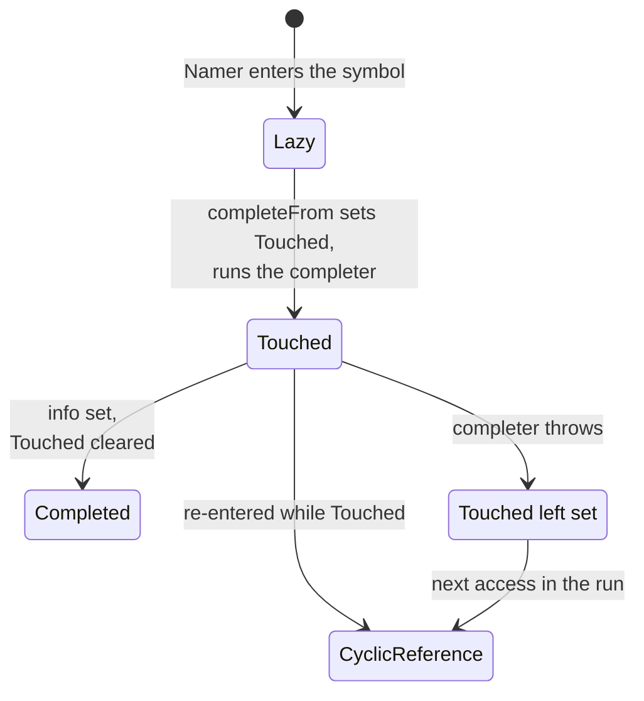
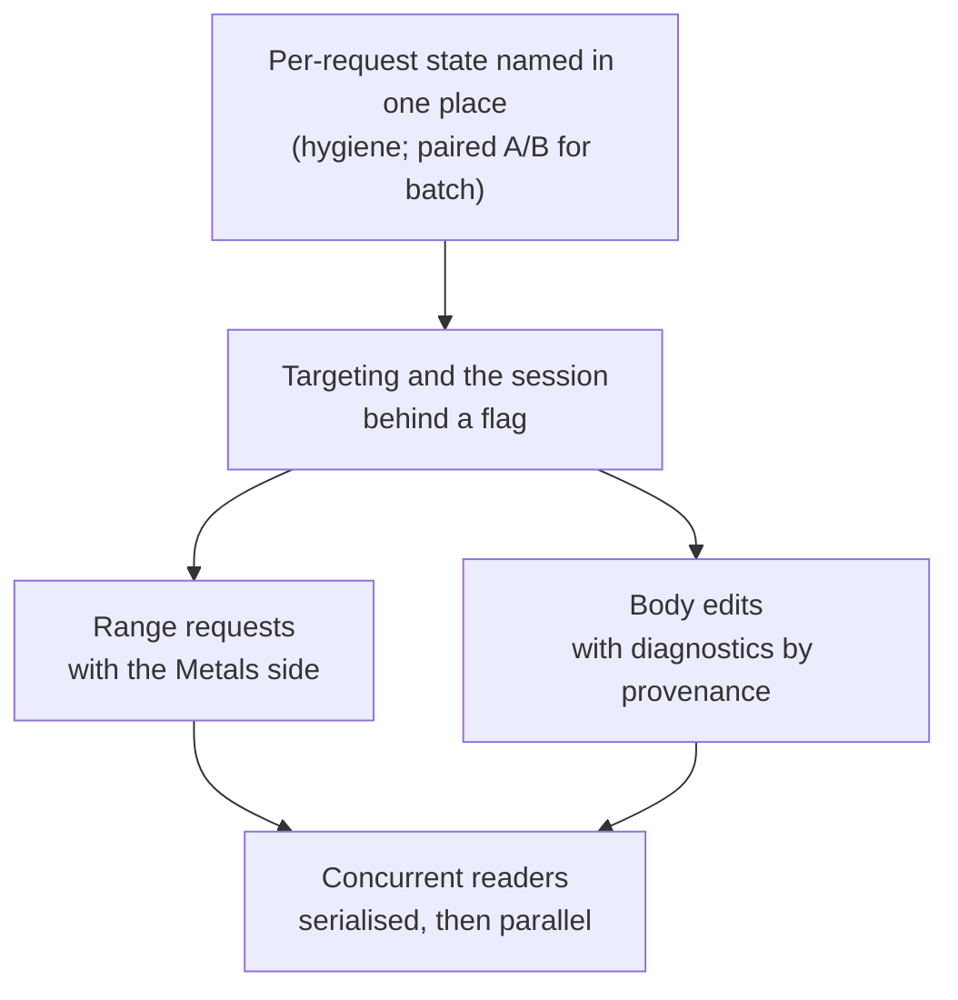

# A more interactive Scala 3: the tour

What a proof of concept showed about targeted, cancellable, incremental and concurrent typechecking in Scala 3's presentation compiler, and how it could land

**What this is:** a short version of [A more interactive Scala 3](../dotc-interactive/index.html), for people who want the concepts, the mechanisms, the tools and a landing order without the detail. The proof of concept is [retronym/scala3#84][PR]. It is evidence for what is feasible and what it costs, not a design to adopt as is; each slide says what was tried and what it showed.

---

## The problem

### 1. An editor's requirements of a compiler

- An answer to a hover or a completion in milliseconds, on a file that is being edited.
- Work nobody needs any more stopped as soon as the next keystroke arrives.
- Little work per edit, when most edits are inside one method body.
- Diagnostics and highlighting computed in the background without delaying the hover.

Scala 3's presentation compiler did one whole-file typecheck per request, on one thread, and could not stop it. The proof of concept asked how far that can change.

### 2. Editor latency is dominated by whole-file work

<figure class="fig anim">
<svg viewBox="0 0 720 200" role="img" aria-label="Share of queueing delay by what ran in between, four replays">
  <text x="0" y="14" class="h">waiting time, by what the jobs in between did</text>
  <text x="0" y="45" class="b">burst</text>
  <g class="a-grow-x" style="--d:.1s"><rect x="80" y="32" width="280" height="18" class="own"/><rect x="360" y="32" width="224" height="18" class="pub"/><rect x="584" y="32" width="17" height="18" class="wait"/><rect x="601" y="32" width="6" height="18" class="typed"/><rect x="607" y="32" width="11" height="18" class="skip"/></g>
  <text x="0" y="81" class="b">spread</text>
  <g class="a-grow-x" style="--d:.25s"><rect x="80" y="68" width="280" height="18" class="own"/><rect x="360" y="68" width="185" height="18" class="pub"/><rect x="545" y="68" width="28" height="18" class="wait"/><rect x="573" y="68" width="39" height="18" class="typed"/><rect x="612" y="68" width="6" height="18" class="skip"/></g>
  <text x="0" y="117" class="b">jars</text>
  <g class="a-grow-x" style="--d:.4s"><rect x="80" y="104" width="213" height="18" class="own"/><rect x="293" y="104" width="168" height="18" class="pub"/><rect x="461" y="104" width="84" height="18" class="wait"/><rect x="545" y="104" width="39" height="18" class="typed"/><rect x="584" y="104" width="17" height="18" class="skip"/></g>
  <text x="0" y="153" class="b">Metals</text>
  <g class="a-grow-x" style="--d:.55s"><rect x="80" y="140" width="258" height="18" class="own"/><rect x="338" y="140" width="196" height="18" class="pub"/><rect x="534" y="140" width="45" height="18" class="wait"/><rect x="579" y="140" width="34" height="18" class="typed"/><rect x="613" y="140" width="28" height="18" class="skip"/></g>
  <text x="90" y="46" class="a-in" style="--d:.9s">50%</text><text x="370" y="46" class="a-in" style="--d:.9s">40%</text>
  <text x="90" y="154" class="a-in" style="--d:.9s">46%</text><text x="348" y="154" class="a-in" style="--d:.9s">35%</text>
  <text x="80" y="188" class="m a-in" style="--d:1.1s">89–93% behind whole-file work; a hover behind a hover waits a frame</text>
</svg>

<i class="own"></i>a whole-file run<i class="pub"></i>a provider over a cached whole-file run<i class="wait"></i>completing the session<i class="typed"></i>targeted, fresh or resumed<i class="skip"></i>targeted, served

<figcaption>814 events of a recorded VS Code session on the compiler's own sources, replayed four ways ([readers §0][M]). Hover wait median 6–7 ms in the burst, jars and Metals replays, p90 142–533 ms; the hover's own driver time 0.1 ms.</figcaption>
</figure>

Measured before anything was built: in a recorded editing session, almost all of the waiting was behind whole-file work, not behind other targeted requests. That decided the order of everything after it ([full talk §42](../dotc-interactive/index.html#s42)).

### 3. Assumptions of the batch compiler

- One thread and one run; the symbol table outlives runs.
- Signatures are lazy: a completer computes one on first use, guarded by a one-bit `Touched` flag that was left set if the completer threw.
- Typing consumes the untyped tree, so a statement cannot be typed twice.

Each assumption breaks somewhere below ([full talk §1](../dotc-interactive/index.html#s1)–[full talk §3](../dotc-interactive/index.html#s3)).

---

## Techniques the proof of concept tried

### 4. Typing only the path to a request

<figure class="fig anim">
<svg viewBox="0 0 720 300" role="img" aria-label="A targeted run types the statements on the path to the request and records the others with their contexts">
  <text x="0" y="14" class="h">A.scala, 60 objects</text>
  <rect x="0" y="24" width="300" height="20" rx="4" class="typed a-in" style="--d:.3s"/><text x="8" y="38" class="mono">import scala.collection.mutable</text>
  <rect x="0" y="48" width="300" height="20" rx="4" class="skip a-in" style="--d:1.8s"/><text x="8" y="62" class="mono">object O1 { … }</text>
  <rect x="0" y="72" width="300" height="20" rx="4" class="skip a-in" style="--d:1.85s"/><text x="8" y="86" class="mono">object O2 { … }</text>
  <rect x="0" y="96" width="300" height="20" rx="4" class="skip a-in" style="--d:1.9s"/><text x="8" y="110" class="mono">…  object O9 { … }</text>
  <rect x="0" y="120" width="300" height="88" rx="4" class="typed a-in" style="--d:.7s"/><text x="8" y="134" class="mono">object O10 {</text>
  <rect x="16" y="142" width="276" height="20" rx="4" class="skip a-in" style="--d:1.95s"/><text x="24" y="156" class="mono">def method10(x: Int): Int = …</text>
  <rect x="16" y="166" width="276" height="20" rx="4" class="typed a-in" style="--d:1.1s"/><text x="24" y="180" class="mono">val r = method10(1).@@</text>
  <text x="8" y="202" class="mono">}</text>
  <rect x="0" y="212" width="300" height="20" rx="4" class="skip a-in" style="--d:2.0s"/><text x="8" y="226" class="mono">object O11 { … }</text>
  <rect x="0" y="236" width="300" height="20" rx="4" class="skip a-in" style="--d:2.05s"/><text x="8" y="250" class="mono">…  object O60 { … }</text>
  <circle cx="232" cy="176" r="5" class="f-own a-pop" style="--d:.1s"/>
  <path d="M 320 176 L 300 176" class="s-own a-in" style="--d:.2s"/>
  <text x="326" y="180" class="c-own b a-in" style="--d:.2s">target</text>
  <g class="a-in" style="--d:2.3s">
    <text x="390" y="62" class="b">skipped: recorded, not typed</text>
    <text x="390" y="80" class="mono">SkippedStat(stat, ctx, owner)</text>
    <text x="390" y="98" class="m">the untyped tree, the context it would</text>
    <text x="390" y="114" class="m">have been typed in, and its owner</text>
  </g>
  <g class="a-in" style="--d:2.7s">
    <text x="390" y="160" class="b">completion in object 10</text>
    <text x="390" y="180">before: 11 statements, 791 trees</text>
    <text x="390" y="198" class="c-typed b">after: 1 statement, 43 trees</text>
    <text x="390" y="222" class="m">400-object file: 2 top-level trees, not 22</text>
  </g>
</svg>

<i class="typed"></i>typed<i class="skip"></i>skipped, context recorded

<figcaption>The x-ray's 60-object file ([session][S] summary, [§2](../dotc-interactive/index.html#s2), [§3](../dotc-interactive/index.html#s3)).</figcaption>
</figure>

Options: the whole file (Scala 3 today), a prefix up to the target (Scala 2), or only the statements on the path. The PoC typed the path and recorded every skipped statement with the context it would have been typed in ([full talk §8](../dotc-interactive/index.html#s8)).

### 5. One run serving many requests

<figure class="fig anim">
<svg viewBox="0 0 720 230" role="img" aria-label="A skipped statement is typed in its recorded context and spliced into the typed tree">
  <text x="0" y="14" class="h">typed tree (tpdTree)</text>
  <rect x="0" y="24" width="250" height="24" rx="5" class="typed"/><text x="10" y="40" class="mono">PackageDef p</text>
  <rect x="20" y="54" width="230" height="22" rx="5" class="typed"/><text x="30" y="69" class="mono">Import …</text>
  <rect x="20" y="80" width="230" height="22" rx="5" class="typed"/><text x="30" y="95" class="mono">ModuleDef O10 (r typed)</text>
  <rect x="20" y="106" width="230" height="22" rx="5" class="typed a-pop" style="--d:2.2s"/><text x="30" y="121" class="mono a-in" style="--d:2.3s">ModuleDef O40</text>
  <text x="440" y="14" class="h">skipped statements</text>
  <rect x="440" y="24" width="200" height="22" rx="5" class="skip"/><text x="450" y="39" class="mono">O1 … O9, O11 … O39</text>
  <rect x="440" y="50" width="200" height="22" rx="5" class="skip a-out" style="--d:1.0s;--o:.15"/><text x="450" y="65" class="mono a-out" style="--d:1.0s;--o:.15">O40  (ctx, owner)</text>
  <rect x="440" y="76" width="200" height="22" rx="5" class="skip"/><text x="450" y="91" class="mono">O41 … O60</text>
  <circle cx="610" cy="61" r="5" class="f-own a-pop" style="--d:.2s"/>
  <text x="560" y="128" class="c-own a-in" style="--d:.3s">hover lands in O40</text>
  <g class="a-in" style="--d:.8s">
    <rect x="300" y="150" width="200" height="40" rx="6" class="own"/>
    <text x="400" y="166" text-anchor="middle" class="mono">typedStats(O40 :: Nil, owner)</text>
    <text x="400" y="182" text-anchor="middle" class="m">in its recorded context</text>
  </g>
  <path d="M 520 72 C 520 120, 470 140, 440 150" class="s-own a-draw" pathLength="1" style="--d:.6s"/>
  <path d="M 300 170 C 270 170, 270 117, 252 117" class="s-typed a-draw" pathLength="1" style="--d:1.7s"/>
  <text x="0" y="215" class="m a-in" style="--d:2.6s">the splice is a TreeMap that copies only the path to the owner; SetRootTree re-run; new skipped members join the list</text>
</svg>
<figcaption>Statements can be typed in any order: object 200 after object 10, then object 5 ([session §3][S]).</figcaption>
</figure>

A request on unchanged text is served from what is typed, or types one skipped statement in its recorded context and splices it in. What broke on the way: a statement whose typing was cancelled cannot be typed again (its untyped tree is consumed), and a skipped statement's completers refuse to run in a later run ([full talk §10](../dotc-interactive/index.html#s10), [full talk §11](../dotc-interactive/index.html#s11)).

### 6. Cancellation that reaches the typer

<figure class="fig anim">
<svg viewBox="0 0 720 360" role="img" aria-label="A cancellation unwinds the stack; each completeFrom frame clears Touched on its way out">
  <text x="0" y="14" class="h">the request's thread, innermost frame on top</text>
  <g class="a-pop" style="--d:.2s"><rect x="490" y="30" width="150" height="24" rx="12" class="bad"/><text x="565" y="46" text-anchor="middle" class="c-bad b">cancel(): flag set</text></g>
  <rect x="0" y="28" width="460" height="28" rx="5" class="bad a-out" style="--d:1.1s"/><text x="10" y="46" class="mono a-out" style="--d:1.1s">checkCancelledTyping  →  throw CancelledCompilation</text>
  <rect x="0" y="60" width="460" height="28" rx="5" class="box a-out" style="--d:1.4s"/><text x="10" y="78" class="mono a-out" style="--d:1.4s">Typer.typed(…)  inside B's body</text>
  <rect x="0" y="92" width="460" height="28" rx="5" class="own a-out" style="--d:1.7s"/><text x="10" y="110" class="mono a-out" style="--d:1.7s">completeFrom(B)</text>
  <g class="a-out" style="--d:1.7s;--o:0"><rect x="490" y="96" width="74" height="20" rx="10" class="own"/><text x="527" y="110" text-anchor="middle" class="c-own">Touched</text></g>
  <g class="a-pop" style="--d:1.9s"><rect x="490" y="96" width="128" height="20" rx="10" class="skip"/><text x="554" y="110" text-anchor="middle">B: LazyType again</text></g>
  <rect x="0" y="124" width="460" height="28" rx="5" class="box a-out" style="--d:2.0s"/><text x="10" y="142" class="mono a-out" style="--d:2.0s">Namer completer of A: types A's body ahead</text>
  <rect x="0" y="156" width="460" height="28" rx="5" class="own a-out" style="--d:2.3s"/><text x="10" y="174" class="mono a-out" style="--d:2.3s">completeFrom(A)</text>
  <g class="a-out" style="--d:2.3s;--o:0"><rect x="490" y="160" width="74" height="20" rx="10" class="own"/><text x="527" y="174" text-anchor="middle" class="c-own">Touched</text></g>
  <g class="a-pop" style="--d:2.5s"><rect x="490" y="160" width="128" height="20" rx="10" class="skip"/><text x="554" y="174" text-anchor="middle">A: LazyType again</text></g>
  <rect x="0" y="188" width="460" height="28" rx="5" class="box a-out" style="--d:2.6s"/><text x="10" y="206" class="mono a-out" style="--d:2.6s">typedStats(O59 :: Nil)  a resume</text>
  <g class="a-pop" style="--d:2.8s"><rect x="490" y="192" width="200" height="20" rx="10" class="skip"/><text x="590" y="206" text-anchor="middle">O59 re-parsed, skipped again</text></g>
  <rect x="0" y="220" width="460" height="28" rx="5" class="box a-out" style="--d:2.9s"/><text x="10" y="238" class="mono a-out" style="--d:2.9s">Run.compileSources</text>
  <rect x="0" y="252" width="460" height="28" rx="5" class="box a-out" style="--d:3.1s"/><text x="10" y="270" class="mono a-out" style="--d:3.1s">InteractiveDriver.runUpTo, CachingDriver.run</text>
  <rect x="0" y="284" width="460" height="28" rx="5" class="typed"/><text x="10" y="302" class="mono">CompilerAccess.withSharedCompiler</text>
  <g class="a-pop" style="--d:3.4s"><rect x="490" y="288" width="232" height="20" rx="10" class="typed"/><text x="606" y="302" text-anchor="middle" class="c-typed">answers the default, keeps the driver</text></g>
  <path d="M 462 42 C 482 42, 482 298, 462 298" class="s-bad a-draw" pathLength="1" style="--d:1.1s"/>
  <text x="0" y="340" class="m a-in" style="--d:3.6s">kept: every statement typed before the abort, the run's facts that completed, the aborted run's context (I14)</text>
</svg>
<figcaption>Each frame restores what it set on the way out: <code>completeFrom</code> clears <code>Touched</code>, a <code>LazyAnnotation</code> keeps its thunk, a <code>SymbolLoader</code> leaves its root loadable ([session §4][S]).</figcaption>
</figure>

Options: thread interrupts (consumed by the first check, swallowed by catch-alls), servicing requests inside the background check (Scala 2: every invariant must hold at every safepoint), or a sticky flag the typer polls and unwinds on. The PoC unwinds, each frame restoring what it set ([full talk §16](../dotc-interactive/index.html#s16)).

### 7. Keeping the run across an edit inside a body

<figure class="fig anim">
<svg viewBox="0 0 340 250" style="max-width:560px" role="img" aria-label="Source being edited: an edit inside area's body invalidates only that body, which is typed again when a request needs it">
  <text x="0" y="14" class="h">an edit inside a method body</text>
  <rect x="0" y="24" width="336" height="162" rx="6" class="editor"/>
  <rect x="8" y="28" width="96" height="20" rx="4" class="tab"/><text x="18" y="42" class="mono" style="font-size:10.5px">Shapes.scala</text>
  <text x="22" y="64" text-anchor="end" class="mono m">1</text>
  <rect x="27" y="50" width="4" height="19" rx="1" class="f-typed a-in" style="--d:.2s"/>
  <text x="22" y="85" text-anchor="end" class="mono m">2</text>
  <rect x="27" y="71" width="4" height="19" rx="1" class="f-typed a-in" style="--d:.2s"/>
  <text x="22" y="106" text-anchor="end" class="mono m">3</text>
  <rect x="27" y="92" width="4" height="19" rx="1" class="f-typed a-in" style="--d:.2s"/>
  <rect x="27" y="92" width="4" height="19" rx="1" class="f-bad a-in" style="--d:2.0s"/>
  <rect x="27" y="92" width="4" height="19" rx="1" class="f-typed a-in" style="--d:4.6s;--t:1.6s"/>
  <text x="22" y="127" text-anchor="end" class="mono m">4</text>
  <rect x="27" y="113" width="4" height="19" rx="1" class="f-typed a-in" style="--d:.2s"/>
  <text x="22" y="148" text-anchor="end" class="mono m">5</text>
  <rect x="27" y="134" width="4" height="19" rx="1" class="f-typed a-in" style="--d:.2s"/>
  <text x="22" y="169" text-anchor="end" class="mono m">6</text>
  <rect x="27" y="155" width="4" height="19" rx="1" class="f-typed a-in" style="--d:.2s"/>
  <text x="40" y="64" xml:space="preserve" style="white-space:pre" class="mono"><tspan class="tk">class</tspan> <tspan class="tt">Shapes</tspan>:</text>
  <text x="40" y="85" xml:space="preserve" style="white-space:pre" class="mono">  <tspan class="tk">def</tspan> area(s: <tspan class="tt">Shape</tspan>): <tspan class="tt">Double</tspan> =</text>
  <text x="40" y="106" xml:space="preserve" style="white-space:pre" class="mono">    s.width * s.height</text>
  <g class="a-slide" style="--dx:-26.5px;--d:1.0s"><rect x="212.1" y="95" width="1.5" height="14" class="f-ink a-blink" style="--d:.3s;--n:1"/></g>
  <text x="185.6" y="106" xml:space="preserve" class="mono a-in" style="white-space:pre;--d:1.00s"> </text>
  <text x="192.3" y="106" xml:space="preserve" class="mono a-in" style="white-space:pre;--d:1.18s">/</text>
  <text x="198.9" y="106" xml:space="preserve" class="mono a-in" style="white-space:pre;--d:1.36s"> </text>
  <text x="205.5" y="106" xml:space="preserve" class="mono a-in" style="white-space:pre;--d:1.54s"><tspan class="tn">2</tspan></text>
  <text x="40" y="127" xml:space="preserve" style="white-space:pre" class="mono">  <tspan class="tk">def</tspan> scale(s: <tspan class="tt">Shape</tspan>, k: <tspan class="tt">Int</tspan>): <tspan class="tt">Shape</tspan> =</text>
  <text x="40" y="148" xml:space="preserve" style="white-space:pre" class="mono">    <tspan class="tt">Shape</tspan>(s.width * k, s.height * k)</text>
  <text x="40" y="169" xml:space="preserve" style="white-space:pre" class="mono">  <tspan class="tk">val</tspan> unit: <tspan class="tt">Shape</tspan> = scale(<tspan class="tt">Shape</tspan>(<tspan class="tn">1</tspan>, <tspan class="tn">1</tspan>), <tspan class="tn">1</tspan>)</text>
  <g class="a-pop" style="--d:3.8s"><rect x="232" y="93" width="96" height="16" rx="8" class="own"/><text x="280" y="105" text-anchor="middle" class="c-own" style="font-size:10.5px">hover in area</text></g>
  <text x="0" y="206" class="a-in" style="--d:2.1s">only <tspan class="mono">area</tspan>'s body is invalidated; its</text>
  <text x="0" y="222" class="a-in" style="--d:2.1s">declared type, every other member and the run are kept</text>
  <text x="0" y="242" class="c-typed b a-in" style="--d:5.4s;--t:.8s">typed again when a request needs it</text>
</svg>

<i class="typed"></i>gutter: typed, kept<i class="bad"></i>gutter: invalidated

</figure>

<figure class="fig anim">
<svg viewBox="0 0 720 200" role="img" aria-label="The whole-file run after a keystroke, with and without body edits, median ms">
  <text x="0" y="14" class="h">whole-file run after a keystroke in a body, median ms</text>
  <text x="0" y="46" class="b">Types.scala</text>
  <rect x="150" y="32" width="478" height="16" rx="3" class="own a-grow-x" style="--d:.1s"/><text x="634" y="45" class="a-in" style="--d:.6s">382 (p90 607)</text>
  <rect x="150" y="52" width="7" height="16" rx="2" class="typed a-grow-x" style="--d:.3s"/><text x="163" y="65" class="c-typed b a-in" style="--d:.6s">5.9 (p90 25)</text>
  <text x="0" y="104" class="b">TypeComparer.scala</text>
  <rect x="150" y="90" width="181" height="16" rx="3" class="own a-grow-x" style="--d:.2s"/><text x="337" y="103" class="a-in" style="--d:.7s">145</text>
  <rect x="150" y="110" width="10" height="16" rx="2" class="typed a-grow-x" style="--d:.4s"/><text x="166" y="123" class="c-typed b a-in" style="--d:.7s">7.9</text>
  <text x="0" y="162" class="b">Contexts.scala</text>
  <rect x="150" y="148" width="40" height="16" rx="3" class="own a-grow-x" style="--d:.3s"/><text x="196" y="161" class="a-in" style="--d:.8s">32.1</text>
  <rect x="150" y="168" width="2" height="16" rx="1" class="typed a-grow-x" style="--d:.5s"/><text x="158" y="181" class="c-typed b a-in" style="--d:.8s">0.8</text>
</svg>

<i class="own"></i>flag off: the edit is a fresh run<i class="typed"></i><code>-Yinteractive-body-edits</code>

<figcaption>45 rounds per file: a digit added inside a method body, a hover elsewhere, then a whole-file run as document highlight or semantic tokens ask; first five rounds dropped ([session §12][S], Measured). The hover right after the edit is unchanged (31.5 / 32.4 ms on Types.scala): it pays the edit itself, mostly the shift.</figcaption>
</figure>

Options: a fresh run per edit, re-typing one body when its signature is unchanged (IntelliJ's block rule), or facts with revisions (Salsa). The PoC tried the second: re-parse, compare with the previous parse, shift every position, re-index one definition ([full talk §37](../dotc-interactive/index.html#s37), [full talk §39](../dotc-interactive/index.html#s39)).

### 8. Typing only the visible lines

<figure class="fig anim">
<svg viewBox="0 0 720 210" role="img" aria-label="A range target types the statements that touch the visible window and skips the rest">
  <text x="0" y="14" class="h">Types.scala, 7,000 lines</text>
  <rect x="0" y="24" width="40" height="176" rx="4" class="skip"/>
  <rect x="0" y="94" width="40" height="22" rx="2" class="own a-pop" style="--d:.2s"/>
  <text x="50" y="110" class="c-own b a-in" style="--d:.3s">the visible 60 lines</text>
  <g class="a-in" style="--d:.7s">
    <rect x="200" y="24" width="200" height="20" rx="4" class="skip"/><text x="208" y="38" class="mono">statements before</text>
    <rect x="200" y="86" width="200" height="20" rx="4" class="typed"/><text x="208" y="100" class="mono">touches the window</text>
    <rect x="200" y="110" width="200" height="20" rx="4" class="typed"/><text x="208" y="124" class="mono">touches the window</text>
    <rect x="200" y="172" width="200" height="20" rx="4" class="skip"/><text x="208" y="186" class="mono">statements after</text>
  </g>
  <g class="a-in" style="--d:1.2s">
    <text x="430" y="70" class="b">a 60-line window</text>
    <text x="430" y="90" class="c-typed b">637–969 trees, 26–38 ms</text>
    <text x="430" y="122" class="b">the whole file</text>
    <text x="430" y="142">41,123 trees, 307–328 ms</text>
    <text x="430" y="174" class="m">semantic tokens for the window</text>
    <text x="430" y="192" class="m">after the hints: 0–1 ms (vs 68–72 ms)</text>
  </g>
</svg>
<figcaption><code>Run.typingTarget</code> may be a range: at each statement list, a statement is typed if its span touches it ([session §7][S], Range requests).</figcaption>
</figure>

Inlay hints and semantic tokens over the visible range type a small fraction of the file. The compiler half works; the editor sees the benefit only once Metals asks for ranges instead of whole files ([full talk §40](../dotc-interactive/index.html#s40)).

### 9. A hover stays fast while another thread types the whole file

The editor needs the whole file typed for its diagnostics, and needs hovers answered meanwhile. In the PoC one thread typed all of `Types.scala` while another answered hovers.

<figure class="fig anim">
<svg viewBox="0 0 720 130" role="img" aria-label="Median hover: 141 ms with one lock for everything, 1.2 ms when a thread waits only for the signature it needs">
  <text x="0" y="14" class="h">median hover while the whole file is being typed, ms</text>
  <text x="0" y="48" class="b">one lock for everything</text>
  <rect x="230" y="34" width="423" height="20" rx="3" class="own a-grow-x" style="--d:.1s"/><text x="660" y="49" class="a-in" style="--d:.7s">141</text>
  <text x="0" y="98" class="b">wait only for the signature needed</text>
  <rect x="230" y="84" width="4" height="20" rx="2" class="typed a-grow-x" style="--d:.4s"/><text x="242" y="99" class="c-typed b a-in" style="--d:.8s">1.2, same diagnostics as a normal run</text>
</svg>
</figure>

Running requests on several threads helps an editor only when there is background work like this to run beside them ([full talk §44](../dotc-interactive/index.html#s44)).

---

## Lessons for sharing a symbol table

### 10. Classify the shared state before fixing any of it

<figure class="fig anim kinds">

kindtreatment

{chip:A scratch}

Per-request scratch

State one request uses while it runs and then throws away.

comparers, context pools, targeting slots, the cancel checker

→

Move to a per-thread <code>Reader</code>.

<a href="../dotc-interactive/index.html#s22b">§22b</a>

{chip:B lazy fact}

Lazy facts

Computed once, on first use, and marked in progress while that runs (a black hole).

completeFrom's Touched, InheritedCache.locked, symbol loaders

→

An owner and a barrier per root.

<a href="../dotc-interactive/index.html#s24">§24</a>

{chip:C cache}

Caches

Derived values kept to avoid recomputing them; any reader would compute the same value.

lastDenot and checkedPeriod, member and base-type caches

→

One published value, or an ordered stamp; concurrent maps.

<a href="../dotc-interactive/index.html#s30">§30</a>, <a href="../dotc-interactive/index.html#s29">§29</a>, <a href="../dotc-interactive/index.html#s30">§30</a>

{chip:D interning}

Interning and counters

One shared table so that equal types are one object; ids handed out in order.

Uniques, NamedTypeUniques, _nextSymId

→

A concurrent interner, an atomic counter.

<a href="../dotc-interactive/index.html#s22c">§22c</a>

{chip:E trees}

Trees

The file's syntax trees: typed into new trees, their attachments consumed on the way.

SymOfTree, TypedAhead, ExpandedTree, the session's splice

→

Skipped statements as facts, a persistent typed tree.

not built (step 5)

</figure>

Every fix that followed is one of these treatments. The classification was worth more than any single fix ([full talk §22](../dotc-interactive/index.html#s22)).

### 11. Choose concurrency per symbol table; keep the batch code as it was

<figure class="fig anim">
<svg viewBox="0 0 720 200" role="img" aria-label="Three instances of Sharing, chosen per ContextBase: Batch, Serialised, Parallel">
  <text x="0" y="14" class="h">final class Sharing(concurrent, parallel), one per ContextBase, never changed</text>
  <g class="a-in" style="--d:.1s"><rect x="0" y="30" width="226" height="150" rx="8" class="box"/>
    <text x="14" y="54" class="b">Sharing.Batch</text><text x="14" y="72" class="mono m">concurrent = false</text>
    <text x="14" y="98">one thread, no locking</text><text x="14" y="116">the batch compiler, the default</text>
    <text x="14" y="150" class="mono">lockAndComplete0</text></g>
  <g class="a-in" style="--d:.5s"><rect x="246" y="30" width="226" height="150" rx="8" class="own"/>
    <text x="260" y="54" class="b">Sharing.Serialised</text><text x="260" y="72" class="mono m">concurrent, not parallel</text>
    <text x="260" y="98">coarse-grained: one completion</text><text x="260" y="116">lock that read actions take too</text>
    <text x="260" y="150" class="mono">completeUnderGlobalLock</text><text x="260" y="168" class="m">step 3; interactive default</text></g>
  <g class="a-in" style="--d:.9s"><rect x="492" y="30" width="228" height="150" rx="8" class="typed"/>
    <text x="506" y="54" class="b">Sharing.Parallel</text><text x="506" y="72" class="mono m">concurrent and parallel</text>
    <text x="506" y="98">fine-grained: a claim per root,</text><text x="506" y="116">read actions in parallel</text>
    <text x="506" y="150" class="mono">completeUnderRootClaim</text><text x="506" y="168" class="m">step 4; -Yinteractive-parallel</text></g>
</svg>
</figure>

One seam decides, when a symbol table is made, whether readers are absent, serialised or parallel. Batch call sites compile to the original code and allocate nothing; the concurrent branches live elsewhere ([full talk §22a](../dotc-interactive/index.html#s22a)).

### 12. Claims: one thread completes a symbol, the others wait

<figure class="fig anim">
<svg viewBox="0 0 720 360" role="img" aria-label="R2 owns g; R1 owns f and waits on g's barrier; R2 publishes g; R1 completes f and answers">
  <defs><marker id="m34" viewBox="0 0 10 10" refX="9" refY="5" markerWidth="7" markerHeight="7" orient="auto-start-reverse"><path d="M0,0 L10,5 L0,10 z" class="f-mut"/></marker></defs>
  <text x="90" y="20" class="b" text-anchor="middle">R1 · hover on f</text><text x="290" y="20" class="b" text-anchor="middle">root f</text><text x="430" y="20" class="b" text-anchor="middle">root g</text><text x="630" y="20" class="b" text-anchor="middle">R2 · completion</text>
  <line x1="90" y1="30" x2="90" y2="340" class="ln"/><line x1="290" y1="30" x2="290" y2="340" class="ln"/><line x1="430" y1="30" x2="430" y2="340" class="ln"/><line x1="630" y1="30" x2="630" y2="340" class="ln"/>
  <rect x="250" y="34" width="80" height="56" rx="4" class="skip"/><text x="290" y="66" text-anchor="middle" class="m">idle</text>
  <rect x="390" y="34" width="80" height="26" rx="4" class="skip"/><text x="430" y="51" text-anchor="middle" class="m">idle</text>
  <rect x="390" y="60" width="80" height="110" rx="4" class="own a-grow-d" style="--d:.31s"/><text x="430" y="104" text-anchor="middle" class="b a-in" style="--d:.5s">InProgress</text><text x="430" y="120" text-anchor="middle" class="a-in" style="--d:.5s">owner R2</text>
  <rect x="570" y="60" width="120" height="110" rx="4" class="own a-grow-d" style="--d:.31s"/><text x="580" y="80" class="a-in" style="--d:.5s">runs g's completer</text><text x="580" y="96" class="m a-in" style="--d:.5s">own TyperState</text>
  <path d="M 568 64 L 474 64" class="mut a-in" style="--d:.31s" marker-end="url(#m34)"/><text x="520" y="58" text-anchor="middle" class="m a-in" style="--d:.31s">acquire</text>
  <rect x="250" y="90" width="80" height="160" rx="4" class="own a-grow-d" style="--d:.78s"/><text x="290" y="160" text-anchor="middle" class="b a-in" style="--d:1s">InProgress</text><text x="290" y="176" text-anchor="middle" class="a-in" style="--d:1s">owner R1</text>
  <rect x="30" y="90" width="120" height="40" rx="4" class="own a-grow-d" style="--d:.78s"/><text x="40" y="108" class="a-in" style="--d:.9s">types f's body</text><text x="40" y="122" class="m a-in" style="--d:.9s">ahead</text>
  <path d="M 152 94 L 246 94" class="mut a-in" style="--d:.78s" marker-end="url(#m34)"/><text x="200" y="88" text-anchor="middle" class="m a-in" style="--d:.78s">acquire</text>
  <path d="M 152 134 L 386 134" class="s-wait a-draw" pathLength="1" style="--d:1.4s"/><text x="200" y="128" text-anchor="middle" class="c-wait a-in" style="--d:1.4s">needs g</text>
  <g class="a-in" style="--d:1.5s"><rect x="30" y="130" width="120" height="40" rx="4" class="wait a-blink" style="--d:1.7s"/></g><text x="40" y="148" class="a-in" style="--d:1.5s">waits on g's</text><text x="40" y="162" class="a-in" style="--d:1.5s">barrier</text>
  <text x="200" y="152" text-anchor="middle" class="m a-in" style="--d:1.5s">no cycle</text>
  <rect x="390" y="170" width="80" height="160" rx="4" class="typed a-grow-d" style="--d:2s"/><text x="430" y="200" text-anchor="middle" class="b a-in" style="--d:2.1s">Done</text><text x="430" y="216" text-anchor="middle" class="mono a-in" style="--d:2.1s">T_g</text>
  <path d="M 388 178 L 154 178" class="s-pub a-draw" pathLength="1" style="--d:2s"/><text x="200" y="192" text-anchor="middle" class="c-pub a-in" style="--d:2.1s">latch opens</text>
  <rect x="570" y="170" width="120" height="30" rx="4" class="typed a-grow-d" style="--d:2s"/><text x="580" y="190" class="a-in" style="--d:2.1s">publishes, goes on</text>
  <rect x="30" y="182" width="120" height="66" rx="4" class="own a-grow-d" style="--d:2.2s"/><text x="40" y="200" class="a-in" style="--d:2.3s">reads g.info,</text><text x="40" y="216" class="a-in" style="--d:2.3s">finishes f</text>
  <rect x="250" y="250" width="80" height="80" rx="4" class="typed a-grow-d" style="--d:3.26s"/><text x="290" y="280" text-anchor="middle" class="b a-in" style="--d:3.35s">Done</text><text x="290" y="296" text-anchor="middle" class="mono a-in" style="--d:3.35s">T_f</text>
  <rect x="30" y="256" width="120" height="30" rx="4" class="typed a-grow-d" style="--d:3.41s"/><text x="40" y="276" class="a-in" style="--d:3.5s">answers the hover</text>
  <line x1="20" y1="40" x2="700" y2="40" class="mut dash a-sweep" style="--ty:296px;--t:4.6s"/>
</svg>
<figcaption>Rule 2 is the barrier: nobody but the owner sees <code>f</code> or <code>g</code> half-completed. Rule 3: whoever completes <code>g</code> writes the same <code>T_g</code> ([readers §3.1][M]).</figcaption>
</figure>

One lock around every completion is correct and serialises most of a reader's time. A claim per root lets readers run in parallel: the owner alone sees the completion in progress, others wait at the barrier, and a cancelled owner hands over. K2 moved the same way, from a global resolve lock to per-declaration locks ([full talk §23](../dotc-interactive/index.html#s23), [full talk §24](../dotc-interactive/index.html#s24), [full talk §34](../dotc-interactive/index.html#s34)).

### 13. Hazards and their patterns

| pattern | hazard | `Batch` | `Serialised` | `Parallel` |
|---|---|---|---|---|
| coarse lock | completions racing each other | the original code | one completion lock (`exclusive`, `serialised`)  | – |
| claim and barrier | a completion's intermediate state seen by others ([§24](../dotc-interactive/index.html#s24)) | the original code  | – | a claim per root (`exclusive`, `claimed`) |
| wait, don't peek | acting on another reader's work in progress ([§27](../dotc-interactive/index.html#s27))  | – | wait on the lock, look again | `awaitOtherReader` |
| a chosen victim | readers waiting on each other ([§28](../dotc-interactive/index.html#s28))  | –  | – | `CompletionRoots.backOff` |
| one published value | a cache in several fields ([§29](../dotc-interactive/index.html#s29)) | plain fields | packed value, publish once | packed value, publish once |
| ordered stamp | a value and its stamp ([§30](../dotc-interactive/index.html#s30)) | plain stores | `Caching.stamped` with fences | `Caching.stamped` with fences |
| private typer state | type variables crossing readers ([§31](../dotc-interactive/index.html#s31)) | the original code | commit under the lock (`endState`) | settle and drop (`privately`, `endState`) |
| concurrent structures | shared maps and interners | plain | synchronised, lock-free hits (`newEqHashMap`, `newUniques`) | the same |

These hold beyond this code: anything that shares lazily computed state between readers meets them ([full talk §32](../dotc-interactive/index.html#s32)).

### 14. Publishing caches safely

| | how | correct when | cost |
|---|---|---|---|
| packed value | one immutable object in one `@volatile` field, built in a local, stored once | always | an allocation per store |
| seqlock (`StampedLock`'s optimistic read) | the writer makes a version odd, writes the fields, makes it even with release; a reader rereads the version after its reads and retries if it changed | always | writers exclude each other; every read rereads and may retry |
| release and acquire on a last field | the fields stored plainly, one designated field last with release; readers load it first with acquire | every writer in a period stores the same values | a fence per read on ARM, no allocation |

Within one run every writer of a stamped cache computes the same value, so the cheapest form suffices there; caches whose writers disagree need a packed value ([full talk §29a](../dotc-interactive/index.html#s29a), [full talk §30](../dotc-interactive/index.html#s30)).

---

## Testing and measurement

### 15. The x-ray harness

<figure class="fig anim">
<svg viewBox="0 0 720 380" role="img" aria-label="A background pass claims and types one skipped statement at a time; hovers on another reader are served, wait for the claimed statement, or claim one the pass has not reached">
  <defs><marker id="m36" viewBox="0 0 10 10" refX="9" refY="5" markerWidth="7" markerHeight="7" orient="auto-start-reverse"><path d="M0,0 L10,5 L0,10 z" class="f-mut"/></marker></defs>
  <text x="100" y="20" class="b" text-anchor="middle">R1 · background pass</text><text x="360" y="20" class="b" text-anchor="middle">skipped statements</text><text x="620" y="20" class="b" text-anchor="middle">R2 · hovers</text>
  <line x1="100" y1="30" x2="100" y2="360" class="ln"/><line x1="620" y1="30" x2="620" y2="360" class="ln"/>
  <rect x="300" y="36" width="120" height="22" rx="4" class="skip"/><text x="360" y="51" text-anchor="middle" class="mono">s1 … s4</text>
  <rect x="30" y="60" width="140" height="60" rx="4" class="own a-grow-d" style="--d:.3s"/><text x="40" y="80" class="a-in" style="--d:.4s">visible lines first</text><text x="40" y="96" class="m a-in" style="--d:.4s">a range target</text>
  <rect x="300" y="122" width="120" height="22" rx="4" class="own a-pop" style="--d:1.1s"/><text x="360" y="137" text-anchor="middle" class="mono a-in" style="--d:1.1s">s1 claimed by R1</text>
  <rect x="30" y="122" width="140" height="56" rx="4" class="own a-grow-d" style="--d:1.1s"/><text x="40" y="142" class="a-in" style="--d:1.2s">types s1</text>
  <circle cx="620" cy="80" r="6" class="f-typed a-pop" style="--d:.5s"/><text x="608" y="84" text-anchor="end" class="a-in" style="--d:.5s">served, 1 ms</text>
  <circle cx="620" cy="104" r="6" class="f-typed a-pop" style="--d:.8s"/><text x="608" y="108" text-anchor="end" class="a-in" style="--d:.8s">served</text>
  <circle cx="620" cy="128" r="6" class="f-typed a-pop" style="--d:1.1s"/><text x="608" y="132" text-anchor="end" class="a-in" style="--d:1.1s">served</text>
  <path d="M 548 156 L 424 140" class="s-wait a-draw" pathLength="1" style="--d:1.45s"/><text x="490" y="166" text-anchor="middle" class="c-wait a-in" style="--d:1.45s">lands in s1</text>
  <g class="a-in" style="--d:1.5s"><rect x="560" y="152" width="120" height="26" rx="4" class="wait a-blink" style="--d:1.6s;--n:2"/></g><text x="570" y="169" class="a-in" style="--d:1.5s">waits for s1</text>
  <rect x="300" y="180" width="120" height="22" rx="4" class="typed a-pop" style="--d:2s"/><text x="360" y="195" text-anchor="middle" class="mono a-in" style="--d:2s">s1 spliced</text>
  <path d="M 424 191 L 556 186" class="s-pub a-draw" pathLength="1" style="--d:2s"/>
  <circle cx="620" cy="196" r="6" class="f-typed a-pop" style="--d:2.1s"/><text x="608" y="200" text-anchor="end" class="a-in" style="--d:2.1s">answered</text>
  <rect x="300" y="210" width="120" height="22" rx="4" class="own a-pop" style="--d:2.3s"/><text x="360" y="225" text-anchor="middle" class="mono a-in" style="--d:2.3s">s2 claimed by R1</text>
  <rect x="30" y="210" width="140" height="56" rx="4" class="own a-grow-d" style="--d:2.3s"/><text x="40" y="230" class="a-in" style="--d:2.4s">types s2</text>
  <rect x="300" y="240" width="120" height="22" rx="4" class="own a-pop" style="--d:2.7s"/><text x="360" y="255" text-anchor="middle" class="mono a-in" style="--d:2.7s">s4 claimed by R2</text>
  <rect x="560" y="240" width="120" height="40" rx="4" class="own a-grow-d" style="--d:2.7s"/><text x="570" y="258" class="a-in" style="--d:2.8s">types s4 itself</text><text x="570" y="272" class="m a-in" style="--d:2.8s">a resume</text>
  <rect x="300" y="270" width="120" height="22" rx="4" class="typed a-pop" style="--d:3.1s"/><text x="360" y="285" text-anchor="middle" class="mono a-in" style="--d:3.1s">s2, s4 spliced</text>
  <rect x="30" y="296" width="140" height="40" rx="4" class="own a-grow-d" style="--d:3.4s"/><text x="40" y="314" class="a-in" style="--d:3.5s">types s3; s4 is</text><text x="40" y="328" class="m a-in" style="--d:3.5s">already typed</text>
  <circle cx="620" cy="300" r="6" class="f-typed a-pop" style="--d:3.4s"/><text x="608" y="304" text-anchor="end" class="a-in" style="--d:3.4s">served</text>
  <circle cx="620" cy="324" r="6" class="f-typed a-pop" style="--d:3.7s"/><text x="608" y="328" text-anchor="end" class="a-in" style="--d:3.7s">served</text>
  <line x1="20" y1="40" x2="700" y2="40" class="mut dash a-sweep" style="--ty:310px;--t:4.4s"/>
</svg>
<figcaption>The x-ray's background pass. On a quiet machine with <code>-Yinteractive-parallel</code>, the pass types <code>Types.scala</code> in 560–850 ms with 27–53 hovers served beside it at about 1 ms median; serialised, 3–6 hovers at 17–490 ms median. Its diagnostics equal a whole-file run's ([readers §8][M] step 4).</figcaption>
</figure>

The x-ray drives the driver directly: a background pass beside hovers, a recorded editor session replayed against each build, a throughput demo over the compiler's own sources. Its main value was exposing mistakes in the PoC itself: a whole-file run that left no session (I58), the wrong compiler options, a server that outlived its build ([full talk §36](../dotc-interactive/index.html#s36), [full talk §45](../dotc-interactive/index.html#s45)).

### 16. Finding races

| layer | what it checks | found |
|---|---|---|
| Lincheck on `Caching` | the stamped cell from several threads against every sequential order ([§30a](../dotc-interactive/index.html#s30a)) | the helper's ordering |
| two-reader soak and oracle suites | random walks of requests, cancellations and edits on one driver, every answer equal to a whole-file run's | I34–I47 ([§23](../dotc-interactive/index.html#s23)) |
| the k=8 race-hunt loop | `Throughput -Dtp.loop`: 484 files, per-file diagnostics diffed against a single-reader run, the claim log around each divergence | I70–I81 ([§29](../dotc-interactive/index.html#s29)) |
| one-pattern soaks | `ShownSoak` (conversions to `Shown`, written out longhand as well), `ExtensionParamsSuite`, `LazyRefRunSpliceSuite`, `DriverThreadLocalLeakSuite` | I78, I79, I84, I86, I83 |
| lints | `StampedCachesTest`: a stamp in `core` only through `Caching` | keeps [§30](../dotc-interactive/index.html#s30) true |

Every answer is compared with a single-reader whole-file run; a divergence is a race until shown otherwise ([full talk §33](../dotc-interactive/index.html#s33)).

### 17. Batch compilation: no measurable cost

| corpus | build | ms/op, median of 5 rounds | Δ | instructions/op | Δ |
|---|---|---|---|---|---|
| dottyUtil | base | 140.9 | | 1.900G | |
| dottyUtil | step 2 (the `Reader`) | 141.4 | +0.4% | 1.895G | −0.3% |
| dottyUtil | step 3 (structures per base, lock, publication) | 141.3 | +0.3% | 1.919G | +1.0% |
| re2s | base | 240.4 | | 4.793G | |
| re2s | step 2 | 237.5 | −1.2% | 4.711G | −1.7% |
| re2s | step 3 | 237.6 | −1.2% | 4.744G | −1.0% |

Nothing above about 2 percent, which is the spread between rounds of one build. Resolving below that needs the costs behind a switch, so that paired variants run in one process ([full talk §47](../dotc-interactive/index.html#s47)).

---

## A landing order

### 18. Fixes that need no flag

| | stock compiler or Metals |
|---|---|
| I50 | after a request timeout, mtags' queue reset leaves the old executor's backlog running beside the new queue on one driver (`denotation … invalid in run`); the presentation-compiler side holds the driver's monitor per job, the mtags side needs an issue |
| I15 | an empty completion prefix bypasses `CachingDriver`, so the commonest member completion never benefits from it |
| I10 | the 16-bit run id is unguarded; a long-lived driver overflows it into the phase bits |
| I11, cancellation | `isCancelled` consumes the interrupt bit and nothing in the typer polls it, so Metals' token cancels the future, not the work; the sticky flag and the typer checkpoints are separable from targeting ([§14](../dotc-interactive/index.html#s14)) |
| I49 | after a stock reproduction: a scaladoc comment cooked under a discarded typer state is cached without its warning |
| the `Reader` | kind A out of `ContextBase` and `Run`: hygiene the batch compiler could take with a paired A/B, since it names every piece of per-request state in one place |

Each has a test and is independent of the PoC's flags ([full talk §62](../dotc-interactive/index.html#s62)).

### 19. Increments, each useful on its own

An order to discuss, not a plan. Each step is flag-gated and can stop without the next. Concurrent readers come last because the measurements say they pay off only once whole-file work is no longer what the editor waits for (slide 2).

### 20. Open problems and comparable designs

- **Open in the PoC:** Namer completions that can run again (two readers completing in opposite orders still raise a cycle no sequential order has); facts that outlive a run, which snapshot readers across an edit would need; the shared state a sweep listed and no test has hit yet.
- **Designs to weigh it against:** Kotlin K2's lazy resolve and analysis sessions, IntelliJ's read and write actions, Roslyn's immutable compilations, Salsa's revisions and cancellation ([full talk §48](../dotc-interactive/index.html#s48)–[full talk §51](../dotc-interactive/index.html#s51)).

[PR]: https://github.com/retronym/scala3/pull/84
[PR68]: https://github.com/retronym/scala3/pull/68
[S]: https://github.com/retronym/scala3/blob/claude/mr-code-813f14/docs/_docs/internals/interactive-session.md
[M]: https://github.com/retronym/scala3/blob/claude/mr-code-813f14/docs/_docs/internals/interactive-multi-reader.md
[TI]: https://github.com/retronym/jvm-lang-models/blob/main/packages/scala/docs/track-i.md
[TC]: https://github.com/retronym/jvm-lang-models/blob/main/packages/scala/docs/track-i-concurrent.md
[11328]: https://github.com/scala/scala/pull/11328
[periods]: https://github.com/scala/scala3/blob/main/docs/_docs/internals/periods.md
[sharing]: https://github.com/retronym/scala3/blob/fc37c6b7ca/compiler/src/dotty/tools/dotc/core/Sharing.scala
[marlowbook]: https://www.oreilly.com/library/view/parallel-and-concurrent/9781449335939/ch01.html
[pike]: https://go.dev/blog/waza-talk
[kt200]: https://github.com/JetBrains/kotlin/blob/v2.0.0/ChangeLog.md
[caching]: https://github.com/retronym/scala3/blob/fc37c6b7ca/compiler/src/dotty/tools/dotc/core/Caching.scala
[lincheck]: https://github.com/JetBrains/lincheck
[lincheckTest]: https://github.com/retronym/scala3/blob/fc37c6b7ca/compiler/test/dotty/tools/dotc/core/CachingLincheckTest.scala
[llfir]: https://github.com/JetBrains/kotlin/blob/master/analysis/low-level-api-fir/README.md
[firstate]: https://github.com/JetBrains/kotlin/blob/master/compiler/fir/tree/src/org/jetbrains/kotlin/fir/declarations/FirResolveState.kt
[lllock]: https://github.com/JetBrains/kotlin/blob/master/analysis/low-level-api-fir/src/org/jetbrains/kotlin/analysis/low/level/api/fir/file/builder/LLFirLockProvider.kt
[kafund]: https://kotlin.github.io/analysis-api/fundamentals.html
[katoken]: https://github.com/JetBrains/kotlin/blob/master/analysis/analysis-api/src/org/jetbrains/kotlin/analysis/api/lifetime/KaLifetimeToken.kt
[ijthread]: https://plugins.jetbrains.com/docs/intellij/threading-model.html
[ijcancel]: https://plugins.jetbrains.com/docs/intellij/background-processes.html#handling-cancellation
[ijpsi]: https://plugins.jetbrains.com/docs/intellij/psi-performance.html
[ijrm]: https://github.com/JetBrains/intellij-community/blob/master/platform/util/src/com/intellij/openapi/util/RecursionManager.java
[roscomp]: https://learn.microsoft.com/en-us/dotnet/api/microsoft.codeanalysis.compilation
[rosscs]: https://github.com/dotnet/roslyn/blob/main/src/Compilers/CSharp/Portable/Symbols/SymbolCompletionState.cs
[lippert]: https://learn.microsoft.com/en-us/archive/blogs/ericlippert/persistence-facades-and-roslyns-red-green-trees
[rosconc]: https://learn.microsoft.com/en-us/dotnet/api/microsoft.codeanalysis.compilationoptions.concurrentbuild
[raarch]: https://rust-analyzer.github.io/book/contributing/architecture.html
[salsart]: https://salsa-rs.github.io/salsa/plumbing/database_and_runtime.html
[salsacyc]: https://salsa-rs.github.io/salsa/plumbing/cycles.html
[marlow01]: https://doi.org/10.1145/378795.378858
[harris05]: https://doi.org/10.1145/1088348.1088354
[stg]: https://doi.org/10.1017/S0956796800000319
[bsalc]: https://doi.org/10.1145/3236774
[bsalc2]: https://doi.org/10.1017/S0956796820000088
[compctl]: https://www.scala-lang.org/api/2.13.2/scala-compiler/scala/tools/nsc/interactive/CompilerControl.html
[scideppc]: https://github.com/scala-ide/docs/blob/master/src/sphinx/dev/architecture/presentation-compiler.rst
[cadb]: https://www.youtube.com/watch?v=WxyyJyB_Ssc
[martres17]: https://doi.org/10.1145/3136000.3136012
[martres17v]: https://www.youtube.com/watch?v=1Nk5EL94uJc
[petrcg]: https://doi.org/10.1145/2983990.2983991
[miniph]: https://doi.org/10.1145/3062341.3062346
[petrth]: https://doi.org/10.5075/epfl-thesis-7979
[metack]: https://github.com/scalameta/metals/blob/main/docs/acknowledgements/development.md
[pc17528]: https://github.com/scala/scala3/pull/17528
[nh]: https://www.scala-sbt.org/1.x/docs/Understanding-Recompilation.html
[sbtcred]: https://www.scala-sbt.org/1.x/docs/Credits.html
