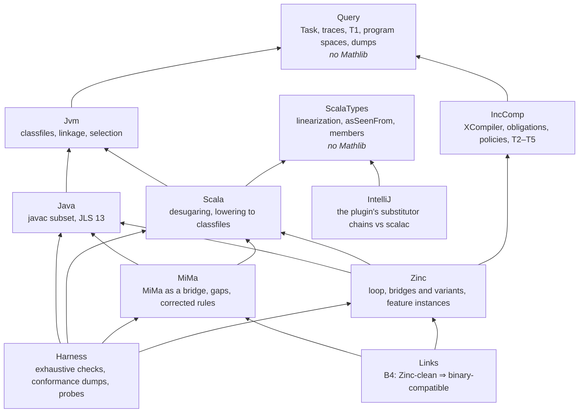

# A repository for the models: JVM, Java, Scala, incremental compilation, Zinc, MiMa, IntelliJ

Status: proposal for review. Nothing is moved yet.

## Problem

The Lean model started on 8 October as a check of one Zinc design and lives in `talks/zinc-incrementality/lean/`. Four days later it is about 27,000 lines, with layers for the JVM, Java, Scala and MiMa beside the Zinc work. A second, smaller model of `asSeenFrom` for IntelliJ lives in `retronym/scala-type-system-tck/lean/` and shares a vendored copy of `Scala/AsSeenFrom.lean`. Keeping all of this inside a talks repository causes four problems:

- **No home for the general parts.** `Jvm`, `Java` and `Scala` are not about Zinc, but they import `Zinc.Task` because that is where the query-tree core happens to live. A reader looking for "a model of JVM linkage" will not look in a talk directory.
- **No reuse without copying.** The TCK vendors `AsSeenFrom.lean` and can drift from it. Any other consumer (a compiler's test suite, another IDE) would have to do the same, and would pull in Mathlib to get a file that does not need it.
- **One build for everything.** One lakefile builds all libraries; `BinCompat.Sound` takes about half an hour and sits outside the default targets by hand.
- **Talks and model change at different speeds.** The talks cite file names and line numbers. Twice in a week a talk cited Lean names that a refactor had deleted.

## Key decisions

1. **One repository, several Lake packages.** Each package has its own lakefile, its own dependencies and its own CI job. A root workspace builds them together. Packages that do not need Mathlib do not depend on it, so the TCK, or a compiler's test suite, can `require` them cheaply by `git … subDir`.
2. **Layers with one direction of import.** Core semantics (the JVM, Java, Scala) never import a consumer (Zinc, MiMa, IntelliJ). A theorem that connects two consumers, such as B4 (Zinc-clean implies binary-compatible), lives in a package of its own that imports both.
3. **The query tree is the core, not part of Zinc.** `Task`, its trace and T1 move to a Mathlib-free package. `Task.lean` imports `Mathlib.Data.Finset.Basic` today but does not use it.
4. **Incremental compilation in general is separate from Zinc.** The framework (`XCompiler`, the obligations, policies, T2–T5, non-local hashes, files) says nothing specific to Zinc. Zinc, its bridges and its variants (Scala 2's bridge, Scala 3's, the Merkle PoC, bridge-side hashing) are instances of it. Other build tools can become instances later.
5. **Calibration travels with its layer.** Each layer's probes (HotSpot, javac, scalac, MiMa, Zinc's conformance harness) live next to the layer they calibrate, with the numbers they produced.
6. **History is kept.** Move `zinc-incrementality/lean/` with `git filter-repo --subdirectory-filter`, and merge in the TCK's `lean/` history the same way, so `git blame` still explains each decision.
7. **The talks pin a commit.** Talk notes cite `repo@sha:file:line`, and a check in the talks repo verifies that every cited Lean name exists at the pinned commit.

## Proposed layout

| package | what it answers | from today | lines today | Mathlib |
|---|---|---|---|---|
| `Query` | what a computation that asks questions is, and why recording its trace is enough (T1) | `Zinc/Task.lean`, the dump helpers | ~90 | no |
| `Jvm` | when a classfile links against a library, and to which method | `Jvm/` | 1,370 | today `List.dedup` only; aim for no |
| `Java` | what javac emits for a Java subset; JLS chapter 13 | `Java/` | 1,147 | no |
| `ScalaTypes` | types, `asSeenFrom`, and later linearization and membership, as scalac computes them | `Scala/AsSeenFrom`, `Syntax`; `Members` once it no longer imports `Lower` | ~430 | no |
| `Scala` | what scalac and dotc emit for a Scala subset | the rest of `Scala/` | ~1,800 | no |
| `IncComp` | when an incremental build equals a clean one, for any compiler and policy | `Task` aside, `Model`, `General`, `Soundness`, `Uniqueness`, `Termination`, `Tree`, `NonLocal*`, `Stale`, `Files`, `PingPong`, `Cycles` | ~3,200 | yes |
| `Zinc` | Zinc's loop, its bridges, its variants, and each Scala and Java feature as an instance | the rest of `Zinc/`, `ZincNames/` | ~16,200 | yes |
| `MiMa` | which library edits MiMa reports, which it misses, and corrected rules | `BinCompat/` except the Zinc bridge files | ~960 | yes |
| `IntelliJ` | when the plugin's substitutor chains agree with scalac's `asSeenFrom` | the TCK's `lean/AsSeenFrom/` | ~840 | no |
| `Links` | theorems that connect consumers (B4) | `BinCompat/ZincBridge*.lean` | ~770 | yes |
| `Harness` | executables that enumerate spaces, write dumps, and compare with real tools; the probes | root `*.lean`, `probes/`, `scripts/` | ~1,300 Lean, plus Python, Java, Scala | as needed |

Inside `Zinc`, the instances group by what the reader is looking for, not by phase number: `Zinc.Loop` (the policies, `transitiveStep`, subprojects, classpath, pipelining), `Zinc.Bridges` (Scala 2 as seen from, Scala 3 as declared, Merkle, bridge-side hashing), and `Zinc.Features` (names, implicits and givens, erasure, inline and opaque types, macros, annotations, SAM, Java, sealed, companions). The phase numbers stay in the documents as history.

Each package carries the same files: a `README.md` (the question it answers, its key definitions and theorems, its calibration, its gaps), the Lean, its probes if it has a real tool, and a `docs/` folder for its PLAN and track notes. The cross-cutting documents (`BUG-MAP.md`, the catalogues, `DESIGN-spec.md`, the reviews) go to the root `docs/`.

**Repository name.** Something that does not say Zinc or Scala alone. Candidates: `retronym/jvm-lang-models`, `retronym/build-semantics`, `retronym/models`. My recommendation is `jvm-lang-models`: it names the platform that ties the layers together and leaves room for Kotlin or Bazel later.

## Supporting changes

- **Break the `Jvm → Zinc` edge.** `Jvm`, `Java` and `Scala` import `Zinc.Task` today; they import `Query.Task` after the move.
- **Merge the two `asSeenFrom` models.** The TCK's `Port.lean` already proves its `Scalac.asf` is the shared map (`asf_eq`). After the move, the TCK's Lean becomes the `IntelliJ` package on top of `ScalaTypes`, and the TCK repo `require`s it instead of vendoring.
- **Split the slow targets.** `MiMa.Sound` and the whole-space `native_decide` examples get their own CI job and are not default targets.
- **Per-package trust checks.** The `native_decide` lint and the `#print axioms` list run per package; each package README reports its own counts.
- **A name check for documents.** A script resolves every backticked Lean name in the docs and in the talks against the built environment and fails on a dangling one. It would have caught both stale citations of the last week.

## Migration

Each step builds and keeps the talks' links working.

- TODO 1. Create the repository from `zinc-incrementality/lean/` with history (`git filter-repo`). Keep one package for now. CI as today.
- TODO 2. Extract `Query`, remove the Mathlib import from `Task`, and point `Jvm`, `Java`, `Scala` at it.
- TODO 3. Split `ScalaTypes` out of `Scala`: `AsSeenFrom` and `Syntax` move as they are; `Members` imports `Lower` today, so its membership core has to be separated from lowering first. Both packages are already Mathlib-free once `Query` is.
- TODO 4. Split `IncComp` from `Zinc`. This is the largest step: `Compiler`, `TCompiler`, `GCompiler` and `NCompiler` still define their own loops (central review, finding 1's residue), so first move the general theorems, then retire the per-variant loops.
- TODO 5. Split `MiMa` and `Links` out of `BinCompat`.
- TODO 6. Bring in the TCK's `lean/` with its history as `IntelliJ`; switch the TCK repo to `require` it; delete the vendored copy.
- TODO 7. Move `probes/` and `scripts/` into `Harness` and the per-package folders; move documents to `docs/`.
- TODO 8. In the talks repo: replace `zinc-incrementality/lean/` with a README that points to the new repository, pin a commit in each talk, add the name check.

`zinc-lean/lean/` (the primer, and the V1 and V2 snapshots) stays in the talks repo: it is slide material, frozen on purpose.

## Future directions

### Verifying the compilers and the JVM

Full verification of javac, scalac or HotSpot is out of reach and is not the useful goal. Three cheaper things are, in order of value:

1. **Translation validation at scale.** The probes already check that the model's lowering agrees with scalac on about 1,350 programs per version, and its linkage with HotSpot on 58,400. The next step is to run the same comparison on real code: lower each class of a real build in the model, compare with the classfiles the compiler produced, and treat every disagreement as either a model bug or a compiler bug. That is what `IncBench --verify` did for Zinc on Spark's catalyst, one layer down.
2. **Check the bridge, not the compiler.** The obligations are about what the compiler *records*, so the compiler need not be verified to check them. Log the queries a real compiler run makes (lookups, misses included), and check the bridge's recorded keys against the log with `coverage` as the oracle. This finds a missing key before anyone writes a test, and it is the one check the model cannot do on its own. retronym/zinc#54 does a version of it against keys the model predicts.
3. **Specify the parts compilers share.** JLS chapter 13 (binary compatibility) is already stated in `Java/Jls13.lean`. The same can be done for the parts of SLS that the TCK's `SPEC-GAPS.md` finds underspecified (`asSeenFrom`, base type sequences), with scalac as the reference. These become tests that both scalac and dotc, and IntelliJ, must pass.

### A model of bytecode

Today `Jvm` models linkage (resolution, selection, access) but runs no code (ROADMAP Track J4). The next layer, in increasing cost:

- **Method bodies as call sites.** A method is a list of the sites it invokes and the fields it reads. That is enough to judge MiMa's 17 unjudged `ReversedMissingMethodProblem` reports and nestmate changes, and it needs no operand stack.
- **Constants and inlining.** Folded constants and inlined bodies at the client: what scalac's `@inline` and dotc's `inline` put into a client's bytecode, which Zinc must treat as API.
- **The verifier.** Type-checking bytecode against its `StackMapTable`: the step where a stale classfile becomes a `VerifyError` rather than a `NoSuchMethodError`. Existing formalisations to borrow from: Jinja and JinjaThreads (Isabelle), Bicolano (Coq), the ACL2 JVM models (M1–M6). None is in Lean.
- **An importer, not a parser.** Read real classfiles with the JDK's Classfile API (`java.lang.classfile`) in a probe and emit the model's JSON, as `probes/jvm` already does for its cases. A classfile parser in Lean is not needed for any of the questions above.

### Other directions

- **Other incremental compilers as instances of `IncComp`.** Kotlin's IC (ABI snapshots and a lookup tracker), Bazel's ABI jars, Gradle's Java incremental compilation. Each is a choice of keys and a policy; the obligations say which are sound.
- **Precision as a theorem.** A framework-level definition of necessary invalidation, so that designs can be compared by theorem rather than per instance (central review, finding 4).
- **The Zinc instances on the shared Scala semantics.** `Hier`, `Erasure`, `Flat` and `ImplicitScope` each carry their own toy Scala. Ported onto `ScalaTypes` and `Scala`, they and `MiMa` would reason about one language.
- **Scala 3 from TASTy.** Feed real TASTy into the model (through an importer, as above) to calibrate `ScalaTypes` against dotc as the TCK does against scalac.
- **IntelliJ beyond `asSeenFrom`.** Conformance and base type sequences, the other TCK dimensions, each with its runtime checks in the plugin.

## Presenting a large model

A 27,000-line model is read by people who arrive with a question: a bug they hit, a feature they are adding, a tool they maintain. The presentation should route them to the 300 lines that answer it.

- **Start from the reader's question.** The root README has a "start here, by goal" section (understand the theory, add a feature, test Zinc, binary compatibility). Keep it, and add one entry per package: "I maintain javac / scalac / MiMa / the IntelliJ plugin".
- **One card per package.** Each package README has the same five parts: the question it answers; at most five definitions and five theorems, each with a one-line statement in prose and its hypotheses; what it is calibrated against and how many programs agree; known gaps; where to start reading.
- **Enter from a known bug.** `BUG-MAP.md` already maps 145 real bugs to the part of the model that expresses them. Make it the index: a reader who knows sbt/zinc#1796 finds `ExtraHash.lean` and the theorem stating its fix.
- **One template for every instance.** Every feature instance has the same shape: the compiler's algorithm as a task, today's bridge as keys, the bug as a witness, the fix as keys with the obligations proved. Document the shape once, with `Sam.lean` as the worked example, and a reader who has read one instance can read all of them.
- **Statements before proofs.** Put each file's definitions and theorem statements first and the proofs after, or in a separate `Proofs` module, so the statements read as a specification. Lean has no signature files; a `Spec` module per package that re-states the key theorems with `#check` and a doc comment does the same job.
- **Generated, not hand-maintained, numbers.** Sizes, theorem and example counts per facet, calibration counts, the axioms report and the `native_decide` lint run in CI and write one status page. Hand-written numbers went stale within days twice this week.
- **API docs plus a narrative.** doc-gen4 for every declaration, with an import-graph diagram generated from the source. For the five or six central files, a literate rendering that shows the goal states (Verso, or LeanInk with Alectryon), as the talks' screenshots do by hand.
- **Small Scala next to every definition.** Each instance's doc comment opens with the Scala program it models and the edit that breaks it. Most readers know the Scala and not the Lean.
- **Shared vocabulary.** One glossary (query, trace, key, covers, hash, up to date, run, clean), the same one the talks use.
- **The talks as the narrative layer.** `zinc-incrementality` (the problem), `zinc-lean` (the model), `zinc-testing` (how it was checked), linked from the root README, each pinned to a commit.

## Open questions

1. Repository name.
2. Public from the start, or private until the IncComp split is done?
3. Lean and Mathlib versions: pin per package, or one toolchain for the workspace? One toolchain is simpler; per-package pins only matter once outsiders depend on a package.
4. Should `Query` be proposed somewhere more general, for example as a small library alongside other build-system formalisations, or stay internal?
5. Keep the phase numbers in file names and docs, or retire them now that features are grouped by topic?
