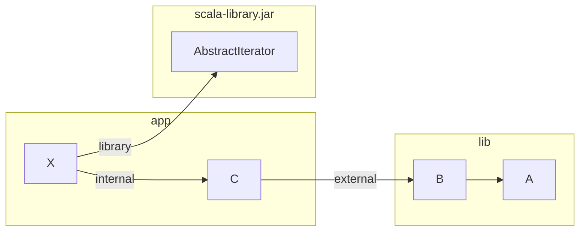
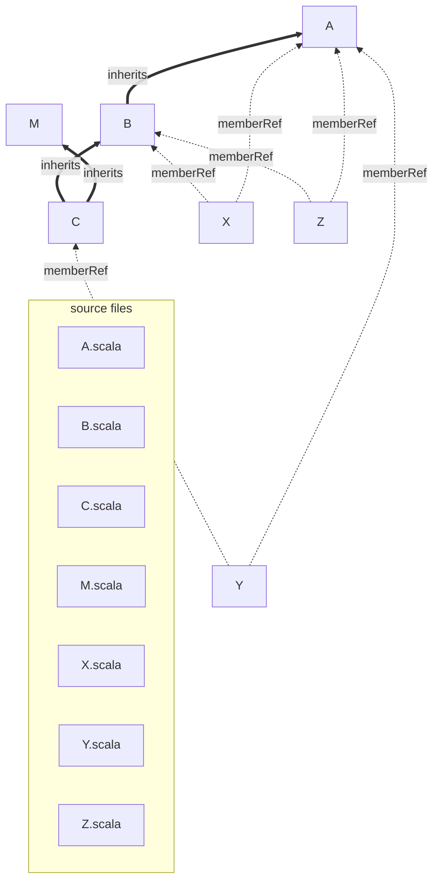
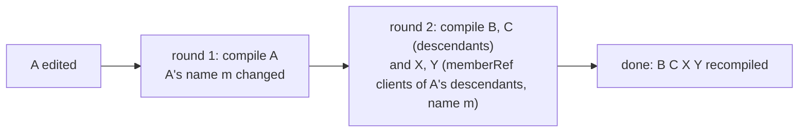
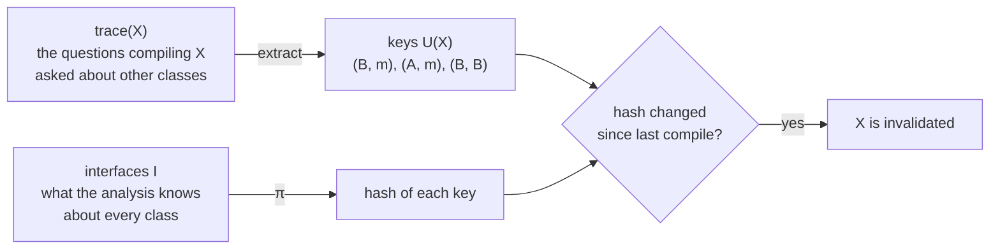
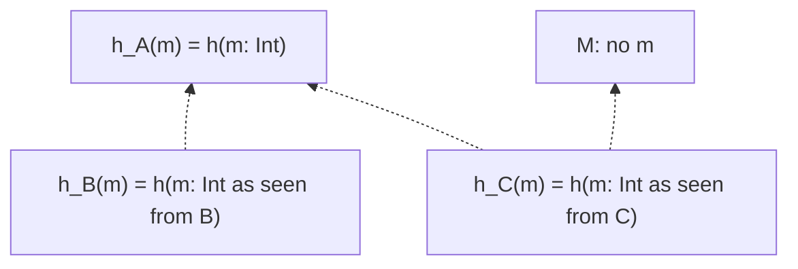
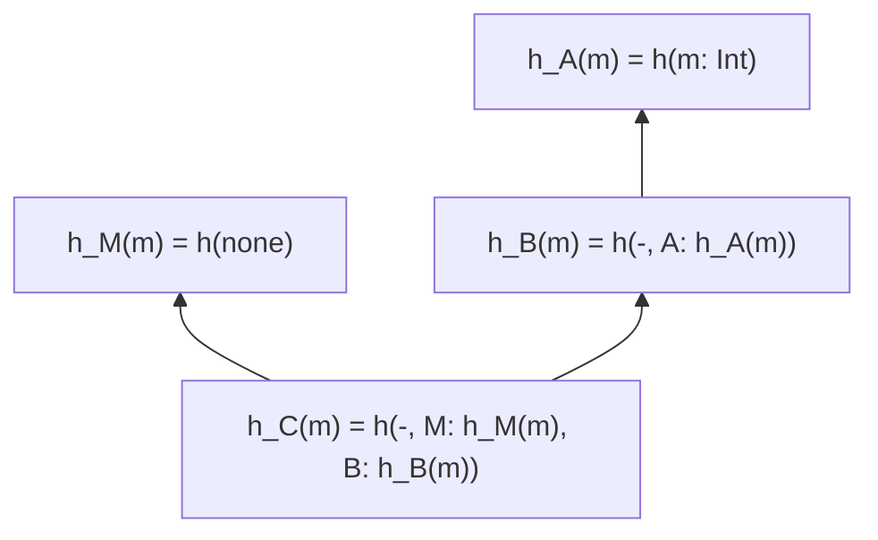
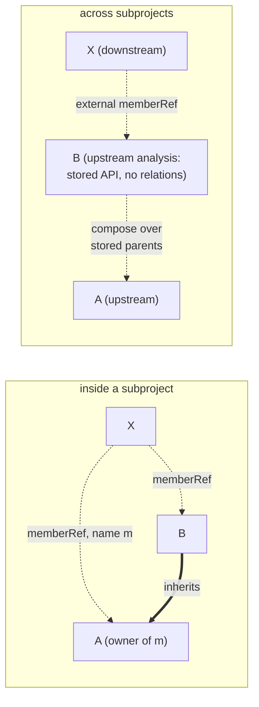
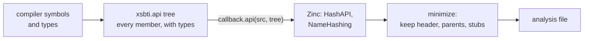
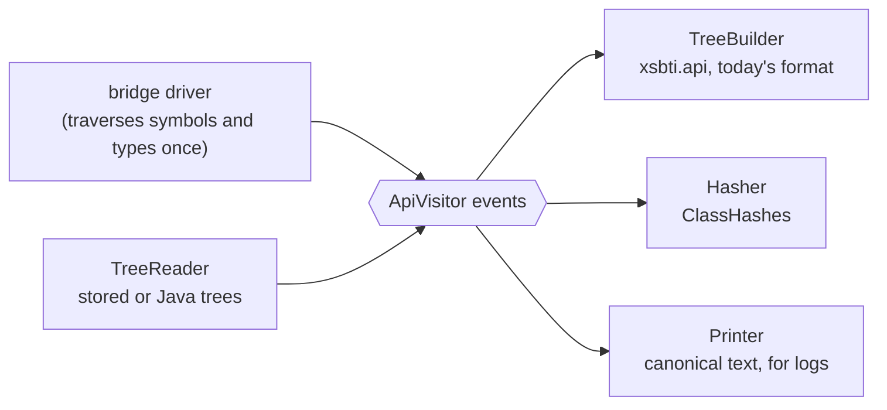

# Merkle hashing and in-bridge hashing in Zinc

**Status:** first draft, for review with [`PLAN.md`](PLAN.md). Each card is one slide (a few are split with `<!-- break -->`). The small grey block under a slide holds speaker notes, sources and the time budget; it is not meant to be shown. A chip under each heading says what the slide describes: <span class="chip today">status quo</span> Zinc and the compilers as released, <span class="chip poc">PoC</span> the proof of concept, <span class="chip model">model</span> the Lean model, <span class="chip proposal">proposal, not built</span>. A slide with none introduces a concept. The analysis listings (§3–§5, §11–§12) are written by hand from the code of `develop` and the PoC; [`PLAN.md`](PLAN.md) step D1 replaces them with listings printed from real analysis files.

**Audience:** Scala tooling people: compiler, build-tool and IDE maintainers. They know Zinc as users, some of its internals, and what a name hash is. They need not have seen the companion talks.

**Thesis:** Zinc's analysis file stores, for every class, every member it inherits, as hashes. That is a choice, not a requirement. The Lean model states what any hashing scheme must satisfy, and two changes that satisfy it remove most of the cost: Merkle hashing stores each class's own declarations and composes the rest, and in-bridge hashing computes the hashes in the compiler instead of building a tree for Zinc to hash and discard.

**Companion talks:** `zinc-incrementality` (Zinc's design; §7–§11 are the long form of Parts I and III here), `zinc-lean` (the model; §12, §17, §18 are the long form of Part II), `zinc-testing` (how the PoC was tested).

**Code:** the PoC is [retronym/zinc#24](https://github.com/retronym/zinc/pull/24) (draft, Scala 2 bridge in Zinc), with the cross-module work in [#30](https://github.com/retronym/zinc/pull/30) and the Scala 3 compiler side in [retronym/scala3#5](https://github.com/retronym/scala3/pull/5). `integration/merkle` in retronym/zinc combines them (`zinc-incrementality/integration/`). **Lean model:** [retronym/jvm-lang-models](https://github.com/retronym/jvm-lang-models) at `4faa126ffd12acc1e45ac41c636751b26b863949`.

<!-- break -->

**Contents (~40 min):**

| part | sections | min |
|---|---|---|
| I. What the analysis stores | §1 the contract · §1a three kinds of reference · §2 sources, classes and edges · §3 a notation for the analysis · §4 the running example today · §5 an edit, today · §6 the cost at scale · §6a what this talk proposes | 12 |
| II. What we are free to change | §7 traces, keys, hashes and invalidation · §8 the obligations · §9 what is free and what is fixed · §10 two consequences | 7 |
| III. Merkle hashing | §11 how a name's hash is computed, today and with Merkle · §12 the running example under Merkle · §13 inside and across subprojects · §14 descendants read their ancestors · §15 where it is more precise, and where not | 11 |
| IV. In-bridge hashing | §16 a tree built to be hashed and discarded · §17 the obligation is about equality only · §18 three steps and what they saved · §19 library ancestors · §20 one traversal, several outputs · §20a the three designs side by side | 9 |
| V. Measurements | §21 results so far · §22 what is measured next | 4 |
| Close | §23 status and next steps | 1 |

The total is ~44 min; §1a's second card and §20a can move to the notes if time is short.

---

## Part I — What the analysis stores

### 1. An incremental build must equal a clean build

- Zinc compiles the sources that changed, then asks which other classes could compile differently because of what changed, and compiles those, until nothing more is invalidated. Each of these compiles is a *round*.
- It decides this by comparing hashes stored in the *analysis file* from the previous compile with the hashes the new compile produced.
- So the analysis file determines both what Zinc can detect and what each compile costs: it is written on every compile and read on every compile.
- This talk is about what goes into that file, and what we may change about it.

<div class="fn">

Notes: 1 min. The contract is §1 of every companion talk; one slide here.

</div>

### 1a. Three kinds of reference

<p class="kind"><span class="chip today">status quo</span></p>

A build is split into **subprojects** (sbt projects, Mill modules), each compiled by its own Zinc run into its own output directory, with its own analysis file. A class can refer to three kinds of class. Below, `app` and `lib` are subprojects, `app` depends on `lib`, and both have the Scala library on their classpath:



| kind | what Zinc records | how a change is found | what is invalidated | when |
|---|---|---|---|---|
| **internal**: same subproject | class → class edges (`memberRef.internal`, `inheritance.internal`) and used names | the hashes of the classes just compiled, against their previous hashes | clients filtered by changed name; every descendant, and its clients | after every round, until nothing changes |
| **external**: another subproject of the build | class → upstream class name (`memberRef.external`, …), and a copy of each upstream class's stored API as last seen (`apis.external`) | that copy, against the upstream analysis as it is now | clients filtered by changed name; every descendant in this subproject, and its clients | once, before the first round |
| **library**: a jar or the JDK | source → jar or classfile (`libraryDep`) | the jar's or classfile's stamp | every source that depends on it, unfiltered | once, before the first round |

<div class="fn">

Notes: 2 min. Zinc's own words are internal, external and library (or binary). `IncrementalCommon.detectInitialChanges` finds all three kinds of initial change; `invalidateInitial` turns external API changes into invalidations (`invalidateClassesExternally`: name-filtered `memberRef.external` clients, plus every class in this subproject that inherits from the upstream class, directly or transitively, and the name-filtered clients of each) and library changes into sources (`usesLibrary`); only internal changes feed later rounds. The upstream analysis is read through `Lookup.lookupAnalyzedClass`; sbt also has a fast path, `ExternalLookup`, that can skip it. With pipelining, downstream compiles against upstream's early output (pickles), but the order of the Zinc runs is the same.

</div>

<!-- break -->

**Why the three are treated differently.**

| difference | inherent, pragmatic or historical |
|---|---|
| No rounds across subprojects: a downstream change never recompiles upstream | **Inherent.** Subprojects form an acyclic graph and are compiled in order; upstream's outputs are finished before downstream starts, and nothing downstream can change them. |
| Downstream sees upstream's stored API, but not its relations | **Pragmatic.** Each analysis is written only by its own subproject's run, and downstream needs to know *what* changed upstream, not why. The cost: downstream cannot find which upstream classes inherit from a changed upstream class, because those inheritance edges are in upstream's relations. So a change to upstream `A` reaches a downstream client of `B` only if `B`'s own stored API changes too. Today it does, because upstream recompiles `B` and stores `A`'s members in it again (§5); §13 shows what replaces that. |
| A library has a stamp, not an API | **Partly inherent:** there is no compiler run that sees its source, so an API would have to be read back from classfiles. **Mostly pragmatic:** libraries change rarely, so recompiling every user on a change is acceptable. |
| The same program recompiles differently laid out as one subproject or as two | **Historical.** Inside a subproject Zinc can follow relations from every class it recompiled, round after round; across, it starts once from what changed in upstream's stored API. When an ancestor's companion gained an implicit, the first layout was clean and the second missed a client, until [sbt/zinc#1845](https://github.com/sbt/zinc/pull/1845). The model treats the layout as a policy on one loop (`zinc-lean` §19). |

<div class="fn">

Notes: included in the 2 min. The point to carry into Part III: the three kinds differ in what the downstream side can *see*, and the hashing scheme has to work with what is visible at each boundary. Whether a class is internal or external is a build-layout decision; nothing in the language distinguishes them.

</div>

### 2. Sources, classes, and the edges between them

<p class="kind"><span class="chip today">status quo</span></p>

```scala
// A.scala
abstract class A[T] { def m: Int = 0; def g: Int = 0 }
// B.scala
class B extends A[Int]
// M.scala, C.scala
trait M
class C extends B with M
// X.scala, Y.scala, Z.scala
object X { def f(b: B) = b.m }   // client of B.m
object Y { def f(c: C) = c.m }   // client of C.m
object Z { def f(b: B) = b.g }   // client of B.g
```



- All seven classes are in one subproject, so every edge is internal (§1a).
- Each source defines classes; each class gets an entry in the analysis.
- Zinc records two kinds of edge between classes: **inheritance** (the extends clause) and **memberRef** (anything else: a type mentioned, a member selected).
- A client of `b.m` records a memberRef edge to `B`, the type it selected through, *and* to `A`, the owner of `m`. The second edge matters again in §13.
- Each class also records its **used names**: `X` used `B` and `m`.

<div class="fn">

Notes: 1.5 min. This is the program of `zinc-incrementality` §10a and of [`Hier.lean`](https://github.com/retronym/jvm-lang-models/blob/4faa126ffd12acc1e45ac41c636751b26b863949/packages/zinc/Zinc/Bridges/Hier.lean), and the PoC's scripted test `merkle-member-type`. The owner edge comes from `ExtractDependencies`, which records a memberRef on the owner of every selected member. Edges to library classes (`Int`, `AnyRef`) are recorded too, as library dependencies; omitted here.

</div>

### 3. A notation for the analysis file

<p class="kind"><span class="chip today">status quo</span></p>

The analysis file is protobuf, or optionally text. This talk prints it in a notation with one block per source and per class:

```zan
source B.scala                     -- stamps: content hash of the source
  defines B                        -- relations.classes
  products B.class                 -- relations.srcProd

class B                            -- apis.internal(B): an AnalyzedClass
  header    class B[]              -- name, kind, access, modifiers, type parameters
  parents   A[Int], AnyRef, Any    -- structure.parents: the linearization, as seen from B
  decls     -                      -- declarations kept in the stored API
  api       #B                     -- apiHash: one hash of the whole class
  names     B   h(header of B)     -- nameHashes: one hash per (name, scope)
            m   h(m: Int)
            g   h(g: Int)
            +22 platform names     -- toString, equals, ... from AnyRef and Any
  inherits  A                      -- relations.inheritance.internal
  memberRef A                      -- relations.memberRef.internal
  uses      A, Int                 -- relations.names: the class's used names
```

- `h(…)` is the hash of what is written inside it. Hashes are opaque; only equality between two compiles matters.
- In a diff between two compiles, a line starting `~` has a changed hash, `+` is added and `-` removed.
- Left out: library dependencies, product stamps, compile setup, source infos. They do not change between the designs in this talk.

<div class="fn">

Notes: 1.5 min. Field names are those of `xsbti.api.AnalyzedClass` (`apiHash`, `nameHashes`, `extraHash`, `api`) and `sbt.internal.inc.Relations` (`classes`, `srcProd`, `inheritance`, `memberRef`, `names`). `extraHash` equals `apiHash` except for traits, where it adds private fields and super accessors; it is omitted until §14. `header` is a name for the parts of `ClassLike` that minimization keeps. [`PLAN.md`](PLAN.md) D1: a small tool, `zan`, that reads a real analysis file and prints this notation, so every listing in the talk can be regenerated.

</div>

### 4. The running example, as Zinc stores it today

<p class="kind"><span class="chip today">status quo</span></p>

```zan
class A
  header    abstract class A[T]
  parents   AnyRef, Any
  decls     -
  names     A   h(header of A)
            m   h(m: Int)
            g   h(g: Int)
            +22 platform names

class B
  parents   A[Int], AnyRef, Any
  decls     -
  names     B   h(header of B)
            m   h(m: Int)          -- copied from A, as seen from B
            g   h(g: Int)          -- copied from A, as seen from B
            +22 platform names
  inherits  A

class C
  parents   M, B, A[Int], AnyRef, Any
  decls     -
  names     C   h(header of C)
            m   h(m: Int)          -- copied from A, as seen from C
            g   h(g: Int)          -- copied from A, as seen from C
            +22 platform names
  inherits  B, M

object X
  names     X   h(header of X)
            f   h(f(b: B): Int)
            +22 platform names
  memberRef B, A
  uses      B, m, Int
```

- **No member is stored, only its hash.** `APIUtil.minimize` drops every member from the stored API (except `main` methods, for discovery). The members are kept only as name hashes.
- **Every inherited member is hashed again in every descendant**, as seen from that descendant, and the hash is computed when *that descendant* is compiled.
- The hierarchy's whole API is in the file once per class that inherits it.

<div class="fn">

Notes: 1.5 min. Scala 2's `ExtractAPI.mkStructureWithInherited`: `inherited` = `nonPrivateMembers` minus decls, each rendered with `memberInfo` (as seen from the class). Scala 3 renders inherited members as declared (`zinc-incrementality` §7); the storage is the same. Since 2009 (Harrah, [42c5d47b](https://github.com/scala/scala/commit/42c5d47b99f6d4ed215957d784934c3580c36968)). The platform count is illustrative; D1 prints the real one.

</div>

### 5. An edit, today: `A.m: Int` becomes `A.m: String`

<p class="kind"><span class="chip today">status quo</span></p>

```zan
class A
~ names     m   h(m: String)

class B                            -- still says m: Int until B is recompiled
  names     m   h(m: Int)

class C
  names     m   h(m: Int)
```



- `B` and `C` are recompiled although their bytecode cannot change: neither declares, overrides or calls `m`. They are recompiled to recompute their stored hashes.
- `X` and `Y` must recompile: their `m` changed type. `Z` uses only `g` and stays.
- Zinc does not need `B`'s new hash to find `X`. `X` has a memberRef edge to `A`, the owner of `m`, and used the name `m`, so the change to `A` invalidates `X` directly. Zinc also invalidates, for each descendant of `A`, its memberRef clients that use a changed name; this is *invalidation by inheritance*. `B`'s and `C`'s refreshed hashes are then compared, and the comparison finds no client that is not already invalidated.

<div class="fn">

Notes: 1.5 min. `merkle-member-type` pins this on the PoC's baseline commit: `B C X Y` in two rounds. Invalidation by inheritance is in `invalidateClassesInternally` (`invalidateByInheritance`, then the memberRef clients of every descendant, filtered by the ancestor's changed names; `zinc-incrementality` §9).

</div>

### 6. The cost at scale

<p class="kind"><span class="chip today">status quo</span></p>

Spark 4.0.1, `sql/catalyst`: 2,527 classes in one module. `TreeNode` has 261 descendants, `Expression` 257.

| edit | classes recompiled | rounds | wall |
|---|---|---|---|
| `TreeNode`: body only | 10 | 1 | 0.8 s |
| `TreeNode`: add a member nobody uses | 1,371 | 3 | 14.4 s |
| `Expression`: add a member nobody uses | 1,200 | 3 | 10.7 s |
| clean build, warm | 2,527 | 1 | 11.4 s |

- Adding a member nobody uses to `TreeNode` costs more than a clean build of the module.
- Of the 212,389 name hashes in catalyst's analysis, 118,343 (56%) are members inherited from classes in the same module. They are a quarter of the file on disk.
- Every compile also builds the `xsbti.api` tree these hashes are computed from: in catalyst's clean build, 1,093 MB allocated in the `xsbt-api` phase, against 1,250 MB for the typer.

<div class="status">

<span class="chip bench">benchmark on real code</span>

</div>

<div class="fn">

Notes: 1.5 min. IncBench, `--build/--edits` mode, pipelining off, one repetition; A side of the table in `zinc-incrementality` §10. Allocation from `-Yprofile-enabled`, mean of 2 warm clean builds (PLAN-merkle-poc.md, "Extraction cost"). The 56% figure is from [retronym/zinc#30](https://github.com/retronym/zinc/pull/30).

</div>

### 6a. What this talk proposes

<p class="kind"><span class="chip poc">PoC</span></p>

Two changes, built as a proof of concept:

1. **Merkle hashing** (Part III). A class's entry in the analysis stores its own declarations. A descendant's hash for a name is composed from its ancestors' hashes, by Zinc, without compiling the descendant. A descendant is recompiled only when its own compilation reads the change.
2. **In-bridge hashing** (Part IV). The compiler bridge computes the hashes from compiler types and sends Zinc the hashes and a small summary of the class, instead of an `xsbti.api` tree for Zinc to hash.

- Scala 2: both changes in Zinc and its compiler bridge. Scala 3: the same changes in the compiler's `ExtractAPI` and `sbt-bridge`. Java sources are out of scope.
- It passes Zinc's scripted suite, 74 Merkle-specific scripted tests and 11 that pin its recompiled sets beside today's. Everything is a draft in forks; nothing is proposed upstream yet.
- Part II first says why changing what Zinc stores is allowed at all.

<div class="fn">

Notes: 1 min. [retronym/zinc#24](https://github.com/retronym/zinc/pull/24) (Scala 2), [#30](https://github.com/retronym/zinc/pull/30) (cross-module), [#70](https://github.com/retronym/zinc/pull/70) (precision tests), [retronym/scala3#5](https://github.com/retronym/scala3/pull/5) (Scala 3 compiler side); `integration/merkle` combines the Zinc side.

</div>

---

## Part II — What we are free to change

### 7. Traces, keys, hashes and invalidation

<p class="kind"><span class="chip model">model</span></p>



- A **query** is one question a compilation asks about another class: "what is the type of `B`'s member `m`?".
- A **key** is what Zinc records instead of the query: a class and a name.
- **π** maps the analysis and a key to a hash.
- A class is **invalidated** when one of its keys' hashes changed.

| model | Zinc |
|---|---|
| `keys d tr`, written U(d) | memberRef edges plus used names |
| `π I c k` | `nameHashes` of class `c`, entry `k` |
| `covers q k` | the key `(A, m)` covers "what is `A.m`?" |
| `hashDeps I c` | which classes' interfaces `π I c _` reads |

<div class="fn">

Notes: 1.5 min. [`NCompiler`](https://github.com/retronym/jvm-lang-models/blob/4faa126ffd12acc1e45ac41c636751b26b863949/packages/inc-comp/IncComp/NonLocalAns.lean#L32) in [`NonLocalAns.lean`](https://github.com/retronym/jvm-lang-models/blob/4faa126ffd12acc1e45ac41c636751b26b863949/packages/inc-comp/IncComp/NonLocalAns.lean). The model's fields, written as a diagram; no Lean syntax is needed on this slide. `zinc-lean` §6a has the full vocabulary.

</div>

### 8. The obligations

<p class="kind"><span class="chip model">model</span></p>

Zinc's loop returns the clean build (T3) for any choice of `π`, `keys`, `covers` and `hashDeps` that meets four obligations:

| obligation | in words | in the model |
|---|---|---|
| **compositionality** | a class compiled with others gets the output it would get compiled alone against their interfaces | `comp` |
| **coverage** | every query in a trace is covered by a recorded key | ∀ q ∈ trace(d), ∃ k ∈ U(d), covers q k |
| **abstraction** | an unchanged hash means unchanged answers to every query its key covers | π I c k = π I′ c k → answer I q = answer I′ q |
| **locality** | a hash reads only the interfaces in `hashDeps` | I = I′ on hashDeps(c) → π I c = π I′ c |

and one rule for the loop: after compiling `R`, compare hashes over the classes whose hashes read `R`, not only over `R`:

$$\mathrm{affected}(R) = R \cup \{\, c \mid \mathrm{hashDeps}(c) \cap R \neq \emptyset \,\}$$

<div class="fn">

Notes: 2 min. [`NCompiler.Obligations`](https://github.com/retronym/jvm-lang-models/blob/4faa126ffd12acc1e45ac41c636751b26b863949/packages/inc-comp/IncComp/NonLocalAns.lean#L58) and `affected` in the same file; T2″ is `round_preserves`, T3a″ `zinc_sound`. The formulas are paraphrases with the interface argument kept; the Lean is in `zinc-lean` §12. For a local hash `hashDeps(c) = {c}` and `affected(R) = R`, which is Zinc today ([`Embed.lean`](https://github.com/retronym/jvm-lang-models/blob/4faa126ffd12acc1e45ac41c636751b26b863949/packages/inc-comp/IncComp/Embed.lean) proves the local model is a special case).

</div>

### 9. What is free and what is fixed

<p class="kind"><span class="chip model">model</span><span class="chip today">status quo</span></p>

The compiler and its traces are fixed: they are what the compiler does. Everything Zinc stores is a choice, constrained only by the obligations.

| choice | Zinc today | what the obligations require |
|---|---|---|
| what a class stores | every member, own and inherited, as name hashes | nothing directly: only what its hashes cover |
| `π`: what a name hash covers | the member as seen from the class | abstraction: an unchanged hash means unchanged answers to the queries its key covers |
| `hashDeps`: what a hash reads | the class and its ancestors, read when the class is compiled (§11) | locality, and comparing hashes over `affected(R)` (§10) |
| who computes `π` | Zinc, over an `xsbti.api` tree from the bridge | nothing: only equality between hashes matters (§17) |
| keys | memberRef edges and used names | coverage: every query a compilation asks is covered by a key |
| which descendants recompile | all of them | a policy may recompile more than is invalidated, never less |

- A new choice that meets the obligations needs nothing new proved about Zinc's loop: the theorems apply to it unchanged.
- Part III changes the first, second, third and last rows; Part IV the fourth. §20a puts the three designs side by side.

<div class="fn">

Notes: 2 min. The point of Part II: hashing and relations are ours to change, so long as the model's obligations hold. The policy condition is [`Policy.Sound`](https://github.com/retronym/jvm-lang-models/blob/4faa126ffd12acc1e45ac41c636751b26b863949/packages/inc-comp/IncComp/Model.lean#L117). `zinc-lean` §18 compares the schemes in the model.

</div>

### 10. Two consequences

<p class="kind"><span class="chip model">model</span><span class="chip today">status quo</span><span class="chip poc">PoC</span></p>

**A hash that reads other classes must be recomputed when they change.**

```scala
trait P { def m: Int = 1 }     // edit: def m: String = ""
class C extends P
object X { (new C).m }         // X records the key (C, m)
```

- `C`'s hash for `m` reads `P`. If Zinc compiled only `P` and compared hashes only for `P`, nobody would recompute `(C, m)`, and `X` would keep `m: Int`.
- The model has this counterexample, [`stale_unsound`](https://github.com/retronym/jvm-lang-models/blob/4faa126ffd12acc1e45ac41c636751b26b863949/packages/inc-comp/IncComp/Stale.lean#L130), and the fix, [`stale_affected`](https://github.com/retronym/jvm-lang-models/blob/4faa126ffd12acc1e45ac41c636751b26b863949/packages/inc-comp/IncComp/Stale.lean#L135): compare hashes over `affected(R)`, which contains `C`.
- **Today** Zinc meets this by recompiling every descendant of `P`, which recomputes `C`'s hash (§5). A design that does not recompile `C` must recompute its hash instead.

**A hash must be a function of the interface.** If the same class gets a different hash in a different JVM, or in a different batch, every compile looks like a change: overcompilation, not unsoundness. **The PoC** had three such bugs: an enum's identity hash, `Object.wait`'s `@throws` annotation present only if another unit in the run had typed a call to `wait`, and an absent class side counted as top-level.

<div class="fn">

Notes: 1.5 min. The second item is [retronym/zinc#69](https://github.com/retronym/zinc/pull/69) (merged into the PoC): on scala/scala every no-op compile recompiled ~380 sources before it. `MerkleHashesStabilitySpec` composes the same analysis in this JVM and a forked one.

</div>

---

## Part III — Merkle hashing

### 11. How a name's hash is computed, today and with Merkle hashing

<p class="kind"><span class="chip today">status quo</span><span class="chip poc">PoC</span></p>

In both designs `B`'s hash for `m` depends on `A`. They differ in who computes it, from what, and when it is recomputed.

<div class="cols">

<div>

**Today: the compiler renders the inherited member**



Dotted: read from the compiler's symbols when the class is compiled.

</div>

<div>

**Merkle: Zinc composes the ancestors' hashes**



Solid: read from the stored hashes, by Zinc.

</div>

</div>

| | today | Merkle |
|---|---|---|
| `h_C(n)` | $h(\text{the member } n \text{ that lookup in } C \text{ finds, as seen from } C)$ | $h\big(\mathrm{own}_C(n),\ \langle (P,\ \mathrm{own}_P(n)) \mid P \in \mathrm{lin}(C),\ n \in \mathrm{decls}(P) \rangle\big)$ |
| computed by | the bridge, when `C` is compiled | Zinc, from hashes already in the analysis |
| reads | `C`'s ancestors, through the compiler's symbols | `C`'s stored linearization and its ancestors' stored hashes |
| stored per class | a hash for every member, own and inherited | a hash for every declaration |
| after an edit to `A`, `h_C(m)` is made current by | recompiling `C` | recomputing it, without compiling |

- Both hashes are non-local: `hashDeps(C)` contains `A`. So both must meet §10's obligation to recompute after `A` changes; today does it by recompiling every descendant (§5).
- The Merkle hash of a descendant is a hash of its ancestors' hashes, as in a Merkle tree, here over the inheritance graph.
- `h_M(m) = h(none)` records that `M` has no `m`, so a later `M.m` changes `h_C(m)`. Today the same edit reaches `C` because `C` is recompiled.

<div class="fn">

Notes: 2.5 min. Today: Scala 2's `ExtractAPI.mkStructureWithInherited` renders `nonPrivateMembers` minus decls with `memberInfo` (as seen from the class); Scala 3 renders them as declared, with the parents' type arguments in `parents` (`zinc-incrementality` §7). Merkle: the flattened form the PoC builds (`MerkleHashes.composed`, decision 1 in `PLAN-merkle-poc.md`); it reads the stored linearization, so there is no recursion and no new persisted field. The recursive form over direct parents is `zinc-incrementality` §10. The bridge's 2009 doc comment has a TODO asking for parent hashes, and Scala 3's `ExtractAPI` a 2016 TODO for a lazy `parentStructures`. In the model: today is [`Hier.W`](https://github.com/retronym/jvm-lang-models/blob/4faa126ffd12acc1e45ac41c636751b26b863949/packages/zinc/Zinc/Bridges/Hier.lean#L238); Merkle is [`Hier.Mk`](https://github.com/retronym/jvm-lang-models/blob/4faa126ffd12acc1e45ac41c636751b26b863949/packages/zinc/Zinc/Bridges/Hier.lean#L257) (recursive) and [`Flat.Fl`](https://github.com/retronym/jvm-lang-models/blob/4faa126ffd12acc1e45ac41c636751b26b863949/packages/zinc/Zinc/Bridges/Flat.lean#L579) (flattened, sound by [`flat_sound`](https://github.com/retronym/jvm-lang-models/blob/4faa126ffd12acc1e45ac41c636751b26b863949/packages/zinc/Zinc/Bridges/Flat.lean#L760) if a class whose header changed recompiles all its descendants).

</div>

### 12. The running example under Merkle

<p class="kind"><span class="chip today">status quo</span><span class="chip poc">PoC</span></p>

<div class="cols">

<div>

**Today**

```zan
class A
  decls     -
  names     A   h(header of A)
            m   h(m: Int)
            g   h(g: Int)
            +22 platform names

class B
  decls     -
  names     B   h(header of B)
            m   h(m: Int)
            g   h(g: Int)
            +22 platform names

class C
  decls     -
  names     C   h(header of C)
            m   h(m: Int)
            g   h(g: Int)
            +22 platform names
```

</div>

<div>

**Merkle**

```zan
class A
  decls     def m, def g, <init>
  names     A   h(header of A)
            m   h(m: Int)
            g   h(g: Int)
            +22 platform stubs

class B
  decls     <init>
  names     B   h(header of B)
            +22 platform stubs

class C
  decls     <init>
  names     C   h(header of C)
            +22 platform stubs
```

</div>

</div>

- `B` and `C` lose `m` and `g`; the stored record of what they inherit is their `parents` line, which both designs already store.
- `decls` is new: a stub per declaration (name, access, modifiers; no types). §14's rules read it.
- Platform members (`toString`, …) stay, as typeless stubs. Library ancestors are §19.

<!-- break -->

**The edit again: `A.m: Int` becomes `A.m: String`.**

```zan
class A
~ names     m   h(m: String)

-- B and C: nothing stored changed. Their composed hashes are recomputed:
~ h_B(m) = h(-, A: h(m: String))
~ h_C(m) = h(-, M: h(none), B: h_B(m))
```

| | recompiled | rounds |
|---|---|---|
| today | `B C X Y` | 2 |
| Merkle | `X Y` | 2 |

`B` and `C` are not recompiled: nothing their own compilation reads changed (§14 says what that means).

<div class="fn">

Notes: 2.5 min. `merkle-precision-member-type` pins `X Y` and, with every descendant recompiled, `B C X Y`; `merkle-precision-decls-only` checks that `B` stores no name hash for `m` or `g` (`checkNoNameHash`). Hand-written listing until D1. The minimized API with stubs is `APIUtil.minimizeStructure` in the PoC; it drops the erased-signature witness, which only feeds the hash. Inside one subproject the PoC does not even compute `h_B(m)`: next slide.

</div>

### 13. Inside a subproject, and across subprojects

<p class="kind"><span class="chip today">status quo</span><span class="chip poc">PoC</span></p>



- **Today** no composition is needed anywhere: when `A` changes, `B` is recompiled (§5) and stores `A`'s `m` again, so `B`'s stored API changes, here and as seen from downstream.
- **Inside a subproject no composed hash is needed.** `X` has an edge to `A`, the owner of `m`, and invalidation by inheritance (§5) reaches the clients of `A`'s descendants that use a changed name. Between them they invalidate the same clients that a composed hash for `B` would. The PoC's change here is only to stop storing inherited members and stop recompiling every descendant.
- **Across subprojects it is needed.** A downstream compile reads the upstream analysis's stored APIs, but not its relations, so it cannot find which upstream classes inherit from the one that changed (§1a). The PoC composes the upstream class's name hashes over its stored linearization when it looks the class up, so a change to `A` changes `B`'s composed hashes.
- `macros/macro-type-change-3` is the test that requires composition: a macro reflects over `baseClasses`, selects no member, so no edge names the ancestor.

<div class="fn">

Notes: 2 min. In model terms, inside a subproject the PoC uses local hashes and keys that name every ancestor a member lookup visited (`zinc-incrementality` §10, "decls + walk" in the table "What the model says"); across subprojects it uses non-local composed hashes. Both satisfy the obligations; the choice is about where the work happens. `MerkleHashes.composed` is called from `Lookup` for external classes. An ancestor contributes its `extraHash` (class side only), not its `apiHash`, because companion-object members are not inherited; its implicits come from both sides, since a companion's implicits are in the implicit scope of its descendants.

</div>

### 14. Descendants read their ancestors too

<p class="kind"><span class="chip today">status quo</span><span class="chip poc">PoC</span></p>

A descendant's compilation reads its ancestors in places its used names do not record: refchecks and code generation. **Today** every descendant recompiles after an ancestor changes (§5), so these reads need no rule. **The PoC** recompiles a descendant only when one of these rules fires; each rule names one such read.

| rule | the descendant `D` recompiles when the change to ancestor `P`… | why | test that fails without it |
|---|---|---|---|
| overrides | touches a name `D` declares | override conformance, bridges | `merkle-override` |
| conflicts | touches a name another ancestor of `D` declares | inherited members must be reconciled | `merkle-conflict` |
| abstract | touches a name deferred in any ancestor, and `D` is concrete | `D` must implement it | `merkle-abstract`, `-abstract-ancestor` |
| header | changes `P`'s parents, type parameters, self type or modifiers | keeps `D`'s stored linearization fresh | (none: defence in depth) |
| traitDirect | is to a trait `P` that `D` mixes in first (no class ancestor of `D` has `P`) | mixin forwarders in `D`'s bytecode | `merkle-trait-override`, `merkle-trait-direct` |
| mirror | reaches a top-level object `D` | static forwarders in its mirror class | `merkle-mirror` |
| annotated | touches an annotated member | sbt's test discovery reads inherited annotations | `merkle-discovery` |
| exports (Scala 3) | is to a class `D` wildcard-exports | Scala 3 records `export x.*` as inheritance | `merkle3-export-add` |

- In the model these are keys of the descendant's own trace: queries from `D` to its ancestors, as [`Flat.lean`](https://github.com/retronym/jvm-lang-models/blob/4faa126ffd12acc1e45ac41c636751b26b863949/packages/zinc/Zinc/Bridges/Flat.lean) models the override, conflict and abstract checks. In Zinc they are a policy over the inheritance edge.
- Ablation is the test plan: each rule has a scripted test that undercompiles with that rule off, and `descendantRules=none` fails all of them. (Checked by hand so far; [`PLAN.md`](PLAN.md) T9 records it as a table.)

<div class="fn">

Notes: 2 min. `DescendantRules.scala` in the PoC; presets `all` (today), `default`, `none`, `strict`. `uses` and `fallbacks` were dropped by ablation: a descendant is a memberRef client of its parent (constructor call), so ordinary invalidation reaches it. The exhaustive check in [`FlatRules.lean`](https://github.com/retronym/jvm-lang-models/blob/4faa126ffd12acc1e45ac41c636751b26b863949/packages/zinc/Zinc/Bridges/FlatRules.lean) found that `abstract` must count names deferred in *any* ancestor (672 of 142,500 single-class edits unclean with the narrower rule). The forwarder rules were found by thinking about bytecode, not by the model. Cross-subproject versions: `merkle-x-*`.

</div>

### 15. Where Merkle hashing is more precise, and where it is not

<p class="kind"><span class="chip today">status quo</span><span class="chip poc">PoC</span></p>

Each row is a scripted test that compiles the same program twice, with the PoC's rules and with every descendant recompiled as today, and pins both sets. The "today" column also matches sbt/zinc `develop`.

| edit | today | Merkle | `merkle-precision-…` |
|---|---|---|---|
| `A.m` changes type; `B`, `C` neither declare nor use it | `B C X Y` | `X Y` | `member-type` |
| the same, in a chain `A B C D` with a client of `m` at each level | `B C D` + 4 clients | 4 clients | `deep` |
| `A` loses a member nobody uses | `B C` | nothing | `remove-unused` |
| `A` gains an overload of `m`, used through `C` | `B C X` | `X` | `add-overload` |
| `A.m` changes; `B`'s body uses `A.g` | `B X` | `X` | `uses-other` |
| a protected member changes; `B` calls it, `C` does not | `B C` | `B` | `protected` |
| `A.m` becomes `final`; `C` also gets `m` from a trait | `B C` | `C` (conflicts rule) | `conflict` |
| trait `T.n` changes; `B` mixes in `T`, `C extends B` | `B C Y` | `B Y` (forwarder in `B`) | `trait-vs-class` |
| `A` gains a parent | `B C X Z`, 3 rounds | `B C X Z`, 2 rounds | `header` |
| a parent's type argument changes (`A[Int]` → `A[String]`) | `C X Y Z` | `C X Y Z` | `merkle-as-seen-from` |

- The gain is on the common edit: a member added, removed or changed in a base class that the descendants do not touch.
- A header edit recompiles the same classes: the class-name hash covers the parents, so every client naming the class recompiles in both designs. (On catalyst the PoC recompiled fewer on a header edit, 1,987 against 2,304; which classes make the difference is not yet analysed.)
- An `asSeenFrom` edit is no better: every name inherited through that parent moves. A hash of the *resolved* member would be as precise as today's, with the same recompute obligation.

<div class="fn">

Notes: 2 min. Tests from [retronym/zinc#70](https://github.com/retronym/zinc/pull/70), on top of rz#24, in `integration/merkle`: each has projects `merkle` (`descendantRules = default`) and `all` (`descendantRules = all`). The `all` sets were rerun on `integration/develop` (38cb22d04) and agree, except that develop recompiles the header edit in three rounds (`B C`, then `X Z`). Cross-subproject: `merkle-x-member-type` pins `0 p.B p.C` in the downstream app; only the client `X` recompiles. `research/test-coverage.md` classifies all 74 `merkle*` tests: before these, five failed on develop for precision and the baseline sets were only in history. `merkle-as-seen-from`: the model's materialised design gives `C X Y`, since it has no key for a class's own name (`zinc-incrementality` §10a Edit 2).

</div>

---

## Part IV — In-bridge hashing

### 16. A tree built to be hashed and discarded

<p class="kind"><span class="chip today">status quo</span></p>



- For every compiled class, on every compile, the bridge builds a full `xsbti.api` tree, Zinc hashes it, and then drops almost all of it (§4: no member is stored).
- On catalyst the tree is most of the `xsbt-api` phase's allocation: 1,093 MB today, 704 MB once Merkle stops materialising inherited members.
- The tree is a general reflection of the type system. Incremental compilation needs a hash of it.

<div class="fn">

Notes: 1.5 min. `AnalysisCallback.api`, then `Incremental.scala`; `APIUtil.minimize` keeps the stub unless `apiDebug` is set. Numbers: PLAN-merkle-poc.md "Extraction cost", catalyst warm clean builds, mean of 2.

</div>

### 17. The obligations are about equality only

<p class="kind"><span class="chip model">model</span></p>

- Abstraction says: *equal* hashes mean equal answers. It does not say what the values are.
- A hash is only ever compared with the previous hash of the same class from the same producer. A new bridge or compiler version already forces a full recompile.
- So the bridge may compute different values, with a different function, from compiler types directly, provided it makes the same classes equal:

$$\pi_{\text{bridge}}(x) = \pi_{\text{bridge}}(y) \iff \pi_{\text{Zinc}}(x) = \pi_{\text{Zinc}}(y)$$

- The `⇒` direction is needed for soundness, `⇐` for precision.
- **Check mode tests exactly this.** The bridge sends the tree and its own hashes; Zinc hashes the tree too and reports any class where the two disagree on whether a hash changed since the previous compile.

<div class="fn">

Notes: 1.5 min. `ApiHashCheck`, under `apiCheck=true` or `-Dxsbt.api.check=true`; `AnalysisCallback5.apiCheck(source, full, thin, hashes)`. It also checks, within one compile, the set of name-hash keys, `hasMacro`, and the thin class against `APIUtil.minimize(full)`.

</div>

### 18. Three steps, and what each saved

<p class="kind"><span class="chip poc">PoC</span></p>

| step | what moved | `xsbt-api` allocation, catalyst |
|---|---|---|
| tree (Merkle PoC) | nothing: Zinc hashes the tree | 704–737 MB |
| H1 | Zinc's hashing ported to run over the tree in the bridge; send a thin class plus hashes | (proves the callback and the check) |
| H2 | hash directly from compiler types; build only the thin class | 512 MB |
| H3 | caches shared across the units of a run, so an ancestor is hashed once | 376–381 MB |

- **Equivalence:** check mode found 0 disagreements on the scripted smoke suite (76 tests), on catalyst member edits (10,200 classes, 6,390 comparisons) and header edits (23,673 classes, 19,797 comparisons). A hasher with member signatures deliberately dropped gives 6 disagreements and two undercompiling tests.
- Recompiled sets are identical to the tree path's on every catalyst edit.
- Scala 3 (retronym/scala3#5): on sbt's `main` module, 20 MB for the tree, 23 MB with H2, all `merkle*` tests with 0 disagreements.

<div class="fn">

Notes: 2 min. PLAN-merkle-poc.md "H2 status" and "H2 results"; times there were taken on a loaded machine and are not quoted. What remains of the allocation is mostly `ExtractUsedNames` (a closure per tree node in `processMacroExpansion`), then the per-class name-hash groups. On scala/scala (library, reflect, compiler), taking ancestors' declarations without override checks cut inherited-member selection from 90–100 ms to 2–3 ms per module.

</div>

### 19. Library ancestors

<p class="kind"><span class="chip today">status quo</span><span class="chip poc">PoC</span></p>

- **Today** every ancestor's members are copied into every descendant (§4), libraries' included. When a jar changes, every source that depends on it recompiles (§1a), and the descendants' copies are refreshed with them.
- **The PoC** stops copying members of ancestors that have a stored API (§12). A library class has none to compose from, so at first its members were still copied into every descendant and hashed on every compile. Every compile paid for a precision that matters only when a jar changes.
- Now library members are typeless stubs. When a jar changes, Zinc folds its stamp into the hash of every name a class has only by inheritance, and recompiles the classes whose stored linearization contains a class from that jar.
- A library change then shows up as ordinary name changes, here and downstream.
- Coarser: a jar change moves every inherited name, `toString` included.

| ablation | `merkle-libjar-override` |
|---|---|
| stubs plus stamp folding (default) | passes |
| stubs only | undercompiles: `E extends D extends L` (jar), `E` never names the jar, `L` changes an abstract member |

<div class="fn">

Notes: 1 min. `LibraryAncestors.scala`, `libraryAncestors=names|members|stubs-only`. Measured on catalyst: no difference in allocation beyond noise (1,772 of 39,530 inherited members are from libraries). The reason to do it anyway: with stubs, a library ancestor costs its descendants nothing per compile. Next: per-name hashes of library classes cached by stamp, so only the names that changed move.

</div>

### 20. One traversal of compiler types, several outputs

<p class="kind"><span class="chip proposal">proposal, not built</span></p>

The bridge now has two traversals of compiler types that must agree: one builds trees (Java, older bridges, `apiDebug`, check mode), one hashes. A proposal, after ASM's reader and writers:



- `HashAPI` becomes `TreeReader → Hasher`, so Java, old bridges and the new bridge share one hash function, and check mode can compare values exactly.
- The hasher lives in `compiler-interface`, so Zinc owns the name-hash contract again, and Scala 2 and Scala 3 share it.
- The printer produces the "what changed" explanation from the code that made the decision.

<div class="fn">

Notes: 1 min. `DESIGN-api-visitor.md` (thought experiment, worktree `merkle-hashing-visitor-api`). Types are an algebra with backend-chosen handles, so the driver memoises once for every backend. Not built.

</div>

### 20a. The three designs side by side

<p class="kind"><span class="chip today">status quo</span><span class="chip poc">PoC</span></p>

| choice (§9) | Zinc today | Merkle (Part III) | with in-bridge hashing (Part IV) |
|---|---|---|---|
| what a class stores | every member, own and inherited | own declarations (as stubs) and the linearization | same as Merkle |
| `π`: what a name hash covers | the member as seen from the class | the class's own declaration, composed with its ancestors' | the same equivalence, other values |
| `hashDeps` | the class and its ancestors, read when it is compiled | the class and its stored ancestors, read by Zinc | same as Merkle |
| who computes `π` | Zinc, over an `xsbti.api` tree | Zinc | the compiler bridge, over compiler types |
| keys | memberRef edges and used names | the same, plus the descendant rules (§14) | same as Merkle |
| which descendants recompile | all of them | those whose own compilation reads the change | same as Merkle |

- The model contains all three: Scala 2's bridge ([`Hier.W`](https://github.com/retronym/jvm-lang-models/blob/4faa126ffd12acc1e45ac41c636751b26b863949/packages/zinc/Zinc/Bridges/Hier.lean#L238)), Scala 3's (`Erasure .decl`), and Merkle ([`Hier.Mk`](https://github.com/retronym/jvm-lang-models/blob/4faa126ffd12acc1e45ac41c636751b26b863949/packages/zinc/Zinc/Bridges/Hier.lean#L257), [`Flat.Fl`](https://github.com/retronym/jvm-lang-models/blob/4faa126ffd12acc1e45ac41c636751b26b863949/packages/zinc/Zinc/Bridges/Flat.lean#L579)), each with its obligations proved.

<div class="fn">

Notes: 1 min. A recap of §9 with the two new columns. [`W_obligations`](https://github.com/retronym/jvm-lang-models/blob/4faa126ffd12acc1e45ac41c636751b26b863949/packages/zinc/Zinc/Bridges/HierSound.lean#L209), [`Mk_obligations`](https://github.com/retronym/jvm-lang-models/blob/4faa126ffd12acc1e45ac41c636751b26b863949/packages/zinc/Zinc/Bridges/HierSound.lean#L248), [`Fl_obligations`](https://github.com/retronym/jvm-lang-models/blob/4faa126ffd12acc1e45ac41c636751b26b863949/packages/zinc/Zinc/Bridges/Flat.lean#L676), [`Er_obligations`](https://github.com/retronym/jvm-lang-models/blob/4faa126ffd12acc1e45ac41c636751b26b863949/packages/zinc/Zinc/Features/Erasure.lean#L1004).

</div>

---

## Part V — Measurements

### 21. Results so far

<p class="kind"><span class="chip today">status quo</span><span class="chip poc">PoC</span></p>

| corpus, edit | today | Merkle | source |
|---|---|---|---|
| generated tree, 511 classes over 4 modules: root gains a member | 511 classes, 22.1 s | 1 class, 0.6 s | IncBench |
| catalyst: `TreeNode` gains an unused member | 1,371, 3 rounds, 14.4 s | 420, 2 rounds, 4.5 s | IncBench |
| catalyst: `Expression` gains an unused member | 1,200, 10.7 s | 388, 3.4 s | IncBench |
| catalyst: `TreeNode` gains a parent | 2,304, 29.0 s | 1,987, 22.7 s | IncBench |
| catalyst → `sql/core`: `TreeNode` member, classes in core | 518 | 44 | rz#30 |
| joern (Scala 3): `AstCreatorBase` member | 73 classfiles | 1 | sbt 2 harness |
| catalyst: name hashes stored | 212,389 | 94,046 | |
| catalyst: analysis on disk | 1.88 MB | 1.45 MB | |
| catalyst: `xsbt-api` allocation, clean build | 1,093 MB | 376–381 MB (with H2, H3) | `-Yprofile-enabled` |

- Every incremental result above was compared with a clean build's classfiles: 146 catalyst edits, equal for develop and for the PoC once six scalac batch dependences were fixed.
- Clean builds are not slower (11.4 s and 11.1 s on catalyst).

<div class="status">

<span class="chip bench">benchmark on real code</span> <span class="chip harness">generated tests</span>

</div>

<div class="fn">

Notes: 2 min. One repetition for the catalyst rows; medians of 3 for the generated tree. The joern and sbt/sbt runs are in PLAN-merkle-poc.md "Scala 3"; zinc and sbt/sbt showed no gain (shallow hierarchies; sbt's cascade is macros). The six batch dependences are `zinc-testing` §11.

</div>

### 22. What is measured next

<p class="kind"><span class="chip poc">PoC</span></p>

- **Three configurations on every corpus:** today, Merkle, Merkle with in-bridge hashing. Clean builds must not get slower.
- **More corpora:** scala/scala (library, reflect, compiler) through `zinc-sbt merkle-1.12.x`; Pekko (cross-module traits); the full catalyst → core build; joern and sbt/sbt on Scala 3.
- **A fixed set of edit kinds,** each applied to a minimal program and to a real class: body only; add, remove and change an unused member; add an overload of a used member; change a parent's type argument; add a parent; edit a trait; change a jar.
- **More than recompiled counts:** Zinc's own time per incremental compile (invalidation, analysis build, store), analysis load and save time, retained heap of a loaded analysis.
- **Every timed run also checks** its classfiles against a clean build. A fast result from an unclean build is discarded.

<div class="fn">

Notes: 2 min. [`PLAN.md`](PLAN.md) "Performance tests" has the matrix and the method.

</div>

---

## Close

### 23. Status and next steps

<p class="kind"><span class="chip poc">PoC</span></p>

- Merkle hashing and in-bridge hashing are a working PoC for Scala 2 and Scala 3, passing the scripted suite, the generated-program harness and 146 real edits, and running on scala/scala, sbt, zinc and joern builds.
- The model said what we were allowed to change, and found two rules the tests had not (`abstract` over every ancestor; `header` for the stored linearization).
- Next: the measurement matrix (§22); the visitor design (§20), so that Zinc owns the hash function again; then deciding what to propose upstream, and in what order.

<div class="fn">

Notes: 1 min. Upstream: everything here is in retronym/zinc and retronym/scala3 drafts; no upstream PR is proposed in this talk.

</div>

---

## Notes for Jason

### D. Demos

1. **Minimal, analysis side by side.** The §2 program, compiled by `integration/develop` and `integration/merkle`; `zan` prints both analyses before and after the edit, then the invalidation log with each rule's reason. About 2 minutes, scripted.
2. **catalyst, `TreeNode` gains an unused member.** IncBench `--edits` on both sides, live or recorded: 1,371 classes against 420.
3. **Check mode.** One catalyst edit with `-Dxsbt.api.check=true`: the `[api-check]` summary with 0 disagreements; then the deliberately broken hasher and its disagreements.

### Q. Open questions

1. Is Part II's notation enough, or does the audience need one Lean listing ([`NCompiler.Obligations`](https://github.com/retronym/jvm-lang-models/blob/4faa126ffd12acc1e45ac41c636751b26b863949/packages/inc-comp/IncComp/NonLocalAns.lean#L56)) on screen?
2. §15 has ten rows; should the minor ones (`protected`, `case-class`) move to the notes?
3. Is the two-column layout in §12 readable on a projector, or should the listings go on two cards?
