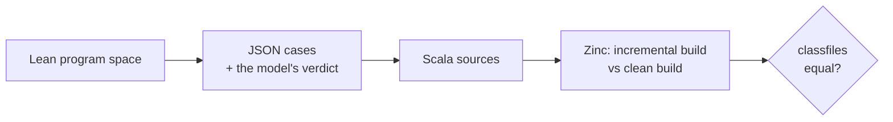

# Testing Zinc against a model of Zinc

**Status:** outline for review. Each `###` is one slide. The grey block under a slide holds notes, evidence and time; it is not shown.

**Audience:** Scala tooling people and anyone who maintains a compiler or build tool. No Lean needed; the model is shown only through what it checked and predicted.

**Thesis:** each test oracle for Zinc had a blind spot, and in each case the Lean model is what exposed it and suggested the next check. The model was tested in turn: against Zinc, against scalac, javac and HotSpot, and by checking its own proofs. Most of this happened between 3 and 11 October 2026.

**Relation to other talks:** `zinc-lean` is about the proofs and covers the same results in §5 and §26–27b; this talk is about the testing. Part III overlaps with the parked joint ≡ separate talk (`zinc-lean` Notes T); if that talk goes ahead, Part III shrinks to one slide pointing to it.

<!-- break -->

**Contents (~40 min):**

| part | slides | min |
|---|---|---|
| I. What "the test passed" meant | §1 the property · §2 scripted tests · §3 the harness had bugs too · §4 determinism as a compiler property | 7 |
| II. The model as an oracle | §5 the PoC passed the suite · §6 exhaustive search over the PoC's rules · §7 generated programs vs clean classfiles · §8 the model was wrong too | 9 |
| III. The clean build was not a fixed reference | §9 catalyst, 146 edits · §10 six batch dependences · §11 why `DeterminismTest` missed them · §12 the fixes went back into `DeterminismTest` | 8 |
| IV. From checking to predicting | §13 the bug map · §14 20 predictions, 20 failures · §15 checking resolved names · §16 checking recorded keys | 8 |
| V. Checking the model | §17 calibration against scalac, javac and HotSpot · §18 checking the proofs · §19 testing fixes across repositories | 5 |
| Close | §20 the sequence · §21 what to adopt | 3 |

---

## Part I — What "the test passed" meant

### 1. The property: an incremental build equals a clean build

$$\mathit{incremental}(\mathit{state}, \mathit{sources}') \;\equiv\; \mathit{clean}(\mathit{sources}')$$

- Undercompilation breaks it: `NoSuchMethodError`, a missing compile error, stale behaviour.
- The obvious test compares the two builds' output. For most of Zinc's history, nothing did.

Notes: 1 min. Same equation as `zinc-lean` §1.

### 2. Scripted tests check how much was recompiled

- A scripted test edits sources, runs `compile`, and checks which classes recompiled; sometimes it runs the program.
- It never compares the output with a clean build.
- Finding a bug depends on someone thinking of the case. Before October the bugs came from user reports and, lately, agents writing probing tests: about 14 confirmed cases on 2.13 in one batch (retronym/zinc#14, 6 October).

Notes: 1.5 min. `zinc-incrementality` §19 ("weakness: scripted checks how much was recompiled"). Downstream copies: scala/scala `sbtTest/scripted`, scala3 `sbt-test/`, `IncrementalCompileSimulator` (scala/scala3#26262).

### 3. The test harness had bugs too

- Tests in a batch shared one directory. On Windows a JAR left under `lib/` by one test ended up on the next test's classpath, so a test compiled against another test's `object A` (sbt/zinc#1802).
- The "2.13.y" label never selected `scala2-sbt-bridge`, the bridge sbt actually uses for 2.13.12 and later. Runs taken to be on the stock bridge were on Zinc's patched one, so a needed fix looked unnecessary (sbt/zinc#1836 → #1837).
- A second Scala version in one scripted build was silently ignored.

Notes: 1.5 min. Later harness bugs (§15) belong to the same theme; mention here that the theme recurs.

### 4. Prior art: determinism as a tested property of scalac

- scala/scala-dev#405 (2017–2018): the same bytes regardless of source order, and when compiling file by file against the others' classfiles. That second condition is joint ≡ separate compilation, the premise of every incremental build.
- Method: compile in normal order, reverse order and file by file; diff with jardiff (retronym/scalac-stability). Seven causes fixed for 2.13.0-M5: fresh-name counters, LambdaLift sorting by `Symbol.id`, declaration order missing from the pickle, and others.
- `DeterminismTest` kept it fixed: annotation order, inferred `packedType`s, synthetic module order, the `InnerClass` attribute (scala/scala#9131), async output (2018–2020).
- Users cared because of Bazel's remote cache.
- So, before this round, I expected the clean build to be a fixed reference.

Notes: 2.5 min. `zinc-incrementality` §6a. Scala 3's counterpart, scala/scala3#7661, has been open since 2019; its `DeterminismTest` arrived in 2026 (scala/scala3#26553).

---

## Part II — The model as an oracle

### 5. The Merkle PoC passed the scripted suite

- The PoC (retronym/zinc#24, 8 October) stops copying inherited members into each class's API and decides which descendants recompile by six rules.
- It passed the full scripted suite.
- Its first trait test also passed with the trait rule switched off: a missing mixin forwarder is invisible at runtime, because the JVM falls back to the trait's default method. A second test (`merkle-trait-override`) was needed to tell the two apart.
- Passing the suite said little about whether the rules were right.

Notes: 2 min. `zinc-incrementality` §19. One line on Merkle only; the design is in other talks.

### 6. Exhaustive search over the PoC's rules

- The Lean model of Zinc's loop runs, so bounded program spaces can be checked exhaustively, with each rule in turn removed (the largest: 216,000 programs × 27 edits).
- The `abstract` rule as stated was unsound: 672 of 142,500 runs. Minimal case: a member loses its body in a class whose ancestor declares it abstract.
- Refreshing only some upstream snapshots goes stale after an edit and its revert (`stale_after_revert`).
- Both fixed in the PoC before any user saw them.

Notes: 2.5 min. retronym/talks#5, #8, #9; `FlatRules.lean`, `Snapshot.lean`. The same `abstract` edit is a bug in plain Zinc on Scala 3 since 2020 (scala/scala3#27270), found later while porting the PoC; mention it here or at §14.

### 7. Generated programs compared with a clean build's classfiles

- The model's program space is dumped as cases, rendered as Scala and run through real Zinc (retronym/zinc#25, the same day as §6).
- The oracle changed from "which classes recompiled" to "are the classfiles equal to a clean build's".
- Cases are ordered by a covering array over the program's factors; each known bug family appears within 7–436 cases.
- Found in Zinc within hours: a class that becomes a trait (the client keeps `invokevirtual`), a parent made `final`, an upstream grandparent's erasure (retronym/zinc#26). The first two are fixed in sbt/zinc#1841.

Notes: 2.5 min. `Conformance.lean`; `sbt.internal.inc.bench.Conformance`.

### 8. The harness found mistakes in the model too

- A deferred declaration hides a concrete one in its own ancestors; the model had it the other way.
- A call's answer must include whether the receiver is a trait (`invokevirtual` vs `invokeinterface`); the model had no such query.
- From here the model and the harness corrected each other.

Notes: 1.5 min. Demo candidate: the class-becomes-trait divergence, then the `javap` diff.

---

## Part III — The clean build was not a fixed reference

### 9. Real code: 146 edits to Spark's catalyst

- `IncBench --verify`: after each incremental build, build the same sources from scratch and compare every classfile by digest (retronym/zinc#31, 9 October).
- 146 edits to `sql/catalyst` (2,527 classes, Scala and Java), each followed by its revert, for `develop` and for the PoC.
- No undercompilation on either side.
- Many classfiles still differed.

Notes: 1.5 min. `CATALYST-DIFFERENTIAL.md` on retronym/zinc.

### 10. Six ways scalac's output depended on the batch

| difference | fix |
|---|---|
| forwarder type variables, `compose[A]` vs `compose[A$]` | scala/scala#11289 |
| Java `static final` constant expressions folded only from classfiles | scala/scala#11290 |
| erased lub: base types of equal depth ordered by symbol id | scala/scala#11291 |
| a Java `Object` parent pickled as `ObjectTpeJava` from source | scala/scala#11292 |
| Java enum `valueOf` parameter, `x` vs `name` | scala/scala#11293 |
| forwarder parameter names for Java methods | compile Java with `-parameters` |

- The harness needed new verdicts to tell compiler nondeterminism apart from staleness: `signature`, `java-context`, `fresh-mismatch`, `bytecode`.
- With the five fixes, all 292 steps are byte-identical.

Notes: 2.5 min. The model already had a name for this: the `comp` obligation. Scala 3 equivalents: scala/scala3#27264, #27265, TASTy type sharing by identity (scala/scala3#26551, retronym/scala3#3).

### 11. Why `DeterminismTest` missed them

- **Combinations nobody writes by hand.** The forwarder bug needs an unrelated class with a clashing type parameter in the same batch.
- **A second `Symbol.id` sort.** 2018 removed the one in LambdaLift; `isLess` kept another. Ids follow load order: declaration order from source, file-name order from a directory, hash-map order from a jar.
- **A situation the test never created.** The lub case depended on Zinc deleting the batch's stale classfiles before compiling.
- **Java.** Four of the six are Java source vs classfile. The test barely compiled Java, and not with `-parameters`.

Notes: 2 min. The general point: hand-written cases find the causes someone anticipated; real code compared byte for byte finds the rest.

### 12. The fixes went back into `DeterminismTest`

- Each of scala/scala#11289–#11293 adds its minimised case to `DeterminismTest`; #11293 also makes `DeterminismTester` compile Java with `-parameters`.
- The real-code comparison finds the bug; the unit test keeps it fixed.

Notes: 1 min.

---

## Part IV — From checking to predicting

### 13. A bug map: every known bug classified by the obligation it breaks

- 145 historical bugs and 208 scripted tests, each assigned to the obligation it breaks: coverage, abstraction or compositionality.
- Of the bugs, 56 are covered by a test, 38 partially, 50 not at all.
- The gaps are where to look next.

Notes: 1.5 min. `BUG-MAP.md`, `BUGS-catalogue.md`, `TESTS-catalogue.md` in `zinc-incrementality/lean/`.

### 14. 20 predictions, 20 failures

- The model predicted 20 failures no test covered, 16 of them new bug families. All 20 failed on `develop` as predicted.
- Examples: an added class that shadows a resolved name (and on Spark, an added `Utils` that makes an import ambiguous); members added to package objects, exports and givens; three mutually inferred classes that alternate without `transitiveStep`; Scala 3.7's given priority; erasure through opaque types.
- The model was now writing the test suite's missing entries.

Notes: 2.5 min. retronym/zinc#32–#35, #47, #49–#53, #57, #58. Of the 20, one is a termination property (#33) and three restate the erasure family already fixed by hand.

### 15. Checking what each name resolved to, not only the verdict

- Bases as source files, plus a classfile probe that reads the constant pool after each clean build (retronym/zinc#36).
- So the model's name resolution is checked on every case, not only its final verdict.
- Making Scala 3 work found two more harness bugs: a deleted source's `.tasty` left in the output, and build paths in every classfile until `-sourceroot` was set.

Notes: 1.5 min. The harness-bug theme from §3 again.

### 16. A clean build can hide a missing key

- Classfile equality cannot see a key the bridge never records, whenever the build happens to come out right.
- The harness now reads Zinc's Analysis and checks the keys the model says must be recorded (retronym/zinc#54).
- Without the fix for names: 136 uncovered cases on builds that were byte-identical to clean. With it (retronym/zinc#47): 0 uncovered in 10,653 cases.
- The `coverage` obligation became something checked directly, not inferred from symptoms.

Notes: 2.5 min. Central review finding 6 (`REVIEW-2026-10-11-central.md`).

---

## Part V — Checking the model

### 17. Calibration against scalac, javac and HotSpot

- The model's lowering of Scala to bytecode agrees with scalac on about 1,350 programs each for 2.12, 2.13 and 3.9; Java lowering with javac on 99.
- The model's JVM linkage agrees with HotSpot 21, 25 and 27 on about 58,000 client programs; the only disagreements are two JDK 21 bugs.
- Pointed at MiMa, a tool it was not built for, it found five gaps.

Notes: 2 min. retronym/talks#39, #50, #58, #60, #64, #65. JDK-8356942, JDK-8350029. Check before presenting whether those JDK bugs were already known.

### 18. Checking the proofs

- No theorem is proved by `native_decide`, which would trust Lean's compiler; CI lints for it and runs `#print axioms` on T1–T5.
- Caveat: the lint misses some directories, and several counterexamples are still checked examples rather than theorems (central review).

Notes: 1 min. retronym/talks#36, #73.

### 19. Testing fixes across repositories together

- A fix often spans Zinc and a compiler bridge; each repository's CI tests only released versions of the others.
- Integration branches regenerated from manifests, with a rerere cache and a lock file of SHAs (retronym/talks#74); scripted tests on a locally published compiler (retronym/zinc#60).
- A pending Zinc test can go green against an unreleased compiler fix.

Notes: 2 min. One slide here; the full recipe is a separate talk idea ("the monorepo experience").

---

## Close

### 20. The sequence

| stage | oracle | its blind spot | found by |
|---|---|---|---|
| scripted tests | which classes recompiled | output never compared | the PoC passing with a rule off |
| exhaustive search | the model's own runs | only the model | §7 |
| generated programs | classfiles vs clean | the clean build varies | catalyst |
| real code | classfiles vs clean, with verdicts | keys that happen not to matter | the key check |
| key check | the Analysis vs the model's keys | the model itself | calibration |

Notes: 1.5 min. Possibly a diagram instead of a table.

### 21. What to adopt

- Compare incremental output with a clean build's, byte for byte, on real code.
- Keep a joint ≡ separate regression suite in each compiler, and feed every real-code difference back into it.
- Write down what the compiler must record, and check the Analysis against it.
- Agents made the speed possible (most of this took a week); the oracles are what made their output trustworthy.

Notes: 1.5 min.

---

## Notes for Jason

### Open questions

1. Title. Alternatives: "How testing of Zinc and its model evolved together"; "Checking an incremental compiler against clean builds".
2. Length: 40 min as outlined, or cut Part V to §17 and §19 for 30.
3. Part III: keep at full length here, or shrink if the joint ≡ separate talk goes ahead.
4. How much Merkle: §5 assumes the audience needs only one line.

### Work before drafting

- Confirm the dates and order of §2–§8 against the PRs; the stage order is from PR creation times.
- Mine the local-models search index for earlier history: `IncrementalCompileSimulator`, the scripted harness bugs, user reports that took longest to reproduce.
- Check the JDK bug numbers in §17.
- Freeze the numbers at a commit (the catalyst totals moved once between runs).
